# 纸上兵戈 · Paper Warfront

一款以纸片舞台呈现的单机即时战术游戏。**纸上兵戈**保留《剑与勇士 / Sword & Soldiers》系列最有辨识度的体验骨架：单位自动行军、金币与法力循环、局内科技、手动施法、阵营不对称和横向战场导航；同时用十院原创阵营、非线性单机战役、真实采矿回仓、三态战争迷雾和夜战灯笼 UI 建立自己的规则与美术身份。

**Paper Warfront** is a single-player real-time tactics game staged as a layered paper theatre. It keeps the readable pillars associated with *Sword & Soldiers*: automatic marching, gold and mana economies, in-match research, manual spells, asymmetric factions, and lateral battlefield navigation. It adds ten original factions, a branching solo campaign, physical mining-and-return logistics, three-state fog of war, and a lantern-lit paper UI language.

[中文说明](#中文) · [English](#english) · [最新 GitHub Release](https://github.com/wikigsroom/paper-war/releases/tag/v1.0.0-paper-warfront)

> 上方 GIF 由当前 <code>3.0.0-rc41-night-lantern-components</code> Windows 原生导出包运行后抓取，再由本地 FFmpeg 编码。它展示自动行军、道路分层、战争迷雾、夜战灯笼 HUD、单位动作和纸片地层；GIF 是游玩展示素材，不代表 Android 真机性能结论。
>
> The GIF above was captured from the current <code>3.0.0-rc41-night-lantern-components</code> native Windows export and encoded locally with FFmpeg. It shows automatic marching, layered roads, fog of war, the Night Lantern HUD, unit motion, and the paper stage. It is visual gameplay evidence, not an Android hardware-performance claim.

## 中文

### 当前版本与首发包

- **产品名**：纸上兵戈。
- **仓库名、包体技术名**：<code>PaperWarfront</code>。
- **当前内部编译版本**：<code>3.0.0-rc41-night-lantern-components</code>。
- **首个公开发行标签**：<code>v1.0.0-paper-warfront</code>，使用上述 rc41 编译结果制作，不改变包内的内部版本追踪。
- **引擎**：Godot 4.7.2；GDScript；原生 <code>Control</code> UI；Windows 原生导出与 Android APK 导出。
- **平台策略**：Windows EXE 可直接运行；Android APK 已完成导出、签名、对齐、包体逻辑和 arm64 16 KB ELF 检查。当前没有实体 Android 设备，因此没有宣称真机帧率、触控手感或兼容性结论。
- **公开发布页**：[GitHub Releases](https://github.com/wikigsroom/paper-war/releases/tag/v1.0.0-paper-warfront)。

首发包的设计目标是提供一个可从源码复建、可从发行页直接下载、同时保留完整设计证据的基线版本。发行页包含 Windows ZIP、Android APK、源码 ZIP、SHA256 校验和双语发行说明；源码仓库不提交 Godot 导入缓存、签名密钥、临时 QA 帧序列或大体积二进制。

### 你会玩到什么

#### 核心战斗循环

1. 在章节页阅读地图冲突、地点动机、真实目标和可见路线，选择当前可行动的剧情纸页。
2. 在任务简报里确认敌方院系、道路分叉、资源点、建筑位、目标锚点和迷雾状态，配置 2–4 个战前快速单位。
3. 开局安排纸工走向矿点。纸工会执行**采矿动作、装载、返城、交付**的完整 FIFO 循环；金币只有在真实回到本方纸城后才入账。
4. 使用金币部署作战兵、建造塔或法灯、排生产队列，并在同一预算里决定即时增援还是研究科技。
5. 单位沿真实道路自动行军。前排、远程、支援、纸工和召唤物使用不同的职责、触及范围、移动阻挡和动作语义。
6. 依据战争迷雾中的可见信息手动释放法术与军令：可以压制前线、保护矿线、争夺桥路，也可以故意隐藏增援方向。
7. 完成摧毁、护送、截击、保护、归仓或生存目标，获得星级、证据旗和路线进度，再回到章节页选择下一条故事路径。

这里的“自动”只描述单位沿路前进和接敌方式。玩家仍然负责**经济起步、出兵顺序、研究时机、道路选择、法术目标、军令窗口和迷雾信息判断**；战斗爽感来自把这些决定叠加成一次成功的推进、截击或反攻。

#### 地图、交战长度与单机剧情

游戏不是把战斗压缩成一条固定长度的屏幕横线。地图数据记录道路节点、道路边、曲线点、桥路、坡路、岔路、汇流点、矿点、建筑位和目标锚点；模拟使用真实路径距离计算移动、抵达、回程、拦截和增援成本。

- 单机战役包含 **10 个章节、200 张地图**。
- 路线图允许择一、并行调查、条件汇流和回访；不强制所有章节按单线推进。
- 每张地图绑定战前冲突、地点动机、教学问题、真实目标、敌方回应、战后结果和后续路线条件。
- 地图结构服务剧情目标：护送需要安全路线与交接点，截击需要可见窗口与拦截线，归仓需要矿线和回程，保护需要持续压力与多道路防守，生存需要阶段性入口和回防选择。
- 道路长度必须影响战术：较短线路利于快速接触，较长线路提高矿工暴露与援军延迟，桥路和高低差改变交战顺序、侦察覆盖与回程成本。

地图设计、路线合同和逐图剧情记录在 [单机地图剧情合同与路线分支验收](docs/paper-warfront/147-单机地图剧情合同与路线分支验收.md)、[二百图剧情与非线性战役](docs/paper-warfront/138-二百图剧情与非线性战役.md) 和 [完整故事路线](docs/paper-warfront/world/04-完整故事路线.md)。

#### 战争迷雾

战争迷雾是战斗规则的一部分，不是单纯的黑色遮罩。每个阵营和道路使用同一套视野查询、探索记忆和失效缓存：

1. **未知**：没有被本方单位、前哨、建筑或事件揭示过的区域只显示纸地形轮廓；敌人、敌方建筑和资源状态不可知。
2. **已探索**：单位离开后保留地形记忆和曾经见过的固定结构，但敌方单位的实时位置、血量、施工进度和最近状态不会伪装成旧快照。
3. **当前可见**：处于本方视野覆盖内的单位、投射物、建筑、矿点变化和交火事件才进入实时渲染与目标查询。

镜头移动不会揭示敌人；上下道路分别计算侦察覆盖；开火、受击、召唤、死亡、建筑变化、路径变化、法术视野和前哨投资会触发迷雾失效刷新。没有状态变化时复用上一份视野结果，保证长地图和移动端不会因为每帧全图重算而失去响应。详细规则见 [战争迷雾失效缓存与 rc37 交付](docs/paper-warfront/148-战争迷雾失效缓存与rc37预览交付.md)。

### 十院与差异化兵种

当前数据为 **10 个阵营 × 6 种独特作战兵 + 1 个阵营纸工 = 70 个核心单位定义**，另有召唤物、投射物和设施状态由战斗系统管理；工程总单位记录为 72 个可渲染/可查询单位条目。各院不是同一基础单位换色：动作帧、轮廓、攻击方式、被动机制、资源循环和战场职责分别受数据合同约束。

| 阵营 | 纸上身份 | 核心资源或战术倾向 |
| --- | --- | --- |
| 印甲军 | 赤砚，守印将军 | 升级、重甲、正面推进 |
| 墨骸社 | 墨归，拾纸祭司 | 牺牲、吸血、高风险交换 |
| 灯符朝 | 灯照，校符使 | 纸灯设施、法力、区域支援 |
| 纸械工坊 | 榫七，总装匠 | 建造、机械、施工节奏 |
| 鸢纸行会 | 飞笺，领信人 | 路口机动、分路、运输效率 |
| 金契商盟 | 契衡，押契官 | 真实归仓、交付、赏金收益 |
| 植纤古庭 | 纤枝，养纸官 | 生长、修复、持续作战 |
| 霜裁守序 | 霜律，裁纸使 | 控制、冻结、交战窗口 |
| 烬纸流亡 | 烬禾，灰烬领主 | 受伤增益、伤害回法、残血反击 |
| 空白档案 | 白匣，留白官 | 研究、复制、信息优势 |

数据入口是 <code>game/data/factions.json</code>、<code>game/data/balance-prototype.json</code>、<code>game/data/unit-actions.json</code>、<code>game/data/unit-frames.json</code> 和 <code>game/data/assets.json</code>。动作处理采用参考图类似的完整 6×6 动作帧思路：每个角色有可核对的待机、行进、起手、攻击/施法、受击和倒地状态，动画锚点、帧序列、命中窗口和纸边阴影分开记录。

### UI 与夜战灯笼视觉系统

当前选择 **03「夜战灯笼」**作为正式运行 UI 方向。视觉规则是深靛夜幕、象牙纸面、朱砂印章、玉青状态色、灯笼暖光和可见的纸张边缘。Logo 的 **02 木刻墨印·印甲统帅**与文字标 **朱印战印**只接入游戏图标和 Android 自适应前景；菜单内容没有被品牌资产擅自重写。

- 战斗画面优先，桌面 HUD 顶栏约 64 px、底部快速栏约 104 px；主要屏幕区域保留给地图和单位。
- 任务简报、实时战斗、军令、研究、建造、暂停和结算都共享同一套纸材、边框、按钮、印章、灯光和信息层级。
- 桌面使用鼠标、键盘焦点和滚轮；移动端使用安全区、触控热区、横向导航和可滚动纸页。
- 资源、法力、迷雾、小地图、目标、快速栏和关键反馈常驻；科技、建造、队列和军令按需展开，避免菜单遮住战场。
- 运行素材与生成源分开：<code>assets/paper-warfront/</code> 保存资产定义与提示词，<code>game/assets/</code> 保存经过检查的运行位图，<code>output/imagegen/</code> 保存生成源和清单。

### 菜单与实机示意图

下列图片全部来自 rc41 Windows 原生运行观察，尺寸为 1600×900；它们已经复制到仓库的 <code>docs/media/paper-warfront-ui/</code>，可在 GitHub 页面直接查看。

#### 主菜单、地图与战役

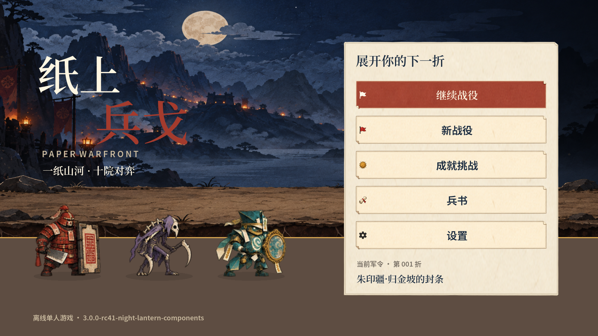

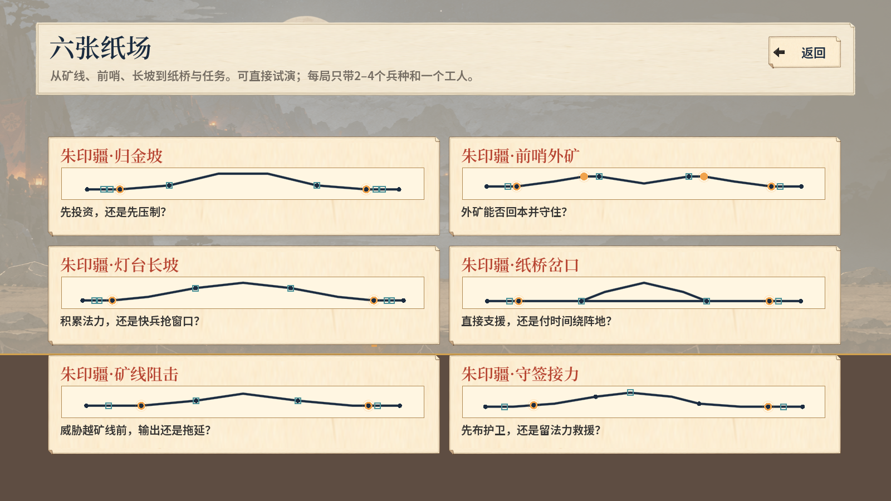

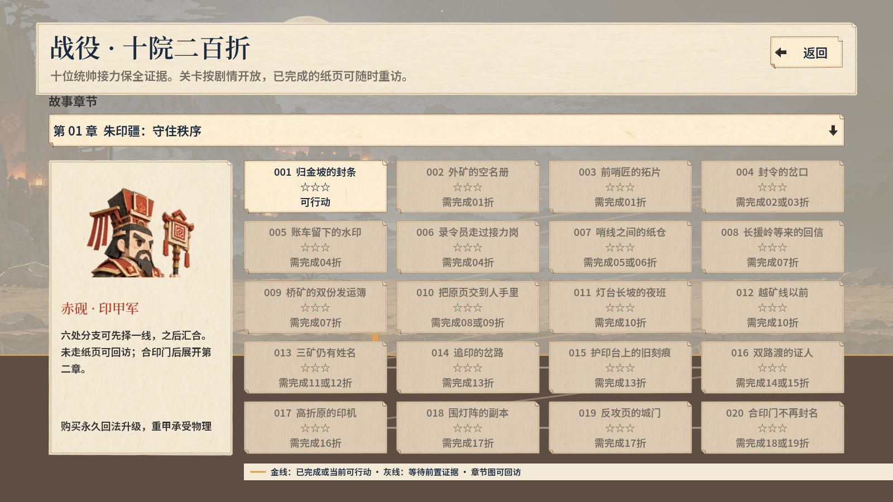

#### 任务简报与实时战斗

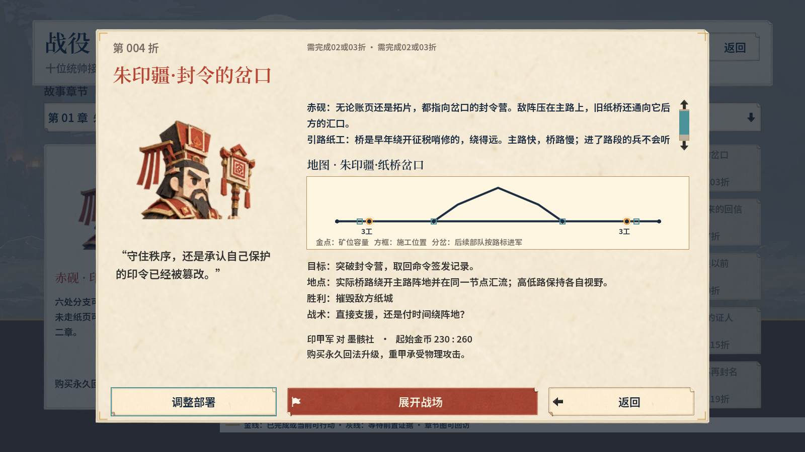

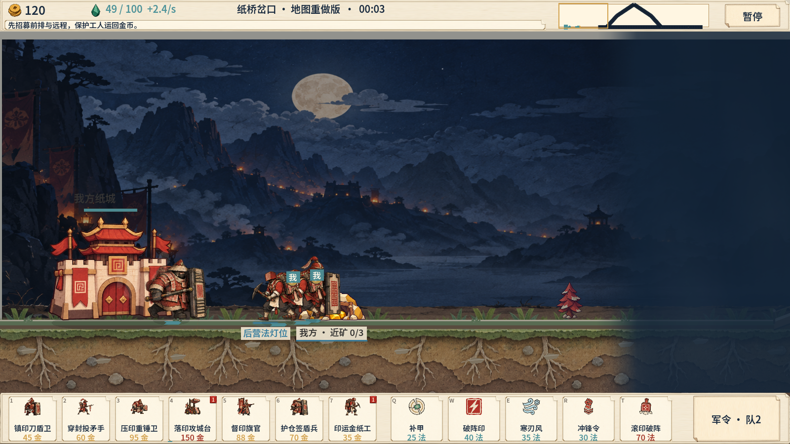

#### 军令、研究、建造、暂停与结算

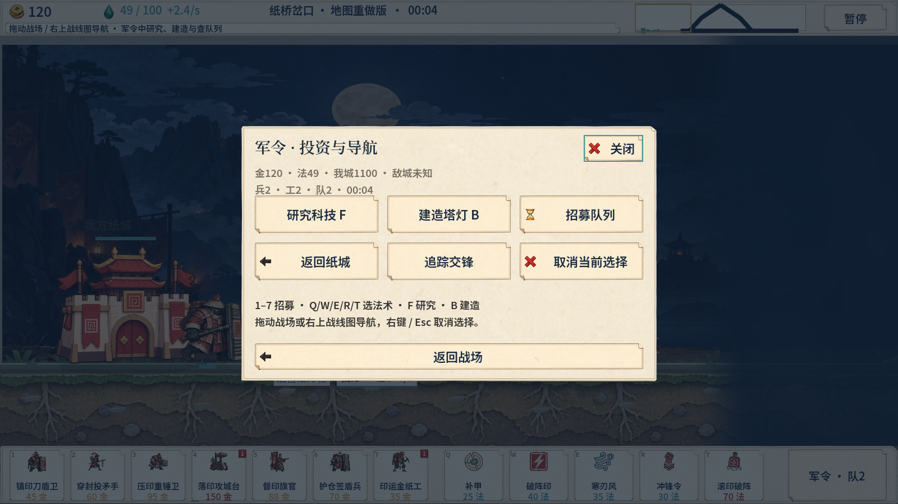

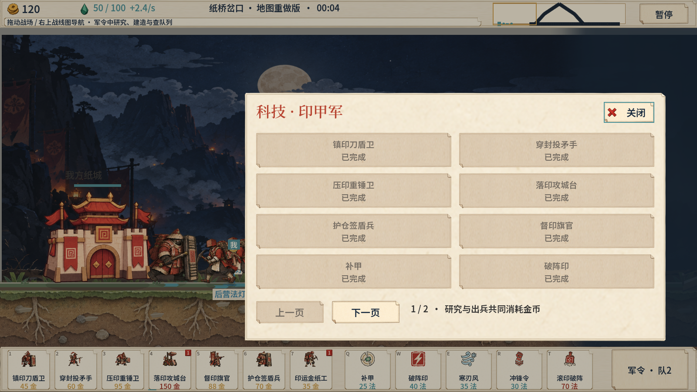

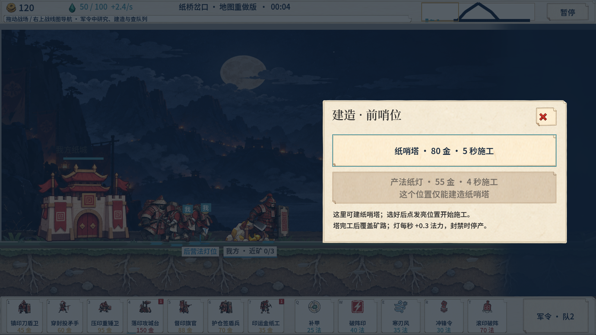

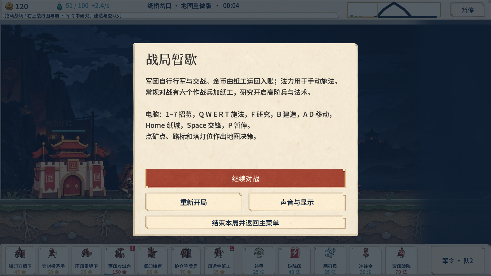

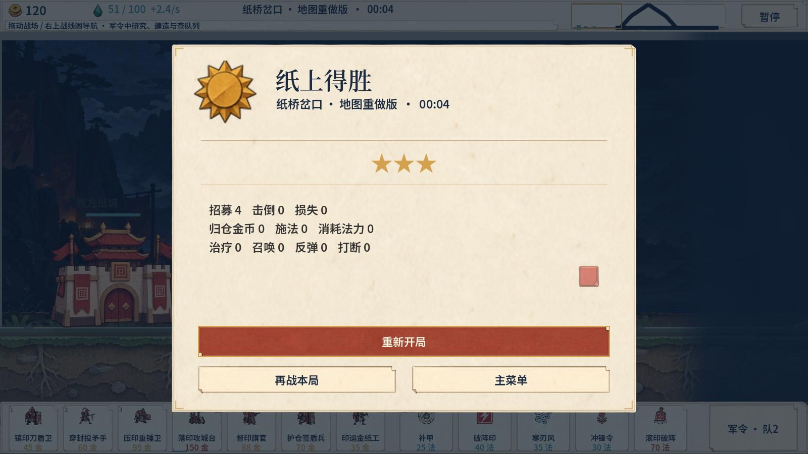

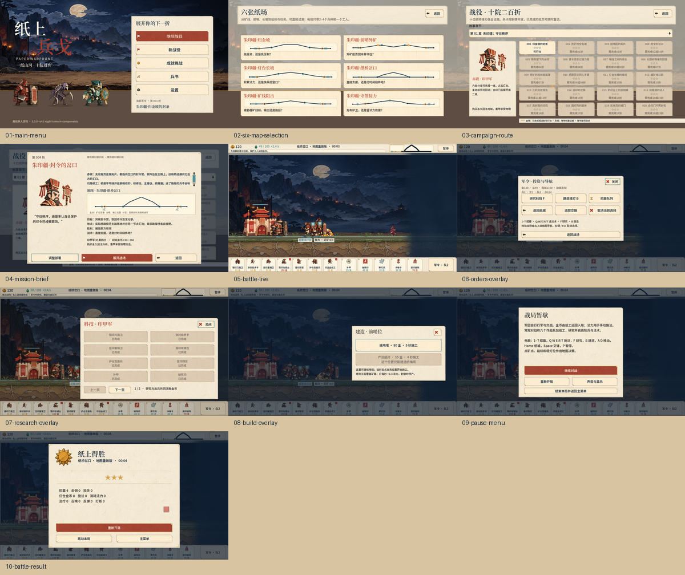

### 操作方式

| 场景 | Windows 桌面 | Android 触控 |
| --- | --- | --- |
| 导航 | 鼠标点击、滚轮、键盘焦点、左右/上下方向键 | 横向滑动、触控热区、页签按钮 |
| 战场镜头 | 鼠标拖拽或滚轮平移，镜头移动不揭示迷雾 | 单指拖拽平移，按钮保持安全区内 |
| 出兵 | 点击底部快速栏的单位卡或键盘焦点确认 | 点击快速栏卡片，卡片随屏幕宽度收缩 |
| 法术/军令 | 选择纸页后点击合法目标 | 选择纸页后点按目标或道路区域 |
| 研究/建造 | 打开对应纸页，确认金币/法力和队列 | 打开横向纸页，滚动卡片并确认 |
| 暂停 | <code>Esc</code> 或暂停按钮 | 屏幕角落暂停按钮 |

### 技术架构

模拟与渲染分离：<code>BattleSim</code> 决定单位、经济、生产、碰撞、命中、路径、目标和视野；<code>BattleView</code> 读取状态，绘制道路、纸片单位、动作帧、投射物、粒子、命中反馈和 UI。这样可以在不依赖渲染帧的情况下回放和验证规则，也能让 Windows 与 Android 使用同一套战斗逻辑。

~~~text
game/
  project.godot                 Godot 4.7.2 工程入口
  main.tscn                     主场景
  scripts/
    main.gd                     菜单、章节、输入与场景编排
    battle_sim.gd               独立战斗模拟、经济、科技、胜负
    battle_view.gd              纸片舞台、道路、单位、投射物与粒子
    battle_visibility.gd        战争迷雾、探索记忆和开火揭示
    tactical_ai.gd              阵营 AI、部署、路线与目标选择
    campaign_route_graph.gd     章节分支、汇流、并行与回访
  data/                         地图、阵营、单位、剧情、UI、资产合同
  assets/                       动作图集、纸材、背景、字体和音频
  tests/                        GDScript 机制、剧情、迷雾和动作合同
assets/paper-warfront/           资产定义、素材清单、风格与版本记录
docs/paper-warfront/             设计章程、玩家手册、研究和验收文档
tools/paper-warfront/            构建、导出、检查、截图和 GIF 工具
~~~

模拟与渲染分离：<code>BattleSim</code> 决定单位、资源、生产、碰撞、命中、路径和视野；<code>BattleView</code> 读取状态绘制分层纸偶。位图、厚片几何、动画帧、命中规则和 QA 证据分开管理。

### Windows 原生构建

要求：Windows 原生 PowerShell、Godot 4.7.2 导出模板、Python 3、Android SDK 36、JDK 21。Godot 和本地工具放在 <code>.tools/</code>，签名文件放在项目外部的 <code>.keys/</code>；不要提交密钥、导出凭据、<code>.godot/</code> 或 <code>output/</code>。

~~~powershell
# 在仓库根目录执行
$env:PAPER_RELEASE_VERSION = '3.0.0-rc41-night-lantern-components'
python tools/paper-warfront/build_game.py

# 打开 Godot 编辑器或直接运行工程
.\.tools\godot\Godot_v4.7.2-stable_win64.exe --path game --editor
.\.tools\godot\Godot_v4.7.2-stable_win64.exe --path game

# 用当前 Windows 包抓取 README GIF
python tools/paper-warfront/capture_gameplay_gif.py --pack release/3.0.0-rc41-night-lantern-components/windows/PaperWarfront.exe --output docs/media/paper-warfront-gameplay.gif

# 生成 Windows ZIP、源码 ZIP 与 SHA256 清单
$env:PAPER_RELEASE_VERSION = '1.0.0'
python tools/paper-warfront/package_release.py
~~~

导出预设会排除 <code>output/*</code> QA 生成物，因此本地截图、报告和历史帧不会进入 Windows PCK 或 Android APK。<code>package_release.py</code> 会检查 ZIP 完整性并拒绝 <code>.keys</code>、<code>.godot</code>、<code>.tools</code>、<code>.keystore</code>、<code>.jks</code> 和导出凭据进入发行包。

### 当前验证范围

| 检查 | 结果 | 说明 |
| --- | ---: | --- |
| Windows 原生 UI 观察 | 10/10 页面通过 | rc41 导出 PCK，1600×900；菜单、战役、任务、战斗、弹窗、暂停、结算均有截图 |
| 桌面 UI 交互 QA | 49/49 通过 | 包含焦点、禁用态、任务、战斗、法术、军令、研究、生产、建造、暂停、胜负 |
| 手机形状 UI 交互 QA | 49/49 通过 | 触控安全区与窄屏布局使用注入尺寸检查，未冒充实体设备 |
| 移动端适配矩阵 | 8/8 场景通过 | 最低战场可视比例约 70.6%，包含缺口、反向缺口、平板与竖屏恢复 |
| 世界战斗机制 | 370 项通过 | 伤害、碰撞、采矿、视野、路径、目标、AI 和资源闭环 |
| Godot 解析 | 通过 | GDScript headless parse 与项目导入检查 |
| Windows 包 | 已导出 | <code>PaperWarfront.exe</code>，SHA256 见发行清单 |
| Android APK | 已导出并静态检查 | 已签名、zipalign、包名/版本、arm64 与 16 KB ELF 检查；无实体设备 |

当前版本仍有明确边界：124 单位压力窗口的采样数据不能表述为稳定 60 FPS；Android 触控和性能需要实体设备复测；全阵营真人平衡、长时间运行耗电和不同厂商 GPU 兼容性不纳入本次首发承诺。

### 文档、素材与约束入口

- [项目文档索引](docs/paper-warfront/README.md)
- [玩家手册](docs/paper-warfront/16-玩家手册.md)
- [项目章程与硬约束](docs/paper-warfront/01-项目章程与硬约束.md)
- [Godot 架构与数据契约](docs/paper-warfront/11-Godot架构与数据契约.md)
- [地图与剧情路线](docs/paper-warfront/147-单机地图剧情合同与路线分支验收.md)
- [战争迷雾规则](docs/paper-warfront/148-战争迷雾失效缓存与rc37预览交付.md)
- [单位动作与素材规范](docs/paper-warfront/frame-rebuild/README.md)
- [夜战灯笼组件级对标与 rc41 验收](docs/paper-warfront/162-夜战灯笼组件级对标与rc41验收.md)
- [素材与 UI 定义](assets/paper-warfront/README.md)
- [原作地图研究](docs/research/swords-and-soldiers-map/recheck-20261008/README.md)

素材生成遵守项目指定的 <code>sub2-image-gen</code> / <code>gpt-image-2.5</code> 工作流；生成图不能替代运行证据。稳定资产 ID 不随意改名，正式资源变更需要同步版本、生成记录、加工记录和引用。项目尚未声明开源许可证；在添加许可证前，请不要把仓库内容作为可再分发的第三方素材包。

## English

### Version and first release

- **Product name**: 纸上兵戈 (Paper Warfront).
- **Repository and package identifier**: <code>PaperWarfront</code>.
- **Current internal build**: <code>3.0.0-rc41-night-lantern-components</code>.
- **First public release tag**: <code>v1.0.0-paper-warfront</code>, packaged from the rc41 build while retaining the internal build identifier for traceability.
- **Engine and stack**: Godot 4.7.2, GDScript, native <code>Control</code> UI, native Windows export, and Android APK export.
- **Platform status**: the Windows EXE is directly runnable. The Android APK has passed export, signing, alignment, package, arm64, 16 KB ELF, and packaged-logic checks. No physical Android device is currently available, so the project makes no hardware FPS, touch-feel, or device-compatibility claim.
- **Release page**: [GitHub Releases](https://github.com/wikigsroom/paper-war/releases/tag/v1.0.0-paper-warfront).

The first release is intended to be reproducible from source and downloadable from GitHub while keeping its design and QA evidence reviewable. The release assets include a Windows ZIP, Android APK, source ZIP, SHA256 checksums, and bilingual release notes. Godot import caches, signing keys, temporary QA frame sequences, and large local build caches stay out of the source repository.

### Core game loop

1. Read the conflict, location motive, objective, and available routes on the campaign page, then choose an actionable story page.
2. Inspect enemy affiliation, road forks, resource sites, build sites, objective anchors, and fog state in the mission brief. Select 2–4 quick-deploy units.
3. Send paper workers to a mine. A worker performs the full **mine, load, return, and deposit** FIFO cycle; gold is credited only after the worker physically returns to the home paper city.
4. Spend gold on combat units, towers, lantern facilities, and production queues while competing with research for the same budget.
5. Let units march automatically along real roads. Frontliners, ranged units, support units, workers, and summons have separate roles, contact rules, movement blocking, and motion semantics.
6. Use manual spells and orders from the information that is actually visible through the fog. Protect a mine line, contest a bridge, conceal a reinforcement route, or turn a contact window into a counter-push.
7. Complete destroy, escort, intercept, protect, return, or survive objectives. Earn stars, evidence flags, and route progress, then choose the next story branch.

“Automatic” describes marching and contact resolution. The player still controls economic opening, deployment order, research timing, route selection, spell targeting, order windows, and information decisions. The satisfying moments come from combining those decisions into a push, interception, or recovery that the map makes meaningful.

### Maps, engagement length, and the solo story

The battlefield is not reduced to a fixed one-screen horizontal line. Map data stores road nodes, edges, curve points, bridges, slopes, forks, merges, mines, build sites, and objective anchors. The simulation uses real path distance for movement, arrival, return trips, interception, and reinforcement cost.

- The solo campaign contains **10 chapters and 200 maps**.
- The route graph supports choice, parallel investigations, conditional merges, and revisits instead of forcing one linear sequence.
- Every map binds a pre-battle conflict, location motive, teaching question, objective, enemy response, post-battle result, and route condition.
- Structure follows the objective: escort maps need safe lanes and hand-off points; interception maps need visibility windows and intercept lines; return maps need mine lanes and travel cost; protection maps need sustained pressure across several roads; survival maps need staged entrances and fallback choices.
- Road length changes decisions: short lanes favor early contact, long lanes increase worker exposure and reinforcement delay, while bridges and elevation alter contact order, scouting, and return cost.

See [the solo map and route contract](docs/paper-warfront/147-单机地图剧情合同与路线分支验收.md), [the 200-map nonlinear campaign](docs/paper-warfront/138-二百图剧情与非线性战役.md), and [the complete story route](docs/paper-warfront/world/04-完整故事路线.md).

### Fog of war

Fog is a gameplay rule, not a black overlay. Each faction and road uses the same visibility query, exploration memory, and invalidation cache:

1. **Unknown**: terrain silhouette may be shown, but enemy units, enemy structures, and resource state are unavailable until revealed by a friendly source or event.
2. **Explored**: remembered terrain and fixed structures remain visible after a unit leaves, but live enemy positions, health, construction progress, and recent state do not remain as fake real-time snapshots.
3. **Currently visible**: only units, projectiles, structures, mine changes, and combat events inside friendly vision enter live rendering and target queries.

Camera motion never reveals an enemy. Upper and lower roads have separate scouting coverage. Firing, being hit, summoning, death, building changes, route changes, spell vision, and watchpost investment invalidate fog results. If no state changes, the previous visibility result is reused so long maps and mobile hardware do not pay for a full-map recomputation every frame. The implementation record is [fog invalidation and cache delivery](docs/paper-warfront/148-战争迷雾失效缓存与rc37预览交付.md).

### Ten factions and distinct units

The data set contains **10 factions × 6 unique combat units + 1 faction worker = 70 core unit definitions**. Summons, projectiles, and facility states are managed by the combat systems; the runtime catalog contains 72 renderable/queryable unit entries. Factions are not one recolored base template: silhouettes, frame sequences, attacks, passive rules, economy loops, and battlefield roles are controlled by separate data contracts.

| Faction | Paper identity | Resource or tactical signature |
| --- | --- | --- |
| Seal Armor | Chiyan, seal general | upgrades, heavy armor, frontal pressure |
| Ink Remnant | Mogui, paper priest | sacrifice, lifesteal, risky exchanges |
| Lantern Court | Dengzhao, seal inspector | lantern facilities, mana, area support |
| Paper Mechanists | Sunqi, assembler | construction, machines, build tempo |
| Kite Guild | Feijian, courier captain | junction mobility, splits, transport efficiency |
| Gold Covenant | Qiheng, contract warden | real deposits, deliveries, bounty income |
| Fiber Grove | Xianzhi, paper gardener | growth, repair, sustained fighting |
| Frost Order | Shuanglv, cutter magistrate | control, freeze, contact windows |
| Ember Exiles | Jinhui, ash lord | wounded bonuses, damage-to-mana, comeback pressure |
| Blank Archive | Baixiang, keeper of blanks | research, copying, information advantage |

The data entry points are <code>game/data/factions.json</code>, <code>balance-prototype.json</code>, <code>unit-actions.json</code>, <code>unit-frames.json</code>, and <code>assets.json</code>. Motion follows a verifiable full 6×6 frame approach inspired by the supplied reference: idle, walk, wind-up, attack/cast, hit, and fall states have explicit anchors, frame order, hit windows, and paper-edge shadows.

### Night Lantern UI and art direction

The production UI direction is **03 Night Lantern**: deep indigo night, ivory paper, vermilion seals, jade status accents, warm lantern light, and visible paper edges. The selected **02 Woodblock Ink Seal · Seal Armor Commander** logo and the **朱印战印 / Vermilion War Seal** wordmark are wired into the game icon and Android adaptive foreground only; the existing menu content remains intact.

- Battlefield first: the desktop top HUD is about 64 px and the bottom quick bar about 104 px, leaving most of the screen for the map and units.
- Mission brief, live battle, orders, research, build, pause, and result views share the same paper material, border, button, seal, light, and information hierarchy.
- Desktop input supports mouse, keyboard focus, and wheel; mobile input uses safe areas, touch zones, horizontal navigation, and scrollable paper sheets.
- Gold, mana, fog, minimap, objectives, quick cards, and critical feedback stay available; research, build, queue, and orders expand on demand.
- Sources and runtime assets are separated: <code>assets/paper-warfront/</code> stores definitions and prompts, <code>game/assets/</code> stores checked runtime bitmaps, and <code>output/imagegen/</code> stores generated sources and manifests.

### Menu and gameplay gallery

The following images are native rc41 Windows runtime observations at 1600×900. They are checked into <code>docs/media/paper-warfront-ui/</code> so GitHub renders them without access to ignored QA output.

### Controls

| Situation | Windows desktop | Android touch |
| --- | --- | --- |
| Navigation | mouse clicks, wheel, keyboard focus, arrow keys | horizontal swipes, touch zones, tab buttons |
| Battlefield camera | drag or wheel to pan; camera movement never reveals fog | one-finger pan; controls stay inside the safe area |
| Deployment | click a quick-card or confirm through keyboard focus | tap a quick-card; cards shrink with the viewport |
| Spell/order | choose a paper sheet, then click a legal target | choose a sheet, then tap a target or road region |
| Research/build | open a sheet, confirm gold/mana and queue state | open the horizontal sheet, scroll cards, confirm |
| Pause | <code>Esc</code> or the pause button | pause button in the corner |

### Technical architecture

Simulation and rendering are separate. <code>BattleSim</code> owns units, economy, production, collision, hits, paths, objectives, and visibility. <code>BattleView</code> reads the state and draws roads, paper units, frame poses, projectiles, particles, hit feedback, and UI. This allows rules to be replayed without a render frame and keeps Windows and Android on the same combat logic.

~~~text
game/
  project.godot                 Godot 4.7.2 entry point
  main.tscn                     main scene
  scripts/
    main.gd                     menus, campaign, input, scene orchestration
    battle_sim.gd               simulation, economy, research, win/loss
    battle_view.gd               paper stage, roads, units, projectiles, particles
    battle_visibility.gd         fog, exploration memory, firing reveals
    tactical_ai.gd               faction AI, deployment, routes, objectives
    campaign_route_graph.gd     branches, merges, parallel paths, revisits
  data/                         maps, factions, units, story, UI, asset contracts
  assets/                       animation atlases, paper, background, fonts, audio
  tests/                        GDScript mechanic, story, fog, and frame contracts
assets/paper-warfront/           asset definitions, inventory, style, revision logs
docs/paper-warfront/             design charter, manual, research, QA records
tools/paper-warfront/            build, export, check, capture, and GIF tools
~~~

### Run and build from source

Requirements: native Windows PowerShell, Godot 4.7.2 export templates, Python 3, Android SDK 36, and JDK 21. Keep Godot and local tools in <code>.tools/</code> and signing files outside the repository in <code>.keys/</code>. Never commit credentials, export files, <code>.godot/</code>, or <code>output/</code>.

~~~powershell
# From the repository root
$env:PAPER_RELEASE_VERSION = '3.0.0-rc41-night-lantern-components'
python tools/paper-warfront/build_game.py

# Open the editor or run the project
.\.tools\godot\Godot_v4.7.2-stable_win64.exe --path game --editor
.\.tools\godot\Godot_v4.7.2-stable_win64.exe --path game

# Capture the README GIF from the current Windows pack
python tools/paper-warfront/capture_gameplay_gif.py --pack release/3.0.0-rc41-night-lantern-components/windows/PaperWarfront.exe --output docs/media/paper-warfront-gameplay.gif

# Create the Windows ZIP, source ZIP, and SHA256 manifest
$env:PAPER_RELEASE_VERSION = '1.0.0'
python tools/paper-warfront/package_release.py
~~~

The export presets exclude <code>output/*</code>, so local screenshots, reports, and historical frames never enter the Windows PCK or Android APK. <code>package_release.py</code> tests ZIP integrity and refuses <code>.keys</code>, <code>.godot</code>, <code>.tools</code>, <code>.keystore</code>, <code>.jks</code>, and export credentials in a release archive.

### Validation scope

| Check | Result | Evidence |
| --- | ---: | --- |
| Native Windows UI observation | 10/10 pages passed | rc41 exported PCK at 1600×900: menu, campaign, brief, battle, overlays, pause, result |
| Desktop UI interaction QA | 49/49 passed | focus, disabled states, mission, battle, spells, orders, research, production, build, pause, victory/defeat |
| Phone-shaped UI interaction QA | 49/49 passed | injected mobile sizes and safe-area checks; no physical-device claim |
| Mobile adaptation matrix | 8/8 scenarios passed | minimum battlefield share about 70.6%, including notches, reverse notches, tablets, and portrait recovery |
| World combat mechanics | 370 checks passed | damage, collision, mining, visibility, paths, objectives, AI, economy |
| Godot parse/import | passed | headless GDScript parse and project import |
| Windows build | exported | <code>PaperWarfront.exe</code>; hash is in the release manifest |
| Android APK | exported and statically checked | signing, zipalign, package/version, arm64 and 16 KB ELF checks; no physical device |

Known boundaries remain explicit: the 124-unit stress window is not advertised as stable 60 FPS; Android touch and performance still need a physical device; full-faction human balance, long-session power use, and vendor-specific GPU compatibility are outside the first-release promise.

### Documentation, assets, and constraints

- [Documentation index](docs/paper-warfront/README.md)
- [Player manual](docs/paper-warfront/16-玩家手册.md)
- [Project charter and hard constraints](docs/paper-warfront/01-项目章程与硬约束.md)
- [Godot architecture and data contracts](docs/paper-warfront/11-Godot架构与数据契约.md)
- [Map and story routes](docs/paper-warfront/147-单机地图剧情合同与路线分支验收.md)
- [Fog of war rules](docs/paper-warfront/148-战争迷雾失效缓存与rc37预览交付.md)
- [Unit frame and asset specification](docs/paper-warfront/frame-rebuild/README.md)
- [Night Lantern component audit](docs/paper-warfront/162-夜战灯笼组件级对标与rc41验收.md)
- [Asset and UI definitions](assets/paper-warfront/README.md)
- [Original map research](docs/research/swords-and-soldiers-map/recheck-20261008/README.md)

Image generation follows the project-approved <code>sub2-image-gen</code> / <code>gpt-image-2.5</code> workflow; generated art is never used as runtime or performance evidence. Stable asset IDs are preserved, and formal resource changes update the version, generation record, processing record, and references. The project currently has no open-source license; do not treat the repository as a redistributable third-party asset pack until a license is added.
