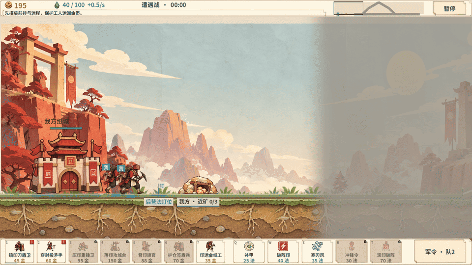

# 纸上兵戈 · Paper Warfront

一款使用 Godot 4.7.2、GDScript 和原生 Control UI 构建的纸片舞台即时战术游戏。项目以《剑与勇士 / Sword & Soldiers》的自动行军、资源循环、手动法术、科技与横向交战骨架为参照，加入十院不对称兵种、逐图剧情、非线性战役、战争迷雾和折纸舞台表现。



上图由当前 `3.0.0-rc38-preview` Windows 原生导出包实际运行后抓取战斗帧生成，展示自动行军、上下道路、战争迷雾、资源 HUD、单位动作和纸片地层。GIF 是游玩展示素材，不代表 Android 真机性能结论。

## 当前版本

当前源码对应 `3.0.0-rc38-preview`。工作区中已生成 Windows EXE、Android APK、Windows ZIP 以及对应 SHA256 和 QA 记录；为了避免 GitHub 单文件及仓库体积限制，二进制发布物、QA 截图、Godot 导入缓存和本地工具链不提交到 Git，源码仓库可以在 Windows 环境中重新构建它们。

已经实现并进入当前源码的范围：

- 单机十章、200 张地图。每张地图绑定战前冲突、地点动机、真实目标、战后结果和独立证据。
- 章节路线允许择一、并行调查、条件汇流和回访；章节路线图直接读取解锁与存档使用的 `campaign-flow.json`，不强制线性推进。
- 横向多道路战场。道路长度、坡道、桥路、资源点、路口和目标锚点参与移动、护送、截击、经济与战争迷雾判定。
- 自动行军。单位沿实际道路推进，前排、远程、支援、纸工和召唤物使用不同的职责、触及和动作语义。
- 金币与法力双资源。纸工往返采矿、归仓和交付产生真实经济；法力来自阵营规则、建筑、道路、击倒、研究或伤害反馈。
- 局内科技、建造、生产队列、手动施法和军令纸页。战前快速栏与任务限制共同决定可用阵容。
- 十个不对称阵营，每个阵营六种独特作战兵与一个阵营纸工，兵种轮廓、动作帧、能力、经济或法力机制存在实际差异。
- 战争迷雾三态：未知、已探索、当前可见。上下道路分别侦察；镜头移动不揭示敌人；小地图、AI、开火揭示和手动施法共用视野规则。
- 纸片舞台渲染：厚纸地层、分层纸偶、关节动作、纸边阴影、命中特效、粒子、投射物和折纸 UI。
- Windows 原生 EXE 与 Android APK 导出路径；Android 当前没有实体设备可供真机验证，不使用模拟器。

## 核心游玩循环

1. 在章节页阅读当前地图的冲突、地点和目标，选择可行动的剧情纸页。
2. 查看敌情、道路分叉、资源点和目标锚点，配置 2–4 个战前快速单位。
3. 开局先安排纸工采矿和归仓，再用金币部署真实作战兵；研究、建筑和队列会占用同一场战斗的预算。
4. 让部队沿道路自动行军，在交战距离、前排屏障、远程射程和上下路侦察之间做选择。
5. 在战争迷雾中根据可见信息手动释放法术和军令，利用地形路线、补给和阵营专长改变战局。
6. 完成摧毁、护送、截击、保护、归仓或生存目标，记录星级、证据旗和路线进度，回到章节页选择下一条故事路径。

## 阵营与兵种方向

| 阵营 | 纸上身份 | 资源/战术倾向 |
|---|---|---|
| 印甲军 | 赤砚 | 升级与重甲正面推进 |
| 墨骸社 | 墨归 | 牺牲、吸血与高风险交换 |
| 灯符朝 | 灯照 | 纸灯设施、法力与区域支援 |
| 纸械工坊 | 榫七 | 建造、机械单位与施工节奏 |
| 鸢纸行会 | 飞笺 | 路口机动、分路和运输效率 |
| 金契商盟 | 契衡 | 真实归仓、交付和赏金收益 |
| 植纤古庭 | 纤枝 | 生长、修复和持续作战 |
| 霜裁守序 | 霜律 | 控制、冻结和交战窗口 |
| 烬纸流亡 | 烬禾 | 受伤增益、伤害回法和残血反击 |
| 空白档案 | 白匣 | 研究、复制和信息优势 |

每个阵营的数据入口在 `game/data/factions.json`、`game/data/balance-prototype.json`、`game/data/unit-actions.json` 和 `game/data/unit-frames.json`。正式单位不会只通过换色复用同一模板；动作帧、角色轮廓、被动机制和战场职责分别受数据合同约束。

## 地图、剧情与战争迷雾

地图数据位于 `game/data/maps.json`，剧情位于 `game/data/story.json` 与 `game/data/campaign-narrative.json`，路线图位于 `game/data/campaign-flow.json`。地图设计遵守以下关系：

- 交战长度由道路拓扑和真实路径距离决定，不能用屏幕横向坐标代替桥、坡、岔路或回程成本。
- 资源点、路口、狭窄地形和目标锚点必须改变抵达、经济、视野或风险中的至少一项。
- 剧情目标会反过来选择地图结构：护送需要安全路线与交接点，截击需要可见窗口与拦截线，归仓需要矿线与回程，保护需要持续压力和多条道路。
- 迷雾遮蔽未知区域；已探索地形保留记忆，但敌方单位、建筑和最近状态不会在失去视野后继续伪装成当前信息。
- 迷雾刷新采用失效标记缓存。单位、建筑、移动、路线、召唤、法术视野、死亡和开火揭示会触发刷新；没有状态变化时复用上一份视野结果。

可执行验收见：

- [单机地图剧情合同与路线分支验收](docs/paper-warfront/147-单机地图剧情合同与路线分支验收.md)
- [战争迷雾失效缓存与 rc37 交付](docs/paper-warfront/148-战争迷雾失效缓存与rc37预览交付.md)
- [剧情路线图与运行绘制缓存调优](docs/paper-warfront/149-剧情路线图与运行绘制缓存调优.md)
- [实体查询缓存、绘制排序复用与 RC38 双平台交付](docs/paper-warfront/150-实体查询缓存与构建输入遍历优化及rc38预览交付.md)
- [完整故事路线](docs/paper-warfront/world/04-完整故事路线.md)

## 操作与界面

桌面端支持鼠标、键盘焦点和滚轮；移动端使用安全区、触控热区、横向导航和可滚动纸页。战斗 HUD 将战场优先级放在资源、法力、迷雾、小地图、目标和底部快速栏，科技、建筑、队列与军令按需展开，保持主要屏幕空间用于战斗画面。

菜单、设置、弹窗、兵卡、章节页、结算页和军令纸页使用统一折纸视觉系统。资源定义在 `assets/paper-warfront/ui/paper-ui.json`，生成提示词和加工记录遵守项目素材约束；运行时实际使用的位图位于 `game/assets/`。

## 技术结构

```text
game/
  project.godot                 Godot 4.7.2 工程入口
  main.tscn                     主场景
  scripts/
    main.gd                     菜单、章节、输入与场景编排
    battle_sim.gd               独立战斗模拟、经济、科技、胜负
    battle_view.gd              纸片舞台、单位排序、投射物与粒子
    battle_visibility.gd        战争迷雾、探索记忆和开火揭示
    tactical_ai.gd              阵营 AI、部署、路线与目标选择
    campaign_route_graph.gd     章节分支/汇流路线图
  data/                         地图、阵营、单位、剧情、UI 和资产合同
  assets/                       已加工的运行素材、动作图集、音频和字体
  tests/                        GDScript 机制、剧情、迷雾和动作合同
assets/paper-warfront/           资产定义、素材清单、风格与版本记录
docs/paper-warfront/             设计章程、玩家手册、研究和验收文档
tools/paper-warfront/            构建、导出、检查、截图和 GIF 工具
```

模拟与渲染分离：`BattleSim` 决定单位、资源、碰撞、命中、路径和视野；`BattleView` 读取状态绘制分层纸偶。位图、厚片几何、动画帧、命中规则和 QA 证据分开管理。

## Windows 原生构建

要求：Windows 原生 PowerShell、Godot 4.7.2 导出模板、Python 3、Android SDK 36、JDK 21。Godot 放在 `.tools/godot/`，本地签名文件放在项目外部 `.keys/`；不要提交密钥、导出凭据或 Godot 导入缓存。

```powershell
# 在仓库根目录执行
$env:PAPER_RELEASE_VERSION = '3.0.0-rc38-preview'
$env:PAPER_QA_DIR = 'output/qa/godot/render-runtime-rc38/local-build'
python tools/paper-warfront/build_game.py

# 运行编辑器或直接启动工程
.\.tools\godot\Godot_v4.7.2-stable_win64.exe --path game --editor
.\.tools\godot\Godot_v4.7.2-stable_win64.exe --path game

# 生成 Windows 原生实机战斗 GIF
python tools/paper-warfront/capture_gameplay_gif.py

# 打包 Windows 预览 ZIP
$env:PAPER_RELEASE_VERSION = '3.0.0-rc38-preview'
python tools/paper-warfront/package_release.py --windows-only
```

`capture_gameplay_gif.py` 使用编译后的 Windows EXE、真实 Godot 渲染帧和 FFmpeg；默认输出 `docs/media/paper-warfront-gameplay.gif`。捕获目录是临时产物，已被 `.gitignore` 排除。

## 验证入口

主要检查工具包括：

- `check_frame_rebuild.py`：动作帧、图集、角色动作和帧源合同。
- `check_mobile_adaptation.py`、`check_mobile_preserved_systems.py`：移动尺寸、安全区、触控和核心系统保留。
- `check_story_routes_ui.py`：章节分支、汇流、存档重载和 200 张剧情简报的原生 UI 观察。
- `check_packaged_apk_logic.py`、`check_packaged_windows_logic.py`：编译包逻辑和资源完整性。
- `check_realtime_battle.py`：Windows 原生 GPU 实时观察；`stress` 是容量压力证据，不等同普通付费对局。
- `write_rc37_visibility_release.py`：生成历史 RC37 发布验证清单；RC38 的双平台验证记录直接保存在对应 QA 目录。

当前 RC38 记录的关键结果：剧情 UI 237 项/200 张简报通过；移动矩阵 8 配置、26723 项通过，最低战场占比 70.6%；APK 与 Windows EXE 各 38 组、195115 项编译包逻辑通过；124 单位压力窗口采样 227 帧，帧间隔均值 28.09ms、p95 34.75ms，应用处理均值 11.93ms、绘制回调均值 7.90ms；手机形状窗口 269 帧均值 16.67ms、p95 16.74ms。压力结果没有被表述为稳定 60FPS，Android 真机和全关真人平衡仍待后续验收。

详细数字和构建哈希保存在本地生成的 `release/3.0.0-rc38-preview/build-manifest.json`、`release/3.0.0-rc38-preview/SHA256SUMS.txt` 及 `output/qa/godot/render-runtime-rc38/`，这些目录因包含大体积二进制或运行证据而不进入 Git。

## 约束与素材规则

- 只使用 Windows 原生工具；不启动 Docker、WSL、虚拟机、容器或 Android 模拟器。
- 生成新图片时使用项目指定的 `sub2-image-gen` 与 `gpt-image-2.5` 工作流，不复制或提交网关密钥。
- 稳定资产 ID 不随意改名；正式资源变更必须更新版本、生成/加工记录和引用。
- 生成图不能作为游戏运行或性能证据；运行证据必须来自 Godot 源码、编译包或 Windows 原生观察。
- 代码、运行素材、资产定义、动作帧和命中规则分开管理；QA、缓存、备份和导出物默认排除。
- 当前项目是单机优先；没有 Android 实体设备时不伪造真机结论，也不使用模拟器替代验证。

## 文档入口

- [项目文档索引](docs/paper-warfront/README.md)
- [玩家手册](docs/paper-warfront/16-玩家手册.md)
- [项目章程与硬约束](docs/paper-warfront/01-项目章程与硬约束.md)
- [地图与剧情路线](docs/paper-warfront/138-二百图剧情与非线性战役.md)
- [单位动作与素材规范](docs/paper-warfront/frame-rebuild/README.md)
- [素材与 UI 定义](assets/paper-warfront/README.md)
- [原作地图研究](docs/research/swords-and-soldiers-map/recheck-20261008/README.md)

项目尚未声明开源许可证；在添加许可证前，请不要把本仓库内容作为可再分发的第三方素材包使用。
