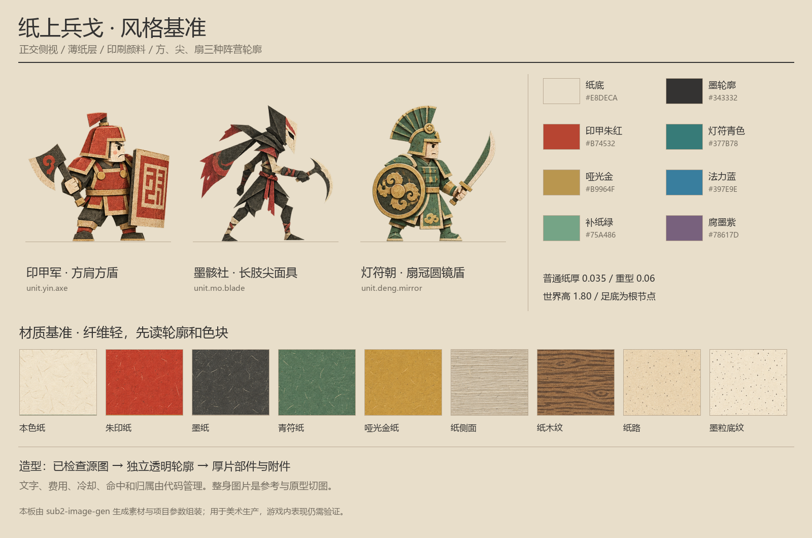

# 美术风格圣经

核心句：**一群认真打仗的厚片纸偶，活在被印出来的纸面山河里。**

基准板用于统一语言；素材板、代码模型和战场构图各有用途。造型按本规范校准，不把生成图片偶发的透视、阴影或数字当成必须复现的规则。

正式基准由本库人物、纸材和精确色值组装。独立生成的风格/交锋示意图保留为探索资料，不能反向覆盖兵器、比例或费用。引用范围见 [art-direction.json](../../../assets/paper-warfront/art-direction.json)。

## 固定画面语言

| 要素 | 必须保留 | 判断方法 |
| --- | --- | --- |
| 视角 | 正交侧视，士兵朝战线左右，主要面可见 | 双方同距离尺寸一致，盾不因透视消失 |
| 材料 | 哑光纸与印刷颜料，薄边和少量折痕 | 近看有纤维，远看先见色块与轮廓 |
| 轮廓 | 纸片折出的方、尖、扇形，武器夸张 | 缩小到操作尺度仍能辨角色 |
| 线条 | 木刻式厚墨轮廓，略不齐但不毛糊 | 外轮廓稳；纸纹不能吞掉眼、刀、盾 |
| 深度 | 有限厚度和部件层级，背景为低对比层 | 看得见纸侧面，不变成立体雕塑 |
| 表情 | 方眉、圆眼或尖眼、简单嘴，认真且滑稽 | 普通士兵有性格，表情变化不增加碎线 |
| 特效 | 纸屑、印痕、短墨卷与薄符圈 | 能看到目标、结果和下一次可点选的位置 |

禁止混用塑料玩具、镜面金属、皮肤写实、复杂骨骼解剖、三维圆润雕刻、摄影景深、电影烟雾。所有木头、石头、金属道具都解释为“纸上的印刷造型”。真实材质效果不进入统一素材库。

## 色彩与对比

参数以 [style-tokens.json](../../../assets/paper-warfront/style-tokens.json) 为准。

| 用途 | 色值 | 使用方式 |
| --- | --- | --- |
| 纸底 | `#E8DECA` | 世界底色、身体、UI 基底 |
| 亮纸 | `#F3EBDD` | 面部、选择轮廓、纸边亮面 |
| 纸侧面 | `#BAAA94` | 薄侧边与有限折层 |
| 印甲朱红 | `#B74532` | 宽肩甲、方盾、军旗和方印 |
| 墨骸墨黑 | `#343332` | 长手、面具、纸骨关系与墨法 |
| 灯符青色 | `#377B78` | 扇冠、镜盾、灯架与圆符 |
| 哑光金 | `#B9964F` | 少量印饰、金币，不能像镜面黄金 |
| 法力蓝 | `#397E9E` | 资源、费用、回法事件 |
| 补纸绿 | `#75A486` | 恢复结果，局部使用 |
| 腐墨紫 | `#78617D` | 持续伤害与祭术小范围点缀 |

阵营色占可见装备的主要面积；墨骸可以有少量朱印封条，但不能成为红甲军。敌我颜色属于关系标识，另用小生命条和边缘标记表达；即使同阵营内战也能分清双方。色弱检查还看方印、尖面具、圆符和条纹标记。

背景比普通角色低一档对比。背景没有抢眼纯黑巨物或高饱和金色太阳。功能颜色不得大面积铺满地形，避免让玩家误以为那里有持续伤害或增益。

## 造型与尺寸

普通纸兵高 1.8 个设计单位；含盔的头身比例约 1:3–4。折斧兵肩宽约身高的 35–42%，墨刃为 23–30%，重型单位通过宽肩和大武器增加重量。纸巨人高约 3.42，工人高 1.48，纸骨兵高 1.36。角色不用靠细节数量区分强弱。

主要部件：头、盔、躯干、前后臂/手、前后腿/胫、武器、盾/附件。正面纸片厚度约 0.035；重型 0.06；巨型可以到 0.08。每层至少具有可见的边缘差异。每个兵种最多两个主装备重点，其余纹样控制为辅。

所有人物源图面向右；左方/右方在运行时翻转整体。图片不使用可读文字印章，以免翻转后倒字。正式名称由 DOM 显示；如果需要叙事书法，作为独立不翻转的贴花管理。

### 阵营剪影

| 阵营 | 必须可见的造型识别 | 纹样与动作 |
| --- | --- | --- |
| 印甲 | 方肩、方盾、方印锤，短粗有力 | 直线和方框；出手有蓄力与盖印停顿 |
| 墨骸 | 尖面具、长臂、纸骨杖、巨型折肩 | 墨卷、断纸边；跃袭、拾纸、纸屑成兵 |
| 灯符 | 扇冠、圆镜盾、灯架、青金符 | 圆和扇；展开、反射、两张纸分开成复制 |

## 场景和 UI 的纸感

场景使用三类层：极淡远山、低对比中景纸林/遗迹、可交互的地面/建筑。装饰纸灯比产法纸灯台更小、更淡、无法力蓝中心；装饰不出现生命条。路径和建造位由代码确定，背景图不能决定碰撞或合法目标。

UI 是纸签和印记的操作语言。圆形入口、方形科技节点与细战线符合用途；外框由 SVG/CSS 或代码画，图标图片只画主题符号。所有文字、数字、冷却罩、锁、选中边框使用运行状态。界面不做厚木框、卷轴大边框或占中心的说明板。

## 材质与动效

人物和建筑的纸纹在 50% 缩放仍应成为轻微表面变化，不能像砂石。高频纤维不用于脸和图标中心。最初用普通哑光材质与轻环境光，侧边适当变暗；避免强实时阴影和全屏后处理。

普通攻击有短蓄力、清楚接触、回收；重击先抬大印锤，再产生短印痕和有限纸屑。补纸把折痕合起，恢复结果直接对应生命条。阵亡把身体折倒并散几片纸，阵亡标记仍是独立低矮纸堆。复制先重叠后分开；复制品使用小来源符号，不能仅靠半透明表达归属。

## 风格检查卡

每次生成或建模都在四种背景上查看：亮纸、暗墨、战场中景、棋盘透明底。再查看正常尺度和 50% 缩放。检查头盔、武器、盾、关键能力符号是否保留，眼与嘴是否清楚；单位是否仍是薄纸而非圆雕；三阵营是否有足够轮廓差异。

出现视角错误、混阵营、角色裁断、相邻格串图、透明边光晕或文字伪影时，不能标为 `visual-reviewed`。纹理太重、背景太强或装备过复杂时先简化；不要通过大量光效遮掩问题。
