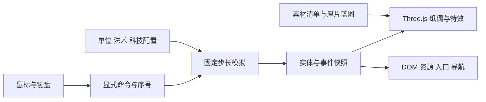

# Three.js 厚片与动画规范

主路线：TypeScript + Vite + Three.js + DOM HUD。当前交付的是几何蓝图、素材和规则数据，后续按本规范构建实际游戏。

## 模拟与画面分离

模拟负责金币、法力、队列、科技、位置、射程、伤害、状态、归属和胜负。Three.js 对象只负责画面。一个实体死亡时先产生模拟事件，再驱动纸偶折倒；纸片动画结束不能决定死亡时刻。

研究、生产、冷却与状态时长转为模拟tick；资源使用整数或固定精度。随机和同一tick中的事件顺序可复现，不让动画帧率、音频时刻或浮点显示格式决定结算。

建议代码结构：`simulation/`、`commands/`、`render/`、`assets/`、`ui/`、`audio/`、`diagnostics/`。保存或回放序列化规则状态、随机种子与命令，不保存 Mesh、Texture 或音频节点。

## 坐标与镜头

X 沿战线向右，Y 向上，Z 向相机；纸偶主要在 XY 平面，薄厚沿 Z。足底中心是角色根。阵营方向翻转整个根节点的 X，同时保持逻辑位置和单位 ID。头像、UI 文字不翻转。

相机固定正交，沿 X 平移，不使用自由 OrbitControls；初始视高 8.2，角色参考高 1.8。不同宽高比改变可见战线宽度，默认不随战斗缩小角色。镜头中心 Y 与地面配置保持一致。装饰层和队列前后错位不参与射程。

## 厚片组装

[rigs 目录](../../../assets/paper-warfront/rigs/animation-profiles.json) 中每个单位有独立蓝图：部件 ID、父节点、局部轴心、二维多边形、材质语义、层级与高度。

实现顺序：

1. 读取蓝图，验证部件父级有向无环且父节点存在。
2. 把二维多边形转为 `Shape`，挤出规定厚度；薄边使用较暗纸色。
3. 按 pivot 建立节点层级；脸使用少量墨点、眉线和嘴形。
4. 通过装备字段生成斧、盾、印锤、纸矛、墨刃、镜盾等独立厚片附件。
5. 使用定义的世界高度缩放整套角色，图像整身 PNG 用于对照。
6. 接入动作与模拟事件；检查左右翻转、受击、攻击接触和层级遮挡。

提供的蓝图是可编码的公共身体构造起点，武器/盾和兵种特征按参考图与装备字段补齐。完整人物 PNG 不是已经拆好关节的肢体纹理。可玩原型先用整身图作为临时平面纸偶，正式动作替换为部件几何。

普通身体模板按宽方、细长、重型、扇形和经济单位分组；炮车使用车体、炮管和轮子模板。纸巨人通过世界高度、宽肩和大手形成威胁；不需要增加大量三角形。

## 材质、层级与资源

前面使用哑光纸材和阵营印色；侧面用纸边色，避免强镜面响应。人物纸纹不覆盖面部重要墨线。优先不透明部件几何，只有装饰 PNG 和特效使用透明裁切；为透明贴片保留颜色边距，降低远处采样光晕。

彩色纸材图直接使用时，材质主色接近白；需要精确匹配阵营色时，用纸纤维的灰度/亮度叠加参数色。不要把彩色纹理再乘一次深阵营色，使纸变脏、变黑。

参考 alpha 测试阈值约 0.35，最终按细纸边实测。没有必要的部件不写透明混合，防止大量重叠排序问题。Z 层由公共部件顺序决定，禁止靠任意 renderOrder 逐帧修补错误。

共享几何、材质和纹理，单位实例仅保存节点/矩阵与动画状态。最初少量单位可普通节点组；规模扩大后，同一 prefab 的同一部件采用实例化或批量提交，按实体变换更新各部件矩阵。多部件角色不能只说“用了实例化”却仍每兵每片单独提交。

## 动作规范

| 动作 | 表现 | 模拟关系 |
| --- | --- | --- |
| idle | 极轻纸片呼吸或小抖动 | 不移动逻辑坐标 |
| walk | 前后腿相反摆动，手臂小幅跟随 | 根位移来自模拟，不由步行动画推进 |
| attack | 蓄力、接触、回收；大武器有明显前摇 | 攻击事件及命中时刻来自模拟 |
| hit | 纸甲后仰、折痕、短墨/纸屑 | 普通 hit 不自动打断攻击 |
| cast | 举手或符展开，目标位置可见 | 单位技能/法术事件触发 |
| death | 折倒、四到六片碎纸、淡出 | 阵亡标记单独保存，寿命由模拟管理 |
| carry/mine | 背金、短敲纸镐 | 金币只能在模拟交付事件入账 |

共享参数见 `animation-profiles.json`，重型和巨型按单位攻击前摇配置覆盖。视觉受击停顿约 55ms，只影响呈现，不停模拟、冷却或生产。相机震动限制为轻微像素偏移，低动态偏好关闭。

复制品使用同 prefab、不同实体 ID 和明确来源标记。控制改变当前归属标识与合法目标，不强行把原兵种涂成新阵营；其原生能力保留。护符、腐墨、定身各有短状态标记，结束时立即移除，不能留下误导性永久特效。

## 选取与特效

每兵拥有稳定投影包围框或身体多边形代理，返回模拟 ID。武器摆动和碎屑不扩大可点击面积。单体法术先过滤合法目标，再匹配距离与可见层级；密集处允许轮换候选，并在确认前高亮目标。

范围法术由屏幕坐标转换为战线 X，范围与结算使用同一半径。范围预览不以材质纹理的模糊边缘判断命中。特效母题用于颜色和符号，落印、拾纸、反弹、复制都用有限程序化节点与粒子实现，不依赖生成全帧动画条。

## 预算与生命周期

首个测试场景按最多 120 作战单位、12 工人、120 活跃投射物和 300 简单纸屑预算；这些是压力目标。建议渲染控制在 400 次以内提交、纹理 GPU 预算 96MB 以内、桌面 1080p 目标 60fps。若设备实测不满足，先减少粒子、层级与投射物表现，再检查批量提交。预算不是已达到的性能承诺。

源图不加载到运行包。首关只加载所需两阵营、公共 UI、纸材和一个背景；库完整不代表一次把所有内容下载。背景不超过必要分辨率；候选 PNG 后续可压缩和打包，但保持无损源图。

离开对局取消帧循环、解除事件、关闭音频节点、归还对象池；共享材质/纹理按引用计数释放。处理窗口缩放与 WebGL 上下文恢复。运行时测试在 Windows 原生浏览器进行，并遵守标签清理约束。
