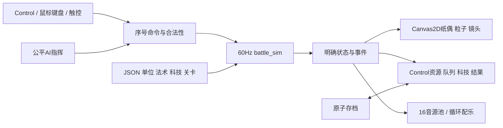

> 1.0 历史快照。当前版本请读 [2.0 制作入口](../../../paper-warfront/README.md)。

# Godot架构与数据契约 · 1.0

地图专项复核（2026-10-08）：1.0 的三个场景共用一套机械地图，十五个战役关卡全部以拆基地结算；现有功能/导出验证不代表原作地图对标已完成。后续地图方向以 [地图研究与重设计约束](../../../research/swords-and-soldiers-map/README.md) 为准，其中的新方案尚未实施。

工程：[project.godot](../../../../game/project.godot) → [main.tscn](../../../../game/main.tscn)。无C#、网络服务、第三方运行时插件或外部3D资产依赖。

## 文件责任

| 文件 | 责任 | 禁止越界 |
| --- | --- | --- |
| data_store.gd | JSON读取、名称/提示、稳定ID、纹理缓存 | 不按图片尺寸决定射程/费用 |
| battle_sim.gd | 经济、队列、科技、实体、战斗、状态、AI、胜负、统计 | 不访问Control、纹理、屏幕尺寸或音频 |
| battle_view.gd | 坐标转换、纸偶分件、相机、预览、瞬时特效 | 不扣资源、不决定死亡、不更改逻辑射程 |
| action_card.gd | 卡片图标、费用、锁、冷却和选中绘制 | 不直接生兵或授予科技 |
| main.gd | 页面、输入、命令调用、暂停、结果与存档 | 所有玩家费用须通过simulation请求 |
| audio_controller.gd / audio_synth.gd | 声音事件、限流、音乐、危急PCM | 不用声音结束判定攻击完成 |

## 时间、命令与实体

累计真实delta，每步1/60秒推进模拟；单帧积累夹到0.15秒避免后台卡顿后巨量追赶。视觉/音频按模拟事件更新，不决定结算。默认随机种子137；同种子同命令重放已校验一致，不把这个结论扩展成跨引擎版本联网确定性。

`request(side, kind, args)`生成递增序号；`command(side, sequence, kind, args)`校验侧别、序号、胜负，再处理recruit/cancel_queue/research/build/cast。返回`{ok,error}`，拒绝时不支付任何费用。重复序号不能重放效果；拒绝也消耗该序号，下一请求使用新号。

单位用正uid，基地用-1/-2，纸标独立uid，建造实体正uid。单位保存原始id、side、x、生命、目标、风up、冷却、状态、clone、寿命、步态等。队列是稳定单位ID，不存图像引用。重开创建新模拟、清空全部实体/标记/飞弹/延迟事件与视觉余波。

## 事件与目标

常用事件：start/spawn/recruit/gold/research/build/attack/hit/death/building_death/cast/impact/heal/dash/summon/reflect/blocked/interrupt/result。每条含kind/time，以及必要x/side/id/uid/伤害/半径/来源。`drain_events()`消费后清空，避免重复播音、重复粒子和历史FX堆积。

直接技能、区域延迟、物理飞弹三条处理通路。状态/保护在真正伤害时检查。区域以战线绝对距离判断；投射物失去目标即丢弃。显示位置的后移/排次只影响绘制和点选，所有战斗距离仍取x。

## 存档与交付数据

schema1，字段unlocked(0..14)、stars、challenge_stars、settings；设置音量0..1，降低震动和跟随为bool。只保存胜利进度/最高星章/设置；暂停退出不会保留对局。用profile.tmp写入后替换profile.json；Windows旧默认用户目录可单次迁移。测试捕获用profile副本，结束恢复，不能污染玩家进度。

源图/提示词在output/imagegen，源库在assets/paper-warfront，运行文件在game/assets。生成素材清单与运行链接清单职责不同。运行包不含技能、密钥、签名私钥、测试脚本、原始生成大图和文档。

单位属性/法术/科技/关卡为数据驱动；1.0地图坐标、基础生命、公共人口与时间步等常量在代码中固定实现并与JSON基线一致。更改这类规则必须同时修改模拟/UI/配置及对应验收，不能只改JSON后假定所有固定逻辑已经变化。

## 平台约束

Windows用Mobile/Vulkan renderer，Android用GL Compatibility；同一2D模拟与UI。桌面默认1280×720，逻辑1600×900；触控转鼠标路径，系统返回与后台暂停独立处理。Android使用原生APK模板，不使用Gradle容器、WSL或模拟器。
