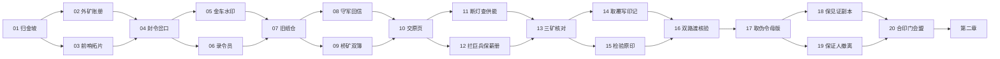

# 单机剧情地图与章内分支 · rc27（历史设计稿）

> 本页保留 rc27 的设计过程记录。200 张地图已经在后续 rc29/rc36 数据中逐图补齐剧情、地理动机和目标绑定；当前验收以[二百图剧情与非线性战役](138-二百图剧情与非线性战役.md)和[单机地图剧情合同与路线分支验收](147-单机地图剧情合同与路线分支验收.md)为准。

用户最新要求取代早期“所有单机关卡必须线性”的硬约束。**每张单机地图必须有配套剧情；地形与章内推进可以线性，也可以分岔、汇流或回访，按剧情和实际玩法选择。** 战场道路、章节解锁、任务阶段分别管理。

在 rc27 当时，本轮先对第一章20张地图逐关重新编写地点冲突、行动目的、战前人物对话、战后结果和证据名称；后续九章180关仍处于旧故事纲要阶段。这个历史状态已由 rc29/rc36 的逐图故事档案取代，200个地图/关卡ID与实战参数保持原引用。

## 剧情与地图的共同约束

| 必须明确的内容 | 实现与评审要求 |
|---|---|
| 为什么来此地 | 地点属于矿村、纸仓、灯台、印机、渡口或交证场所，人物有需要解决的具体冲突 |
| 为什么这样造地图 | 矿洞容量、路长、坡折、桥路、汇口与保护对象的位置须服务冲突；名称含“岔”不代表已经有实际道路分岔 |
| 玩家在保什么、争什么 | 胜利条件必须对应真实攻城、归仓、计时保护、活体护送或边界前拦截，不能只换剧情标题 |
| 未知区域怎么起作用 | 尚未探索的道路保留未知；各路独立视野，不能用故事台词泄露隐藏敌军实时位置 |
| 路线选择付出什么 | 绕行消耗抵达时间；抢矿承担运输风险；守塔与护工争金币和法力；没有免费高地伤害或剧情资源 |
| 完成后发生什么 | 实际完成页才获得对应证据旗；未走支线不出现其证词、完成标记或星级 |
| 剧情怎样继续 | 汇合对白只引用必达事实，或使用“已经保全的见证”等兼容所选路线的表述 |
| 失败与回访 | 战败不推进；已完成地图可重访；重复获胜保留最高星级；遭遇战和试演不写剧情进度 |

不要求每图都双路，也不要求整章都线性。以后可以加入不同章节图结构，但实际道路仍遵守自动行军、路标提交、各路视野与可读汇流点。任意方向的迷宫、可破坏道路和中途变换胜利条件尚未接入，不能当作本轮已有功能。

## 第一章：从封名到共同见证

赤砚起初奉命封锁矿路；他从工钱、原印、空令与原物的核对中，发现军令正在被批量覆写。玩家最后带着伪令母版和自己实际保全的见证，通过合印门与墨归会盟。章节的证据获取发生在真实地图任务里。

每一对分支完成一页即可开放汇合页；不存在必须清空支线才推进的额外门槛。最短第一章需完成14页，完整回访仍是20页，共64种择一路线组合。战场内部路线与这里的章节选择独立，例如02“外矿岔”仍是实际矿位分配图，04/09/14/16/18/20才有实际道路分岔。

| 页 | 地点与冲突 | 地形/任务的作用 | 真正完成后保全的见证 |
|---|---|---|---|
| 01 | 归金坡封住矿村 | 开局矿路与家门相连，攻城解除封锁 | 矿村出入册 |
| 02 | 外矿被宣布废弃却持续供军 | 狭窄近矿与较远外矿，真实归仓核账 | 外矿过秤账 |
| 03 | 原印拓片将被拆毁 | 保护前沿塔，撑过援军坡道空档 | 前哨双印拓片 |
| 04 | 空令从岔口批量发出 | 主路破阵或纸桥绕行，在汇口接战 | 岔口签发记录 |
| 05 | 账车的军费与工钱混写 | 运输线护卫与增工共享预算，真实回款 | 金车水印 |
| 06 | 录令员携原稿逃出 | 活体护送、伏兵入口与接力防护 | 空令原稿 |
| 07 | 两哨之间的旧纸仓仍在供料 | 有限外矿收入需及时变成前线优势 | 旧仓出库页 |
| 08 | 伪撤防令与守军回信矛盾 | 守城计时、长路增援与控制窗口 | 守军回信 |
| 09 | 两路发运簿记着不同院名 | 桥矿护运与主路抢汇口分流 | 桥矿双簿 |
| 10 | 原页需要交到查验者手中 | 护送与工人经济共用护卫预算 | 查验收件签 |
| 11 | 灯台为印机连续供能 | 长坡、快兵与法力投资时差 | 灯台供能页 |
| 12 | 巨兵要跨线覆写旧薪册 | 在真实失败锚点之前伤害与控制 | 未覆写薪册 |
| 13 | 三矿劳动者的姓名被抹除 | 容量/服务/往返不同，真实归仓核对 | 三矿核对册 |
| 14 | 第二具巨像携覆写印记移动 | 主路拖延，桥队争取及时汇合 | 巨像覆写印记 |
| 15 | 原印旧刻痕需要检验 | 保护塔靠近外矿，守塔与护工取舍 | 原印检验页 |
| 16 | 追捕队需要当面看到原物 | 双路活体护送、探路与汇流 | 渡口当面核验 |
| 17 | 伪令母版藏在层叠纸坡后 | 双折坡改变运输与军团衔接 | 伪令母版 |
| 18 | 原物需要不能覆写的副本 | 主路保护塔与桥矿分别需要防守 | 不可覆写副本 |
| 19 | 旧部奉伪令来索印 | 晚段敌入口改变，守城撑过撤离 | 证人撤离签 |
| 20 | 合印门阻止十院共同核验 | 桥矿、汇流与正面军团共同投入 | 第一片祖印见证 |

## 数据、存档与界面

`campaign-flow.json`独立记录解锁前置和后继；`campaign-narrative.json`绑定地图、真实任务、道路ID、原证据旗与地理用途；`campaign.json`保存实际对战配置和人物对白。定义源在`assets/paper-warfront/`，运行副本在`game/data/`，逐字节同步。

`campaign_progress.gd`管理实际完成ID与推荐页。schema3以`campaign_completed`为权威，保留`stars`、`story_flags`、设置和军阵。schema2旧战役确实逐关推进，其已过前沿与星级迁入完成集合；旧15关schema1不冒充当前200关历史。重访旧章不会把“继续战役”退回早章。存档仍以临时文件原子替换。

桌面与移动入口改为“故事战役”。卡片显示可行动、需完成哪一折或已留证；胜利后进入“选择下一页”，不自动假定只有下一关。战前简报显示地图对应剧情、真实胜利条件和空间取舍。菜单沿用已检查的折纸资源，战斗HUD仍需保留至少70%战场。

## 验证与范围

本轮路线检查6,376项，覆盖200个节点的可达性与依赖、64条第一章路径、200种旧前沿迁移、证据旗、重访和存档往返。剧情UI观察使用原生鼠标或ScreenTouch与隔离存档；强制结果用于检查菜单转换，**不是实际付费通关证明**。

密集交战检查另外复现了跃进缓存错误：跃进者临时移动时首次建立阻挡索引，后续友军误读其跃进后位置。现保留当前演员的移动前锚点；200图×双侧×三遍历顺序共1,200项与旧线性判定一致。

## rc27交付与最终复核

[Windows程序压缩包](../../release/3.0.0-rc27-preview/PaperWarfront-Windows-3.0.0-rc27-preview.zip) · [Android APK](../../release/3.0.0-rc27-preview/android/PaperWarfront-3.0.0-rc27-preview.apk)。同一签名、Android版本号30026；真机未验证。

| 已测范围 | 最终结果 |
|---|---|
| 正式规则 | 75组、95,386项，全过；含路线6,376项和跃进/阻挡1,200项 |
| 实际包字节码 | EXE与APK各33组、87,200项，在Windows原生引擎加载真实编译资源 |
| 剧情界面 | 两种布局共66项；真实注入鼠标/ScreenTouch，隔离存档，20份胜利/战术简报全显 |
| 正常付费对局 | 印垒/木拓三图镜像六场，73,103个60Hz步骤与rc26逐步一致 |
| 地图比例 | 200图、22,902项；道路、桥面、厚纸层、单位比例与原约束一致 |
| 移动显示 | 八配置26,721项；战斗净画面至少70%，不等于Android实体设备 |
| 编译画面对照 | 两尺寸、三图、两小数镜头位置共12组，全部在预定容差内 |
| 对战/UI | 正常付费行军50项、受控交锋OpenGL64项/default Vulkan32项，菜单、军令、焦点、六EXE场景与38项折纸资源复核 |

旧简报实际包中20份有15份战术段落超过固定高度，已经缩短为一个完整战术问题；相同观察器最终20份全部通过。第一批UI观察错误地哈希Godot逻辑`.gd`资源路径，修为真实`.gdc`文件字节后在同包重验。原失败、首批导出和源码均归档，没有覆盖已完成证据。

| 场景 | 单位峰值 | 稳态FPS | P95帧间隔 | 墙钟/模拟时间 |
|---|---:|---:|---:|---:|
| rc26满员对照 | 124 | 17.23 | 95.12ms | 20.04/19.55s |
| rc27满员压力 | 124 | 19.32 | 67.61ms | 20.01/19.55s |
| rc27正常分岔 | 13 | 60.00 | 16.74ms | 160.11/159.68s |
| rc27正常长图 | 15 | 59.87 | 16.80ms | 160.11/159.65s |
| rc27手机布局（Windows） | 13 | 59.60 | 17.16ms | 160.10/159.77s |

正常样本每场160秒，300金币、科技未解锁、敌方等待4秒；满员样本每侧直接放入60战斗单位，加4纸工，关闭AI并提高生命值维持负载，不能当正常付费玩法。稳态FPS来自真实单调时钟帧间隔，排除开始2秒以及截图回读和其后0.5秒。模拟按自然App处理推进，没有手动加速；测试中窗口可见、音频开启，默认60FPS上限。

本轮桌面有其他项目的原生无界面任务在运行，未干预用户的其他工作。当前帧率是这台机器此时的观察，不能据此宣布性能提升或独占硬件指标。正常55FPS目标=`true`；满员60FPS目标=`false`。高密度卡顿仍需继续优化。

所有新剧情与章内解锁均未发放额外金币、法力或科技。单位、动作、粒子、全舞台未知雾幕和厚土层继续使用已核验版本；本轮没有生成新图，复用用户指定sub2-image-gen/gpt-image-2.5的既有折纸UI与图集。字体使用现有OFL源重新覆盖新增文本，检查1192个CJK字符、两字体无缺字。

证据根目录`output/qa/godot/capacity-performance-rc27/`，最终包运行证据在`release-final/`；首批导出在`first-export/`，修改前源码/文档在`pre-story-change/`。发布清单绑定当前全部公开输入。

第二至十章同等叙事改写、200关人工平衡、Android真机、满员流畅性能、原作精确视野/时序与真人互战仍未完成。本交付没有把自动结果转换夹具算作真实关卡胜利。
