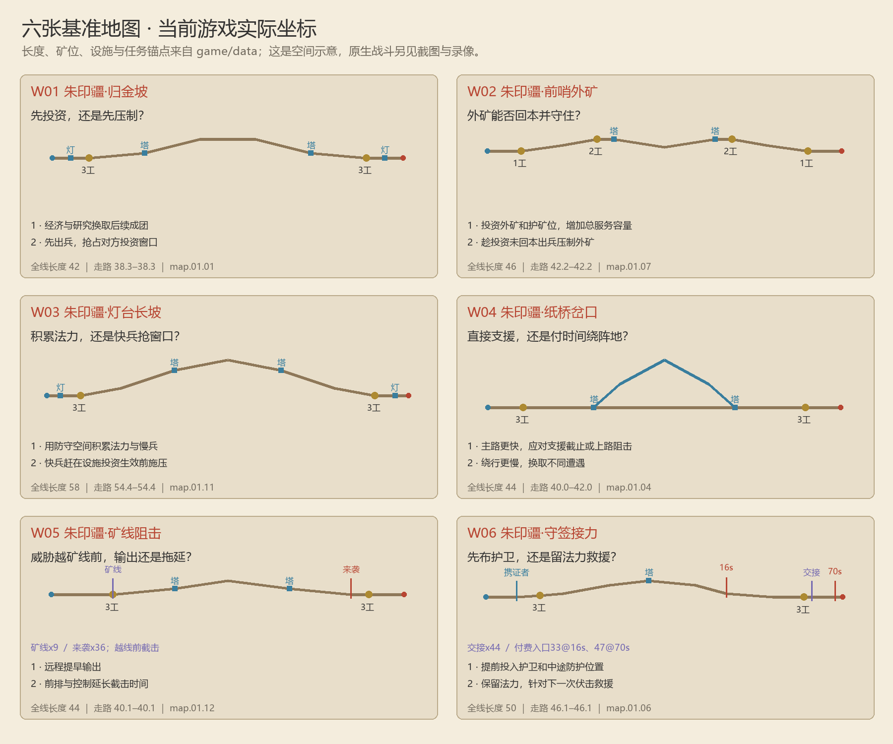

# 地图重做 · 3.0 评审入口

地图从“不同坐标的路径”改为“位置影响投资、抵达、保护和反制”的关卡。先验证六张有明确取舍的基准图，再把其空间语法用于其余194关。单局2–4个战斗兵种加1个工人，合计3–5项生产选择。

当前为 **3.0.0-rc1 地图重做评审版**。自动规则与原生代表画面已有证据；原作 HD 未在本机运行，200 关人工平衡和 Android 真机尚未验收。参数以 `game/data` 为准。

[研究依据](../../research/swords-and-soldiers-map/recheck-20261008/README.md) · [六张实际地图](01-六张基准地图.md) · [200关空间规划](02-战役空间目录.md) · [验证证据](03-实现与验证边界.md) · [素材与原生画面](../../../assets/paper-warfront/theatre-v3-gallery.html) · [Windows／APK](../../../release/3.0.0-rc1/README.md)

地图数量不是质量证明。当前200个场景记录有193种实际几何，140单线、60单处分岔；7组几何复用有明确记录。20种阶段简报配10种地域配置，是批量设计框架，并不等于200张均已逐关人工评审。

研究目录保留重做前的审计和失败证据；其中“白盒尚未接入”是当时的结论。重做后的事实以本目录及绑定散列的验证报告为准。
