# 十院逐图故事与章内行动图

200张单机地图各有战前冲突、叙事目标、实际地理动机、战后结果与稳定证据标志。剧情文本只在战前纸页与结果纸页演出；NPC对话与十院会盟不是额外生成的战斗单位。真正胜利条件仍由模拟器判断。

本次为rc29候选的设计来源，发布验收记录另见正式交付文档。章内行动图决定何时可进入某图；战场道路图决定进入后如何自动行军、探视、采金和接援，二者独立。单路用于长接援、运输与截止线，双路用于护矿、绕阵与汇流，均不强制增加岔路。

“或”允许择一路推进并回访其余纸页；“和”要求列出的关卡全部真实通关，可任选先后。证据只随本人实际完成关卡记录，跳过的支线不自动给星、资源或证据。旧线性存档保留已完成历史，schema3保留实际完成集合。

| 章 | 地区 | 最短实际通关数 | 本章最短路线与调查顺序数 | 行动设计 |

|---|---|---:|---:|---|

| 01 | 朱印疆 | 14 | 64 | 六处分支可先择一线，之后汇合。未走纸页可回访；合印门后展开第二章。 |

| 02 | 旧册泽 | 18 | 64 | 活薪与埋名、投递与发运均须取证。发行戳或本人可择一；末段同时保页、送人。 |

| 03 | 青灯都 | 17 | 32 | 入口线索择一；支付与本人必须齐备。母页后拦机，末段双样齐备再送渡。 |

| 04 | 铜折炉 | 19 | 48 | 材料、断齿、送料三处可任意先查，齐备后核账。拆架副本与工人撤离都要保全。 |

| 05 | 雁信岭 | 17 | 24 | 运费、前哨、桥口三线择一。真实时刻两处齐备；禁递契与原符都在才送渡。 |

| 06 | 契金埠 | 16 | 48 | 收入入口择一；真支付与本人、母页与清账令须齐备。撤债实证三线可择一路。 |

| 07 | 活纤林 | 17 | 64 | 种纤账与根样、批号与本人须齐备。污染来源可择一；封根令与活纸同送渡。 |

| 08 | 冻页台 | 19 | 96 | 逐步开审，再并行取证。撤约令、共审原话、本人交付三项齐备才解冻总约。 |

| 09 | 余烬渡 | 18 | 16 | 先保原名，再查归零。旧原序与删除令、原名与印头均须齐备；拒焚城并保全本人。 |

| 10 | 留白庭 | 20 | 96 | 并行复核可任选先后，关键原件须全部齐备。共阅原话、本人离城后再解除归零。 |

## 01 · 朱印疆：守住秩序

祖印碎裂后，印甲军封锁运输线。赤砚奉命收回失印，却发现被查封的村落仍在执行伪造王命。

章内推进：六处分支可先择一线，之后汇合。未走纸页可回访；合印门后展开第二章。

| 图 | 实际目标 | 叙事目标 | 地理动机 | 本图证物 |

|---|---|---|---|---|

| [001 · 归金坡的封条](maps/map.01.01.md) | destroy_base | 解除封路军营，保住矿村与纸城的联络。 | 坡道把近矿和家门连在一起，敌军推进会直接威胁回款。 | 矿村出入册 |

| [002 · 外矿的空名册](maps/map.01.02.md) | deliver_gold | 用实际归仓的金车证明外矿仍在生产。 | 近矿容量与外矿往返形成经济取舍；采到金还不算送达。 | 外矿过秤账 |

| [003 · 前哨匠的拓片](maps/map.01.03.md) | protect | 保护指定前哨直到鉴印完成。 | 目标位于前沿坡道；守在纸城会留下增援空档。 | 前哨双印拓片 |

| [004 · 封令的岔口](maps/map.01.04.md) | destroy_base | 突破封令营，取回命令签发记录。 | 实际桥路绕开主路阵地并在同一节点汇流；高低路保持各自视野。 | 岔口签发记录 |

| [005 · 账车留下的水印](maps/map.01.05.md) | deliver_gold | 完成归仓目标，追查军费和工钱的共同来源。 | 金车必须沿长运输线真实回城，护矿投入会与招募争预算。 | 金车水印 |

| [006 · 录令员走过接力岗](maps/map.01.06.md) | escort | 护送唯一携证者到真实交接位置。 | 路段和伏兵入口拉开护卫到达窗口，护送者需先铺好接力。 | 空令原稿 |

| [007 · 哨线之间的纸仓](maps/map.01.07.md) | destroy_base | 夺回旧仓，核实命令用纸的来源。 | 有限外矿位于哨线之间，收入兑现与前线抵达形成争夺窗口。 | 旧仓出库页 |

| [008 · 长援岭等来的回信](maps/map.01.08.md) | survive | 守住纸城到等待期结束，保全调令原件。 | 长坡延长援军运输；不能用瞬间出兵替代前后波衔接。 | 守军回信 |

| [009 · 桥矿的双份发运簿](maps/map.01.09.md) | destroy_base | 突破发运营，取得两路发运记录。 | 桥矿在独立桥边，护运与主路抢汇流需要不同路线承诺。 | 桥矿双簿 |

| [010 · 把原页交到人手里](maps/map.01.10.md) | escort | 护送原页到查验岗，保持携证者存活。 | 护送锚点与经济线共享防守预算，军团需衔接沿路护卫。 | 查验收件签 |

| [011 · 灯台长坡的夜班](maps/map.01.11.md) | destroy_base | 突破灯台守营，取得供能记录。 | 长援军路与法力设施形成投资时差，没有额外高地伤害。 | 灯台供能页 |

| [012 · 越矿线以前](maps/map.01.12.md) | intercept | 在巨兵跨过指定矿线之前击倒它。 | 移动巨兵与失败锚点构成实际截止；越线后同帧死亡也无法撤销失败。 | 未覆写薪册 |

| [013 · 三矿仍有姓名](maps/map.01.13.md) | deliver_gold | 完成真实归仓，建立三矿薪资对照。 | 三个矿点的容量、服务与往返时间决定工人分配。 | 三矿核对册 |

| [014 · 追印的岔路](maps/map.01.14.md) | intercept | 拦截携印巨像，保住覆写印记作检验。 | 主路移动目标与长桥援军在汇口相遇，绕行收益取决于抵达时间。 | 巨像覆写印记 |

| [015 · 护印台上的旧刻痕](maps/map.01.15.md) | protect | 保护指定鉴印塔，完成原印检验。 | 保护塔靠近外矿，护工与守塔的时间和金币相互牵制。 | 原印检验页 |

| [016 · 双路渡的证人](maps/map.01.16.md) | escort | 护送检验物到渡口交接锚点。 | 真实双路与汇流点允许选择护送路线，视野与护卫抵达分别决定风险。 | 渡口当面核验 |

| [017 · 高折原的印机](maps/map.01.17.md) | destroy_base | 突破印机守营，取得伪令母版。 | 双折坡改变军团衔接和运输耗时，地形轮廓需清晰可辨。 | 伪令母版 |

| [018 · 围灯阵的副本](maps/map.01.18.md) | protect | 保护灯阵指定前哨到副本完成。 | 桥矿与主路保护塔处于不同道路，防守任务不能用全局横坐标合并。 | 不可覆写副本 |

| [019 · 反攻页的城门](maps/map.01.19.md) | survive | 守住纸城直到撤离完成。 | 后段敌入口改变回防压力，前推与守矿需依据实际已知敌情。 | 证人撤离签 |

| [020 · 合印门不再封名](maps/map.01.20.md) | destroy_base | 打通合印门，完成第一章的交证会盟。 | 收官汇流、桥路护矿与攻城投入共同决定突破窗口。 | 第一片祖印见证 |

章节结果：赤砚解除封路，把第一片祖印交给原本被视为敌人的拾纸祭司。

## 02 · 旧册泽：让亡者作证

墨归从废纸坑召回被抹去的守城兵，他们共同指认死亡名单先于战斗印好。墨骸社因此追查命令的来源。

章内推进：活薪与埋名、投递与发运均须取证。发行戳或本人可择一；末段同时保页、送人。

| 图 | 实际目标 | 叙事目标 | 地理动机 | 本图证物 |

|---|---|---|---|---|

| [021 · 死册先于战火](maps/map.02.01.md) | destroy_base | 突破封仓营，开放死册查验。 | 近矿回款经过坡道，攻仓与护工共享前线。 | 死册纸龄样 |

| [022 · 工钱里的亡名](maps/map.02.02.md) | deliver_gold | 完成归仓，取得活人领薪记录。 | 窄近矿与长外矿的容量、往返不同，扩矿须护运。 | 活人矿薪签 |

| [023 · 没有遗骨的塔](maps/map.02.03.md) | protect | 守住指定塔，保全埋名底簿。 | 目标塔在前沿坡上，家门防线不能代替塔前接援。 | 埋名底簿拓片 |

| [024 · 两份记录的桥口](maps/map.02.04.md) | destroy_base | 突破封令营，公开两份相反记录。 | 主路和较长纸桥在同一节点汇流，各路视野独立。 | 死册签发批号 |

| [025 · 死册的发行戳](maps/map.02.05.md) | deliver_gold | 完成归仓，识别死册发行戳。 | 长金车线拉开收入到账与补兵的时间。 | 死册发行戳 |

| [026 · 猎骨者带着原页](maps/map.02.06.md) | escort | 护送指定猎骨者到交接点。 | 单路长行程经过伏兵入口与可建接力位。 | 未盖死亡章原页 |

| [027 · 发印所的纸灰](maps/map.02.07.md) | destroy_base | 突破发印守营，查清预印流程。 | 有限外矿夹在哨线间，经济兑现与接援有截止。 | 预印死册样张 |

| [028 · 长岭不等来的死人](maps/map.02.08.md) | survive | 守城到原投递信送达。 | 长坡延长援军衔接，前线投入不能放空家门。 | 长岭投递原信 |

| [029 · 桥矿同号的两袋金](maps/map.02.09.md) | destroy_base | 夺下发运营，取两路发运时辰。 | 独立桥矿与主路汇流分开，护运和攻营须选路。 | 桥库发运原簿 |

| [030 · 让活着的人收件](maps/map.02.10.md) | escort | 护送原件到共同查验岗。 | 交接锚点远于近矿，护送与回款分用护卫预算。 | 共同查验收件签 |

| [031 · 长灯台的预印夜](maps/map.02.11.md) | destroy_base | 突破灯台守营，取得预印时刻。 | 单一主路很长，法力投资和重兵抵达形成时差。 | 预印开机页 |

| [032 · 矿线前的灯腹俑](maps/map.02.12.md) | intercept | 矿线前击倒指定护符俑。 | 目标向近矿失败锚点移动，控制和伤害有真实截止。 | 护符俑销毁原令 |

| [033 · 三矿不认死亡章](maps/map.02.13.md) | deliver_gold | 完成归仓，核验三矿活人薪册。 | 三矿容量和服务时间不同，收入必须真实回城。 | 三矿活人薪册 |

| [034 · 携印俑绕不过矿线](maps/map.02.14.md) | intercept | 拦截指定携印俑，封存注销印。 | 主路目标与较长桥路援军存在汇流时间差。 | 注销印原物 |

| [035 · 让塔里的名字读完](maps/map.02.15.md) | protect | 保护指定塔，完成姓名刻痕拓读。 | 外矿与保护塔相近，守塔、护运和补兵争预算。 | 姓名刻痕检验页 |

| [036 · 渡口只收本人证词](maps/map.02.16.md) | escort | 护送本人和检验物到渡口。 | 真实双路在交接前汇流，护卫和目标的入路时机不同。 | 本人交证签 |

| [037 · 纸坡后的日期母版](maps/map.02.17.md) | destroy_base | 突破守营，封存改历母版。 | 双折坡拉开军团衔接与矿车运输，仍是一条主路。 | 改历母版 |

| [038 · 灯照下的不可改历本](maps/map.02.18.md) | protect | 保护指定塔，完成照读副本。 | 保护塔与桥矿分路，双路防守须用道路而非横坐标判定。 | 不可改历照读本 |

| [039 · 把未死的人送出去](maps/map.02.19.md) | survive | 守城到被注销者撤离完成。 | 后段敌入口改变，前推与回守矿线需重新分配。 | 未死者撤离签 |

| [040 · 把死册交给活人读](maps/map.02.20.md) | destroy_base | 突破交印门，移交死册与本人见证。 | 收官双路汇流，攻城与两路经济共同竞争投入。 | 活人共读死册签 |

章节结果：墨归送回被夺印的活人，留下不能再被复制的原始死亡名单。

## 03 · 青灯都：维持灯网供给

朝廷同一日发出互相冲突的两份王命。灯照检查纸灯网络，发现真正的王印被无限复印的命令掩盖。

章内推进：入口线索择一；支付与本人必须齐备。母页后拦机，末段双样齐备再送渡。

| 图 | 实际目标 | 叙事目标 | 地理动机 | 本图证物 |

|---|---|---|---|---|

| [041 · 同日两道王命](maps/map.03.01.md) | destroy_base | 突破封路营，核验冲突王命。 | 近矿回款经过坡道，护工与开路需共同接援。 | 同号冲突王命 |

| [042 · 灯油账上的假签](maps/map.03.02.md) | deliver_gold | 完成归仓，查清灯油支付纸签。 | 窄近矿与远外矿有不同容量和回程风险。 | 灯油原支付签 |

| [043 · 旧灯芯不能作伪](maps/map.03.03.md) | protect | 保护指定塔，完成旧灯芯检验。 | 前沿坡塔离纸城较远，接援与修复须提前投入。 | 旧灯芯检验页 |

| [044 · 桥口的复制网](maps/map.03.04.md) | destroy_base | 突破复制网守营，打开调查通路。 | 真实双路汇流，上下路敌情分别探明。 | 复制网接线页 |

| [045 · 每车金的照明费](maps/map.03.05.md) | deliver_gold | 完成真实归仓，核对照明收入。 | 长运输线延迟回款，扩工与护卫争当前预算。 | 民灯收入原账 |

| [046 · 映符卫不交替身](maps/map.03.06.md) | escort | 护送指定映符卫到查验岗。 | 单路护送经过伏兵入口，接力位需要建造预算。 | 换版接线原件 |

| [047 · 断军令，留民灯](maps/map.03.07.md) | destroy_base | 突破分线守营，取独立民灯接线图。 | 有限外矿在哨线间，收入与前线抵达形成时间窗。 | 独立民灯接线图 |

| [048 · 长岭等原信](maps/map.03.08.md) | survive | 守城到网外原信送达。 | 长坡使补兵衔接延迟，家门必须留防守余量。 | 网外迎证原信 |

| [049 · 桥库的循环副本](maps/map.03.09.md) | destroy_base | 突破桥库守营，查明副本转运。 | 独立桥矿与主路汇口分开，护运和进攻要分路。 | 循环转运原页 |

| [050 · 照读不替人裁决](maps/map.03.10.md) | escort | 护送原件到网外照读岗。 | 交接位置远于近矿，护送与回款竞争护卫投入。 | 网外照读签 |

| [051 · 长坡灯台的母页](maps/map.03.11.md) | destroy_base | 突破灯台守营，取开机母页。 | 单主路较长，供能投资与重兵抵达存在时差。 | 循环开机母页 |

| [052 · 折雷机到矿线前](maps/map.03.12.md) | intercept | 矿线前击倒指定折雷机。 | 向近矿推进的目标带来明确越线失败截止。 | 折雷销毁指令 |

| [053 · 三矿支付同一盏灯](maps/map.03.13.md) | deliver_gold | 完成归仓，建立三矿照明核账。 | 三矿容量与往返不同，真实回款决定工人分配。 | 三矿照明核账 |

| [054 · 桥边拦下印令机](maps/map.03.14.md) | intercept | 拦截指定折雷机，封存换版印。 | 主路目标与长桥援军的汇流存在到达差。 | 换版印原物 |

| [055 · 原灯不盖罪名](maps/map.03.15.md) | protect | 保护指定塔，完成原灯读样。 | 外矿与前沿塔相近，守塔、护工与修复争预算。 | 原灯读样录 |

| [056 · 双路渡的当面读灯](maps/map.03.16.md) | escort | 护送两份检验物到渡口。 | 双路汇流前可选路线，护卫抵达与视野独立计算。 | 渡口双样核验签 |

| [057 · 总换版机的纸齿](maps/map.03.17.md) | destroy_base | 突破总机守营，取得循环母版。 | 双折坡延长运输与接援，一条主路需衔接波次。 | 循环纸齿母版 |

| [058 · 只照读的留证灯](maps/map.03.18.md) | protect | 保护指定塔，完成停机读录。 | 主路目标与桥矿分开，路线防守不能只看横坐标。 | 停机公开读录 |

| [059 · 留灯给走出来的人](maps/map.03.19.md) | survive | 守城到换版工人撤离完成。 | 后段入口改变矿线回防压力，前推要留护城余量。 | 换版工人撤离签 |

| [060 · 光不能替人作证](maps/map.03.20.md) | destroy_base | 突破交印门，移交母版与民灯图。 | 收官双路汇流，护矿、桥路与攻城竞争兵力预算。 | 民灯与母版移交签 |

章节结果：灯照切断伪令灯阵，保住供民间使用的灯网，并承认没有任何印令可以替代证词。

## 04 · 铜折炉：继续交付战争机器

工坊为十院制造印机，却被告知所有故障都源于工人怠惰。榫七在停转矿炉里发现人为更改的生产顺序。

章内推进：材料、断齿、送料三处可任意先查，齐备后核账。拆架副本与工人撤离都要保全。

```mermaid

flowchart LR

  p01["01 故障不是工人的罪"]

  p02["02 运回去的原料钱"]

  p03["03 塔里保存的断齿"]

  p04["04 送料令走过纸桥"]

  p05["05 三证同页的工钱"]

  p06["06 拳兵携着装配原图"]

  p07["07 矿炉的第二套送料架"]

  p08["08 等到未改的维修信"]

  p09["09 桥库发错的机件"]

  p10["10 原图先于新机器"]

  p11["11 长坡后的齿序母片"]

  p12["12 不是巨车的夺图兵"]

  p13["13 三炉欠下的工钱"]

  p14["14 桥边截下禁运令"]

  p15["15 拆架以前验接头"]

  p16["16 双路渡送出修印图"]

  p17["17 高折原的总送料机"]

  p18["18 不再吞原页的样架"]

  p19["19 把工人从罚册放走"]

  p20["20 修印，不造新枷锁"]

  p01 --> p02

  p01 --> p03

  p01 --> p04

  j05{"全部留证"}

  p02 --> j05

  p03 --> j05

  p04 --> j05

  j05 --> p05

  p05 --> p06

  p06 --> p07

  p07 --> p08

  p07 --> p09

  j10{"择一留证"}

  p08 --> j10

  p09 --> j10

  j10 --> p10

  p10 --> p11

  p10 --> p12

  j13{"全部留证"}

  p11 --> j13

  p12 --> j13

  j13 --> p13

  p13 --> p14

  p14 --> p15

  p15 --> p16

  p16 --> p17

  p17 --> p18

  p17 --> p19

  j20{"全部留证"}

  p18 --> j20

  p19 --> j20

  j20 --> p20

```

| 图 | 实际目标 | 叙事目标 | 地理动机 | 本图证物 |

|---|---|---|---|---|

| [061 · 故障不是工人的罪](maps/map.04.01.md) | destroy_base | 突破监工营，开放工坊调查。 | 近矿回款穿过坡道，开路和护工共享前线。 | 封仓监工令 |

| [062 · 运回去的原料钱](maps/map.04.02.md) | deliver_gold | 完成归仓，核对原料付款。 | 窄近矿与远外矿有不同回款时间。 | 原料支付原账 |

| [063 · 塔里保存的断齿](maps/map.04.03.md) | protect | 保护指定塔，完成断齿检验。 | 前沿坡塔与纸城相距较远，接援需提前。 | 断齿切削检验页 |

| [064 · 送料令走过纸桥](maps/map.04.04.md) | destroy_base | 突破送料营，取调序命令。 | 双路在汇口合流，路程差影响队伍到达顺序。 | 送料调序原令 |

| [065 · 三证同页的工钱](maps/map.04.05.md) | deliver_gold | 完成归仓，建立改序责任核账。 | 长运输线延迟收入兑现，扩工和护卫争预算。 | 改序责任核账 |

| [066 · 拳兵携着装配原图](maps/map.04.06.md) | escort | 护送指定拳兵到查验岗。 | 单路伏兵入口与接力位拉开护卫衔接窗口。 | 原序装配图 |

| [067 · 矿炉的第二套送料架](maps/map.04.07.md) | destroy_base | 突破零件守营，核实覆写送料架。 | 有限外矿处于两哨之间，回款与攻坚有窗口。 | 覆写送料架样 |

| [068 · 等到未改的维修信](maps/map.04.08.md) | survive | 守城到维修原信送达。 | 长坡延迟援军，守城须保留生命与法术余量。 | 炉外维修原信 |

| [069 · 桥库发错的机件](maps/map.04.09.md) | destroy_base | 突破发运营，核验机件换签。 | 桥矿在独立道路，攻营与护运分路。 | 机件换签原表 |

| [070 · 原图先于新机器](maps/map.04.10.md) | escort | 护送原图到接头查验岗。 | 长护送线与经济线共用招募预算。 | 送料接头核验签 |

| [071 · 长坡后的齿序母片](maps/map.04.11.md) | destroy_base | 突破守营，取得齿序母片。 | 单主路很长，重兵和后灯投资的兑现不同步。 | 齿序母片 |

| [072 · 不是巨车的夺图兵](maps/map.04.12.md) | intercept | 矿线前击倒指定钩翼兵。 | 目标推进到近矿失败边界，拦截有真实截止。 | 钩翼夺图原令 |

| [073 · 三炉欠下的工钱](maps/map.04.13.md) | deliver_gold | 完成归仓，核验三炉返薪账。 | 三矿容量与往返时间不同，须分配运金投入。 | 三炉返薪账 |

| [074 · 桥边截下禁运令](maps/map.04.14.md) | intercept | 拦截指定钩翼兵，封存禁运令。 | 主路目标与长桥援军有汇流时间差。 | 送料禁运令 |

| [075 · 拆架以前验接头](maps/map.04.15.md) | protect | 保护指定塔，完成分离接头检验。 | 外矿与前沿目标塔相近，护工和守塔争预算。 | 送料分离检验页 |

| [076 · 双路渡送出修印图](maps/map.04.16.md) | escort | 护送修印原图到渡口。 | 双路与接力位分开，护卫到达要按真实道路。 | 渡口修印收件签 |

| [077 · 高折原的总送料机](maps/map.04.17.md) | destroy_base | 突破总机守营，取得完整榫图。 | 双折坡拉长运输与军团衔接，仍只有主路。 | 总送料完整榫图 |

| [078 · 不再吞原页的样架](maps/map.04.18.md) | protect | 保护指定塔，完成拆架读录。 | 保护塔与桥矿在不同道路，须分别分配护卫。 | 拆架照读副本 |

| [079 · 把工人从罚册放走](maps/map.04.19.md) | survive | 守城到工人撤离完成。 | 后段敌入口改变，前推与护矿回防要重新分配。 | 工坊工人撤离签 |

| [080 · 修印，不造新枷锁](maps/map.04.20.md) | destroy_base | 突破交印门，移交祖印榫接图。 | 收官汇流中，矿线、桥路与攻城争同一预算。 | 祖印榫接移交签 |

章节结果：榫七拆除覆写机的送料结构，将可以修复祖印的榫接图交给鸢纸行会。

## 05 · 雁信岭：快速送信完成契约

唯一能串联十院的雁路被相互矛盾的通行符封死。飞笺必须把目击者和榫接图送过被截断的汇流口。

章内推进：运费、前哨、桥口三线择一。真实时刻两处齐备；禁递契与原符都在才送渡。

```mermaid

flowchart LR

  p01["01 送得快也送不到"]

  p02["02 运费不是封口费"]

  p03["03 前哨留住慢递符"]

  p04["04 桥口没有第三条路"]

  p05["05 送令账的到账时辰"]

  p06["06 突枪客走慢的一封信"]

  p07["07 快递契约的集散营"]

  p08["08 长岭的真正投递人"]

  p09["09 桥库的转运空档"]

  p10["10 两份时刻一起送达"]

  p11["11 长坡换签的夜班"]

  p12["12 撞票车抵矿以前"]

  p13["13 三矿同寄一封信"]

  p14["14 桥边截下禁递契"]

  p15["15 慢递符也有原印"]

  p16["16 双路渡不丢慢行者"]

  p17["17 高折原的秘密时刻"]

  p18["18 公示灯照到每一页"]

  p19["19 把收件人送出城"]

  p20["20 第一封不封口的信"]

  p01 --> p02

  p01 --> p03

  p01 --> p04

  j05{"择一留证"}

  p02 --> j05

  p03 --> j05

  p04 --> j05

  j05 --> p05

  p05 --> p06

  p06 --> p07

  p07 --> p08

  p07 --> p09

  j10{"全部留证"}

  p08 --> j10

  p09 --> j10

  j10 --> p10

  p10 --> p11

  p10 --> p12

  j13{"择一留证"}

  p11 --> j13

  p12 --> j13

  j13 --> p13

  p13 --> p14

  p13 --> p15

  j16{"全部留证"}

  p14 --> j16

  p15 --> j16

  j16 --> p16

  p16 --> p17

  p17 --> p18

  p18 --> p19

  p19 --> p20

```

| 图 | 实际目标 | 叙事目标 | 地理动机 | 本图证物 |

|---|---|---|---|---|

| [081 · 送得快也送不到](maps/map.05.01.md) | destroy_base | 突破封路营，开放三处通行调查。 | 近矿回款与主路相连，开路和护工共享前线。 | 同批冲突通行符 |

| [082 · 运费不是封口费](maps/map.05.02.md) | deliver_gold | 完成归仓，核验雁路运费。 | 近矿排队与远矿回程形成扩工、护运取舍。 | 雁路运费原签 |

| [083 · 前哨留住慢递符](maps/map.05.03.md) | protect | 保护指定塔，检验慢递原符。 | 前沿坡塔与纸城分开，接援须按真实行程。 | 慢递原符检验页 |

| [084 · 桥口没有第三条路](maps/map.05.04.md) | destroy_base | 突破桥口守营，取得封路原令。 | 主路与长桥真实汇流，上下敌情分别探明。 | 独占汇口原令 |

| [085 · 送令账的到账时辰](maps/map.05.05.md) | deliver_gold | 完成归仓，核验送令账。 | 长金车线延迟到账，护运投入竞争招募预算。 | 相反封符费用账 |

| [086 · 突枪客走慢的一封信](maps/map.05.06.md) | escort | 护送指定突枪客到交接岗。 | 单路护送经过伏兵入口，接力位需要实际预算。 | 携图本人交证签 |

| [087 · 快递契约的集散营](maps/map.05.07.md) | destroy_base | 突破集散营，开放慢递原件查验。 | 有限外矿在哨线之间，收入与攻坚有截止。 | 慢递未送目录 |

| [088 · 长岭的真正投递人](maps/map.05.08.md) | survive | 守城到投递原信送达。 | 长坡延长援军接续，护城须留回防资源。 | 长岭实际投递页 |

| [089 · 桥库的转运空档](maps/map.05.09.md) | destroy_base | 突破发运营，核验转运空档。 | 独立桥矿与主路汇流分开，护运和攻营分路。 | 桥库扣件转运签 |

| [090 · 两份时刻一起送达](maps/map.05.10.md) | escort | 护送两份时刻证物到查验岗。 | 交接位置远于近矿，护送与经济线竞争护卫。 | 双时刻共同查验签 |

| [091 · 长坡换签的夜班](maps/map.05.11.md) | destroy_base | 突破守营，取得换签母页。 | 单主路较长，重兵、法力设施与前排到达错开。 | 换签夜班母页 |

| [092 · 撞票车抵矿以前](maps/map.05.12.md) | intercept | 矿线前击倒指定撞票车。 | 移动目标与近矿失败锚点构成真实截止。 | 撞票车封锁腹账 |

| [093 · 三矿同寄一封信](maps/map.05.13.md) | deliver_gold | 完成归仓，建立三矿运费核账。 | 三矿容量与往返不同，投入须对准实际周转。 | 三矿共同运费账 |

| [094 · 桥边截下禁递契](maps/map.05.14.md) | intercept | 拦截指定撞票车，保全禁递契。 | 主路目标与长桥援军存在汇流时间差。 | 撞票车禁递契 |

| [095 · 慢递符也有原印](maps/map.05.15.md) | protect | 保护指定塔，校验慢递原印。 | 前沿塔靠外矿，护工与守塔共享紧张预算。 | 慢递原印校验页 |

| [096 · 双路渡不丢慢行者](maps/map.05.16.md) | escort | 护送两份通行检验物到渡口。 | 双路在交接前汇流，护卫与携证者入路时机不同。 | 渡口解除禁递签 |

| [097 · 高折原的秘密时刻](maps/map.05.17.md) | destroy_base | 突破守营，取得秘密时刻母页。 | 双折坡拉长接援与运输，仍是一条主路。 | 秘密时刻母页 |

| [098 · 公示灯照到每一页](maps/map.05.18.md) | protect | 保护指定塔，完成公开时刻读录。 | 主路保护塔与桥矿分开，双路防守须独立分兵。 | 公开时刻读录 |

| [099 · 把收件人送出城](maps/map.05.19.md) | survive | 守城到收件人撤离完成。 | 后段入口变化使前推与矿线回防竞争兵力。 | 收件人真实撤离签 |

| [100 · 第一封不封口的信](maps/map.05.20.md) | destroy_base | 突破交印门，移交公开雁路时刻表。 | 收官双路汇流，护矿与攻城争投入窗口。 | 公开雁路移交签 |

章节结果：飞笺公开雁路时刻表，拒绝再替任何一院秘密封锁消息。

## 06 · 契金埠：保住账面财富

商盟掌握矿路与债契，却发现账面上越来越多的金币来自没有运金人的归仓记录。契衡追查被印出来的繁荣。

章内推进：收入入口择一；真支付与本人、母页与清账令须齐备。撤债实证三线可择一路。

```mermaid

flowchart LR

  p01["01 没有金车的收入"]

  p02["02 过秤以后才是金"]

  p03["03 债印盖不到姓名上"]

  p04["04 桥口的扣契营"]

  p05["05 账车送回原工钱"]

  p06["06 雇佣卫拒绝代签"]

  p07["07 债库不替工人说话"]

  p08["08 长岭等回来的清账信"]

  p09["09 桥矿的空回款"]

  p10["10 原账交到本人手中"]

  p11["11 长坡后的自动记债机"]

  p12["12 巨树清账到矿线前"]

  p13["13 三矿各收自己的工钱"]

  p14["14 桥边截下债契树"]

  p15["15 护住原契的签名栏"]

  p16["16 双路渡只收本人同意"]

  p17["17 强契母版的裂缝"]

  p18["18 保留真账，撤销强契"]

  p19["19 没有债印的出城签"]

  p20["20 工钱给活着的根"]

  p01 --> p02

  p01 --> p03

  j04{"择一留证"}

  p02 --> j04

  p03 --> j04

  j04 --> p04

  p04 --> p05

  p04 --> p06

  j07{"全部留证"}

  p05 --> j07

  p06 --> j07

  j07 --> p07

  p07 --> p08

  p07 --> p09

  j10{"择一留证"}

  p08 --> j10

  p09 --> j10

  j10 --> p10

  p10 --> p11

  p10 --> p12

  j13{"全部留证"}

  p11 --> j13

  p12 --> j13

  j13 --> p13

  p13 --> p14

  p13 --> p15

  p13 --> p16

  j17{"择一留证"}

  p14 --> j17

  p15 --> j17

  p16 --> j17

  j17 --> p17

  p17 --> p18

  p18 --> p19

  p19 --> p20

```

| 图 | 实际目标 | 叙事目标 | 地理动机 | 本图证物 |

|---|---|---|---|---|

| [101 · 没有金车的收入](maps/map.06.01.md) | destroy_base | 突破扣债营，开放收入查验。 | 坡道连接近矿与家门，开路须兼顾回款。 | 无车收入条目 |

| [102 · 过秤以后才是金](maps/map.06.02.md) | deliver_gold | 完成归仓，取得实际过秤签。 | 窄近矿与远外矿的容量、往返不同。 | 矿工实际过秤签 |

| [103 · 债印盖不到姓名上](maps/map.06.03.md) | protect | 保护指定塔，检验重复债印。 | 前沿坡塔离家门较远，护卫需走完接援路程。 | 重复债印检验页 |

| [104 · 桥口的扣契营](maps/map.06.04.md) | destroy_base | 突破扣契营，取得扣薪原条款。 | 双路在汇口相接，各路视野与路程独立。 | 未经同意扣薪条款 |

| [105 · 账车送回原工钱](maps/map.06.05.md) | deliver_gold | 完成归仓，核验原工钱支付。 | 长运输线延迟到账，运金和护卫争预算。 | 原工钱支付页 |

| [106 · 雇佣卫拒绝代签](maps/map.06.06.md) | escort | 护送指定雇佣卫到查验岗。 | 单路护送经过伏兵入口与可建接力位。 | 未签扣债原契 |

| [107 · 债库不替工人说话](maps/map.06.07.md) | destroy_base | 突破债库守营，查验借款收件记录。 | 有限外矿在哨线间，早收入须及时转为前线。 | 债库无签收件簿 |

| [108 · 长岭等回来的清账信](maps/map.06.08.md) | survive | 守城到清账原信送达。 | 长坡延迟援军补位，护城需保留法术与生命。 | 客商清账原信 |

| [109 · 桥矿的空回款](maps/map.06.09.md) | destroy_base | 突破发运营，核验空回款。 | 独立桥矿与主路汇流分开，攻营、护运需分路。 | 桥库空回款原页 |

| [110 · 原账交到本人手中](maps/map.06.10.md) | escort | 护送原账到扣债查验岗。 | 远端交接与经济运输共用护卫预算。 | 扣债共同查验签 |

| [111 · 长坡后的自动记债机](maps/map.06.11.md) | destroy_base | 突破守营，取自动记债母页。 | 单主路很长，重兵与法力设施兑现存在时差。 | 自动记债母页 |

| [112 · 巨树清账到矿线前](maps/map.06.12.md) | intercept | 矿线前击倒指定古纸树。 | 移动目标逼近近矿失败边界，拦截有明确截止。 | 古纸树清账封条 |

| [113 · 三矿各收自己的工钱](maps/map.06.13.md) | deliver_gold | 完成归仓，建立三矿工资核账。 | 三矿容量与服务不同，工人投入需对准周转瓶颈。 | 三矿独立工资账 |

| [114 · 桥边截下债契树](maps/map.06.14.md) | intercept | 拦截指定古纸树，封存旧扣债契。 | 主路目标与长桥援军有汇流时间差。 | 古纸树旧扣债契 |

| [115 · 护住原契的签名栏](maps/map.06.15.md) | protect | 保护指定塔，检验本人签名栏。 | 外矿与前沿塔相邻，护工与守塔争预算。 | 空白签名栏检验页 |

| [116 · 双路渡只收本人同意](maps/map.06.16.md) | escort | 护送本人和原契到渡口。 | 双路在交接前汇流，护卫与携证者需按入路时机接续。 | 本人撤债见证签 |

| [117 · 强契母版的裂缝](maps/map.06.17.md) | destroy_base | 突破守营，取得强契母版。 | 双折坡延长运输与队伍接续，仍是单主路。 | 强迫债契母版 |

| [118 · 保留真账，撤销强契](maps/map.06.18.md) | protect | 保护指定塔，完成公共撤债读录。 | 主路保护塔与独立桥矿分开，须分别护卫。 | 公共撤债读录 |

| [119 · 没有债印的出城签](maps/map.06.19.md) | survive | 守城到矿工撤离完成。 | 后段入口变化增加回防压力，前推需留矿线护卫。 | 无债矿工出城签 |

| [120 · 工钱给活着的根](maps/map.06.20.md) | destroy_base | 突破交印门，移交真实货运核账。 | 收官双路汇流，矿运与攻城共同争预算。 | 真实货运移交签 |

章节结果：契衡烧毁强制债契，保留真实货运账，资助难民与活纸种子的运输。

## 07 · 活纤林：隔绝外界保住古庭

古庭的活纸能保存未经印写的记忆，却正在被新王命的墨液侵蚀。纤枝沿根脉寻找旧约的原始载体。

章内推进：种纤账与根样、批号与本人须齐备。污染来源可择一；封根令与活纸同送渡。

| 图 | 实际目标 | 叙事目标 | 地理动机 | 本图证物 |

|---|---|---|---|---|

| [121 · 根脉还记得姓名](maps/map.07.01.md) | destroy_base | 突破封林营，开放根脉调查。 | 近矿回款经过坡道，开路与护工共享前线。 | 封林污染时序页 |

| [122 · 种纤钱没有回到树上](maps/map.07.02.md) | deliver_gold | 完成归仓，核验种纤支付。 | 近矿容量与外矿长回程形成扩工、护运取舍。 | 种纤原支付签 |

| [123 · 塔里的未染根样](maps/map.07.03.md) | protect | 保护指定塔，完成未染根样检验。 | 坡塔在前沿，接援与修复投入需提前。 | 未染根样检验页 |

| [124 · 桥口的投墨令](maps/map.07.04.md) | destroy_base | 突破投墨营，取得投墨原令。 | 真实双路在汇口相接，路程与视野分别计算。 | 投墨原令 |

| [125 · 一车金一圈年轮](maps/map.07.05.md) | deliver_gold | 完成归仓，核验王墨换料批号。 | 长运输线延迟收入，运金和护卫争当前预算。 | 王墨换料金车签 |

| [126 · 护仓卫带着原年轮](maps/map.07.06.md) | escort | 护送指定护仓卫到交接点。 | 单路护送经过伏兵入口，接力位需建造投入。 | 护仓卫原年轮 |

| [127 · 养根仓藏着军墨](maps/map.07.07.md) | destroy_base | 突破原料守营，核验军墨配料。 | 有限外矿在哨线间，经济兑现与接援存在窗口。 | 军墨配料原页 |

| [128 · 长岭等待旧林人](maps/map.07.08.md) | survive | 守城到旧林原信送达。 | 长坡延迟援军，家门须保留生命和法术余量。 | 旧林未染原信 |

| [129 · 桥库的两批根料](maps/map.07.09.md) | destroy_base | 突破发运营，核验两批根料。 | 独立桥矿与主路汇口分开，护运、攻营需分路。 | 两批根料装箱页 |

| [130 · 让年轮本人解释](maps/map.07.10.md) | escort | 护送本人和根料实证到查验岗。 | 远端交接与经济线共用护卫和招募预算。 | 根料共同查验签 |

| [131 · 长坡的供墨母页](maps/map.07.11.md) | destroy_base | 突破守营，取得供墨母页。 | 单主路很长，重兵抵达与后灯施工错开。 | 供墨配方母页 |

| [132 · 定身司未越矿线](maps/map.07.12.md) | intercept | 矿线前击倒指定定身司。 | 移动目标逼近近矿失败锚点，拦截有截止。 | 定身司封根令 |

| [133 · 三矿付的不是军墨](maps/map.07.13.md) | deliver_gold | 完成归仓，建立三矿种纤核账。 | 三矿容量、服务和回程不同，需分配工人投入。 | 三矿种纤核账 |

| [134 · 桥边截回封根原令](maps/map.07.14.md) | intercept | 拦截指定定身司，保全封根原令。 | 主路目标与长桥援军有汇流时间差。 | 完整封根原令 |

| [135 · 活纸不能换成副本](maps/map.07.15.md) | protect | 保护指定塔，完成活纸原样检验。 | 外矿与前沿塔相近，护工与守塔争预算。 | 活纸原样读录 |

| [136 · 双路渡开放共同记忆](maps/map.07.16.md) | escort | 护送两份检验物到渡口。 | 双路汇流前可选路线，护卫与目标入路时机不同。 | 渡口共同记忆签 |

| [137 · 高折原的污染配方](maps/map.07.17.md) | destroy_base | 突破守营，取得污染配方母版。 | 双折坡拉长运输和接援，仍为单一主路。 | 污染配方母版 |

| [138 · 把原年轮照给大家](maps/map.07.18.md) | protect | 保护指定塔，完成原年轮公开读录。 | 主路保护塔与桥矿分开，须独立分配防守。 | 原年轮公开读录 |

| [139 · 把持原片的人送走](maps/map.07.19.md) | survive | 守城到原片持有人撤离完成。 | 后段入口改变回防压力，前推不能放空家门。 | 原片持有人撤离签 |

| [140 · 活纸不由一院独占](maps/map.07.20.md) | destroy_base | 突破交印门，移交活纸原片见证。 | 收官汇流中，护矿、桥路与攻城争同一预算。 | 活纸共同移交签 |

章节结果：纤枝将最后一株活纸交给十院共同保管，不再把记忆锁在古庭内部。

## 08 · 冻页台：服从永远不变的裁定

裁院把争议证词冻结，声称这样便不会再有战争。霜律发现被冻结的不是争议，而是被反复擦除的和平协定。

章内推进：逐步开审，再并行取证。撤约令、共审原话、本人交付三项齐备才解冻总约。

```mermaid

flowchart LR

  p01["01 冻住的账仍在变"]

  p02["02 被冻结的回程"]

  p03["03 前哨冰签的旧字"]

  p04["04 桥口的撤证裁定"]

  p05["05 冰签记录战争的前一天"]

  p06["06 雪盾卫替书记携册"]

  p07["07 解冻不先烧原页"]

  p08["08 长岭不许急焚"]

  p09["09 桥库两次封存同一页"]

  p10["10 两处原序一起复审"]

  p11["11 单路长坡的三类案签"]

  p12["12 抱壶者到矿线前"]

  p13["13 三矿账里的归零年"]

  p14["14 桥边截下最后的撤约令"]

  p15["15 共审塔留住原话"]

  p16["16 双路渡送出解封记录"]

  p17["17 高折原的总冻结版"]

  p18["18 不同证词同时可读"]

  p19["19 证人不再被冻成案号"]

  p20["20 撤销以沉默判同意"]

  p01 --> p02

  p02 --> p03

  p03 --> p04

  p04 --> p05

  p04 --> p06

  j07{"全部留证"}

  p05 --> j07

  p06 --> j07

  j07 --> p07

  p07 --> p08

  p07 --> p09

  j10{"全部留证"}

  p08 --> j10

  p09 --> j10

  j10 --> p10

  p10 --> p11

  p10 --> p12

  j13{"择一留证"}

  p11 --> j13

  p12 --> j13

  j13 --> p13

  p13 --> p14

  p13 --> p15

  p13 --> p16

  j17{"全部留证"}

  p14 --> j17

  p15 --> j17

  p16 --> j17

  j17 --> p17

  p17 --> p18

  p17 --> p19

  j20{"全部留证"}

  p18 --> j20

  p19 --> j20

  j20 --> p20

```

| 图 | 实际目标 | 叙事目标 | 地理动机 | 本图证物 |

|---|---|---|---|---|

| [141 · 冻住的账仍在变](maps/map.08.01.md) | destroy_base | 突破冻仓守营，取得封存时辰。 | 近矿回款经过坡道，开路与护工共享防线。 | 冻仓封存时辰页 |

| [142 · 被冻结的回程](maps/map.08.02.md) | deliver_gold | 完成归仓，恢复可验证回款。 | 近矿容量与外矿长回程影响扩工、护运。 | 冻矿实际回款签 |

| [143 · 前哨冰签的旧字](maps/map.08.03.md) | protect | 保护指定塔，解读旧冰签。 | 前沿坡塔与纸城分离，援军需走完路程。 | 旧冰签解读页 |

| [144 · 桥口的撤证裁定](maps/map.08.04.md) | destroy_base | 突破封存营，取得撤证裁定。 | 双路汇流，主路较短，纸桥较长且独立探视。 | 沉默撤证原裁定 |

| [145 · 冰签记录战争的前一天](maps/map.08.05.md) | deliver_gold | 完成归仓，核验撤证冰签。 | 长金车线延迟到账，运金与护卫争当前预算。 | 战前撤证归仓签 |

| [146 · 雪盾卫替书记携册](maps/map.08.06.md) | escort | 护送指定雪盾卫与原册到岗。 | 单路护送经过伏兵入口，可建接力位需预算。 | 书记原册交接签 |

| [147 · 解冻不先烧原页](maps/map.08.07.md) | destroy_base | 突破封存库，取得逐页解冻原序。 | 有限外矿处于哨线间，早收入须及时兑现。 | 逐页解冻原序 |

| [148 · 长岭不许急焚](maps/map.08.08.md) | survive | 守城到解冻支援接上。 | 长坡延迟援军补位，护城须留法术与生命余量。 | 长岭保页守城签 |

| [149 · 桥库两次封存同一页](maps/map.08.09.md) | destroy_base | 突破发运营，核验重复封存。 | 独立桥矿与主路汇口分开，防守按道路分配。 | 桥库重复封存原簿 |

| [150 · 两处原序一起复审](maps/map.08.10.md) | escort | 护送原序和两处见证到复审岗。 | 远端交接与经济线共享护卫、招募预算。 | 双处原序复审签 |

| [151 · 单路长坡的三类案签](maps/map.08.11.md) | destroy_base | 突破守营，取得分类母页。 | 单主路较长，后灯和重兵到达存在投资时差。 | 旧约分类母页 |

| [152 · 抱壶者到矿线前](maps/map.08.12.md) | intercept | 矿线前击倒指定抱壶者。 | 移动目标逼近近矿失败边界，拦截有截止。 | 抱壶者焚页原令 |

| [153 · 三矿账里的归零年](maps/map.08.13.md) | deliver_gold | 完成归仓，核验三矿旧年账。 | 三矿容量、服务与回程不同，需分配运金投入。 | 三矿归零旧年核账 |

| [154 · 桥边截下最后的撤约令](maps/map.08.14.md) | intercept | 拦截指定抱壶者，封存撤约原令。 | 主路目标与长桥援军有汇流时间差。 | 最后撤约原令 |

| [155 · 共审塔留住原话](maps/map.08.15.md) | protect | 保护指定塔，完成原和平约解读。 | 外矿与前沿保护塔相近，守塔、护工争预算。 | 共审原话读录 |

| [156 · 双路渡送出解封记录](maps/map.08.16.md) | escort | 护送原册本人到渡口。 | 双路在交接前汇流，护卫与携证者时机不同。 | 解封原册本人交付签 |

| [157 · 高折原的总冻结版](maps/map.08.17.md) | destroy_base | 突破守营，取得总冻结母版。 | 双折坡延长运输与军团接续，仍为单主路。 | 总冻结母版 |

| [158 · 不同证词同时可读](maps/map.08.18.md) | protect | 保护指定塔，完成解封共同读录。 | 主路保护塔与桥矿分开，须独立布防。 | 解封共同读录 |

| [159 · 证人不再被冻成案号](maps/map.08.19.md) | survive | 守城到作证者撤离完成。 | 后段入口变化增加回防压力，前推须留护城余量。 | 作证者真实撤离签 |

| [160 · 撤销以沉默判同意](maps/map.08.20.md) | destroy_base | 突破交印门，移交解封旧约。 | 收官双路汇流，护矿与攻城争同一预算。 | 解封旧约移交签 |

章节结果：霜律解冻十院旧约，撤销所有以沉默代替证据的裁决。

## 09 · 余烬渡：靠愤怒摧毁所有印院

印院战争后的难民被统一记录为灰烬。烬禾带着幸存者穿过旧战场，把十院收集的证据送到祖印核心。

章内推进：先保原名，再查归零。旧原序与删除令、原名与印头均须齐备；拒焚城并保全本人。

| 图 | 实际目标 | 叙事目标 | 地理动机 | 本图证物 |

|---|---|---|---|---|

| [161 · 灰烬栏里还有活人](maps/map.09.01.md) | destroy_base | 突破封路营，开放姓名仓查验。 | 近矿回款经过坡道，开路与护工共用前线。 | 幸存者灰烬注销页 |

| [162 · 灰烬也领了工钱](maps/map.09.02.md) | deliver_gold | 完成归仓，核验幸存者薪签。 | 窄近矿与远外矿有不同容量、回程风险。 | 幸存矿工原薪签 |

| [163 · 残旗记得失踪者](maps/map.09.03.md) | protect | 保护指定塔，完成残旗姓名拓读。 | 前沿坡塔离纸城较远，接援与修复要提前。 | 残旗姓名拓片 |

| [164 · 桥口不给灰烬通行](maps/map.09.04.md) | destroy_base | 突破注销营，取得拒行原令。 | 真实双路汇流，各路路程和视野独立。 | 灰烬拒行原令 |

| [165 · 同一家人的回款补丁](maps/map.09.05.md) | deliver_gold | 完成归仓，核验家庭薪资原签。 | 长运输线延迟到账，护运和招募争预算。 | 家庭薪资补丁原签 |

| [166 · 双刃徒先收好证物](maps/map.09.06.md) | escort | 护送指定双刃徒到交接点。 | 单路护送经过伏兵入口，可建接力位需预算。 | 家庭原签本人交证页 |

| [167 · 合页库不收新战损](maps/map.09.07.md) | destroy_base | 突破合页库，保全原证排序簿。 | 有限外矿在哨线间，收入与攻坚有窗口。 | 原证排序簿 |

| [168 · 长岭等最后一封回信](maps/map.09.08.md) | survive | 守城到最后回信送达。 | 长坡延迟援军衔接，护城须保留生命与法术。 | 祖印外门原回信 |

| [169 · 桥库不拿伤兵作燃料](maps/map.09.09.md) | destroy_base | 突破发运营，核验护卫接班原页。 | 独立桥矿与主路汇口分开，护运、攻营需分路。 | 护卫接班原页 |

| [170 · 余粮护送最后一名携证者](maps/map.09.10.md) | escort | 护送原件本人到查验岗。 | 远端交接与经济线共用护卫预算。 | 祖印通路查验签 |

| [171 · 单路长坡的旧归零页](maps/map.09.11.md) | destroy_base | 突破守营，取得旧归零原序。 | 单主路很长，重兵与后灯投资的兑现错开。 | 旧归零原序页 |

| [172 · 折兽到矿线以前](maps/map.09.12.md) | intercept | 矿线前击倒指定页界折兽。 | 移动目标逼近近矿失败边界，拦截有明确截止。 | 折兽姓名删除令 |

| [173 · 三矿都有人活下来](maps/map.09.13.md) | deliver_gold | 完成归仓，核验三矿幸存名账。 | 三矿容量、服务和往返不同，需分配工人投入。 | 三矿幸存原名账 |

| [174 · 桥边截回删除印](maps/map.09.14.md) | intercept | 拦截指定折兽，保全删除印。 | 主路目标与长桥援军有汇流时间差。 | 折兽删除印原物 |

| [175 · 原名不是灰烬编号](maps/map.09.15.md) | protect | 保护指定塔，完成原名对照。 | 外矿与前沿塔相近，护工和守塔争预算。 | 幸存原名对照页 |

| [176 · 双路渡把证物交给本人](maps/map.09.16.md) | escort | 护送两份原物到渡口交接。 | 双路在交接前汇流，护卫与携证者入路时机不同。 | 祖印外门本人交证签 |

| [177 · 旧战场不是空白](maps/map.09.17.md) | destroy_base | 突破守营，取得旧归零母版。 | 双折坡延长运输与队伍接续，仍为单主路。 | 旧战火归零母版 |

| [178 · 拒绝焚城，先守读名塔](maps/map.09.18.md) | protect | 保护指定塔，完成幸存者读名录。 | 主路保护塔与桥矿分开，须分别布防。 | 幸存者共同读名录 |

| [179 · 把人送走再谈报复](maps/map.09.19.md) | survive | 守城到幸存者撤离完成。 | 后段敌入口变化增加矿线回防压力。 | 幸存者真实撤离签 |

| [180 · 带名字去问归零印](maps/map.09.20.md) | destroy_base | 突破交印门，移交幸存姓名见证。 | 收官双路汇流，护矿、桥路与攻城竞争预算。 | 幸存姓名移交签 |

章节结果：烬禾阻止报复性焚城，带着十院证据和活纸抵达留白庭。

## 10 · 留白庭：接受无争议的空白世界

白匣发现归零印以消除记忆阻止战争，又以同样的消除制造下一场战争。他必须在自己的档案军追捕下解开覆写程序。

章内推进：并行复核可任选先后，关键原件须全部齐备。共阅原话、本人离城后再解除归零。

```mermaid

flowchart LR

  p01["01 自己的档案也被改了"]

  p02["02 让难民的钱真正归仓"]

  p03["03 留名塔保存个人原样"]

  p04["04 桥口不再指向删除"]

  p05["05 真支付与假收入分开"]

  p06["06 映界卫携唯一原程序"]

  p07["07 覆写机的公共接线"]

  p08["08 长岭保住共阅收件处"]

  p09["09 桥库不准独占原件"]

  p10["10 原序由多方共同读"]

  p11["11 单路长坡的三项程序"]

  p12["12 重锤卫到矿线以前"]

  p13["13 三矿共账仍有不同签名"]

  p14["14 桥边截回覆写印头"]

  p15["15 留名塔不归某一院"]

  p16["16 双路渡必须本人交付"]

  p17["17 归零最初的恐惧"]

  p18["18 共阅灯不改任何人的话"]

  p19["19 留名以后仍要活着出去"]

  p20["20 留名印不再覆写本人"]

  p01 --> p02

  p01 --> p03

  j04{"全部留证"}

  p02 --> j04

  p03 --> j04

  j04 --> p04

  p04 --> p05

  p04 --> p06

  j07{"全部留证"}

  p05 --> j07

  p06 --> j07

  j07 --> p07

  p07 --> p08

  p07 --> p09

  j10{"全部留证"}

  p08 --> j10

  p09 --> j10

  j10 --> p10

  p10 --> p11

  p10 --> p12

  j13{"全部留证"}

  p11 --> j13

  p12 --> j13

  j13 --> p13

  p13 --> p14

  p13 --> p15

  p13 --> p16

  j17{"全部留证"}

  p14 --> j17

  p15 --> j17

  p16 --> j17

  j17 --> p17

  p17 --> p18

  p18 --> p19

  p19 --> p20

```

| 图 | 实际目标 | 叙事目标 | 地理动机 | 本图证物 |

|---|---|---|---|---|

| [181 · 自己的档案也被改了](maps/map.10.01.md) | destroy_base | 突破封档营，开放原始记录查验。 | 近矿回款经过坡道，开路与护工共享前线。 | 白匣原笔迹账页 |

| [182 · 让难民的钱真正归仓](maps/map.10.02.md) | deliver_gold | 完成归仓，核验未注销回款。 | 近矿容量与外矿长回程不同，扩工须护运。 | 未注销实际回款签 |

| [183 · 留名塔保存个人原样](maps/map.10.03.md) | protect | 保护指定塔，完成留名原样比对。 | 坡塔与纸城分离，接援、修复须提前。 | 个人留名原样检验页 |

| [184 · 桥口不再指向删除](maps/map.10.04.md) | destroy_base | 突破删入口守营，取得路标原令。 | 真实双路汇流，各路视野与路程独立。 | 删除入口路标原令 |

| [185 · 真支付与假收入分开](maps/map.10.05.md) | deliver_gold | 完成归仓，核验真实支付页。 | 长运输线延迟到账，运金与护卫争预算。 | 真实支付原页 |

| [186 · 映界卫携唯一原程序](maps/map.10.06.md) | escort | 护送指定映界卫与原程序到岗。 | 单路护送经过伏兵入口，接力位需实际建造。 | 归零原件本人交接签 |

| [187 · 覆写机的公共接线](maps/map.10.07.md) | destroy_base | 突破接线守营，取得覆写输入原序。 | 有限外矿在哨线间，经济兑现与接援有窗口。 | 归零输入原序 |

| [188 · 长岭保住共阅收件处](maps/map.10.08.md) | survive | 守城到共阅支援接上。 | 长坡延迟援军，护城须留生命与法术余量。 | 共阅收件守城签 |

| [189 · 桥库不准独占原件](maps/map.10.09.md) | destroy_base | 突破发运营，核验原件分流。 | 独立桥矿与主路汇口分开，须分别分配护卫。 | 原件双路分流表 |

| [190 · 原序由多方共同读](maps/map.10.10.md) | escort | 护送原序到共同查验岗。 | 远端交接与经济运输共用护卫预算。 | 程序原序共读签 |

| [191 · 单路长坡的三项程序](maps/map.10.11.md) | destroy_base | 突破守营，取得三项程序母页。 | 单主路较长，重兵与后灯投资的兑现错开。 | 三项程序母页 |

| [192 · 重锤卫到矿线以前](maps/map.10.12.md) | intercept | 矿线前击倒指定重锤卫。 | 移动目标逼近近矿失败锚点，拦截有截止。 | 重锤卫销证原令 |

| [193 · 三矿共账仍有不同签名](maps/map.10.13.md) | deliver_gold | 完成归仓，建立保留本人签的共账。 | 三矿容量、服务与回程不同，需分配运金投入。 | 三矿保名共同核账 |

| [194 · 桥边截回覆写印头](maps/map.10.14.md) | intercept | 拦截指定锤卫，保全覆写印头。 | 主路目标与长桥援军存在汇流时间差。 | 完整覆写印头 |

| [195 · 留名塔不归某一院](maps/map.10.15.md) | protect | 保护指定塔，完成多签原样比对。 | 外矿与前沿塔相近，守塔与护工争预算。 | 留名多签原样比对页 |

| [196 · 双路渡必须本人交付](maps/map.10.16.md) | escort | 护送程序原件本人到渡口。 | 双路在交接前汇流，护卫与携证者入路时机不同。 | 原程序渡口本人签 |

| [197 · 归零最初的恐惧](maps/map.10.17.md) | destroy_base | 突破守营，取得总归零母版。 | 双折坡延长运输与接援，仍是单主路。 | 总归零循环母版 |

| [198 · 共阅灯不改任何人的话](maps/map.10.18.md) | protect | 保护指定塔，完成共阅原话读录。 | 主路保护塔与桥矿分开，须独立布防。 | 共阅原话公共读录 |

| [199 · 留名以后仍要活着出去](maps/map.10.19.md) | survive | 守城到共同作证者撤离完成。 | 后段入口变化增加矿线回防压力，前推须留护城兵。 | 共同作证者撤离签 |

| [200 · 留名印不再覆写本人](maps/map.10.20.md) | destroy_base | 突破最终守营，完成归零停机交证。 | 收官双路汇流，矿线、桥路与攻城争投入窗口。 | 十院留名共同校印签 |

章节结果：十院拆解归零印，将祖印改为只能共同见证、不能覆写个人记忆的留名印。战场成为可读的旧页，而不是被抹去的历史。

## 结局

十院拆解归零印，将祖印改为只能共同见证、不能覆写个人记忆的留名印。战场成为可读的旧页，而不是被抹去的历史。

552种是各章最短路线及必须并行调查的先后顺序之和，不是所有跨章组合、回访顺序、正常战斗胜利或真人完整体验的统计。
