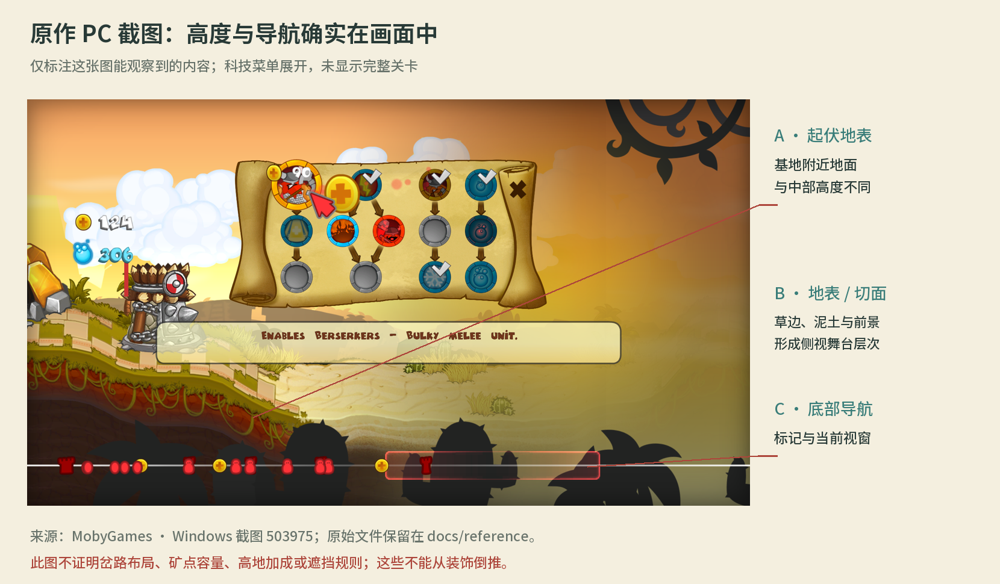

# 地图机制与关卡案例

事实依据见 [台账](01-来源与事实台账.md)。下文把原作事实与设计推导分开，不把本作公式和方案写成原作参数。

## 1. 正确的地图模型

初代压缩了 RTS 的单位操作负担，但没有取消空间选择。更准确的模型是：**横向为主的自动行军路径，部分关卡局部分岔；矿区和建筑地点附着其上；关卡脚本规定任务与变化。** 它既包含直接对推，也能用路标、保护对象和截击边界形成不同任务。

把“自动朝敌方前进”理解成“任意时刻只存在一条直线”，会漏掉分岔选择；把上下路线理解成 MOBA 的三条独立兵线，又会引入原作没有被证实的操作体系。路标把一次点击转化成后续来兵的路线承诺，已经走入一段路的单位继续自主作战。切换时机、归属权限和精确批次边界需要在 PC 实机补证。

地图应拆成四层：可行走结构；矿点/建造位/出入口；目标与事件；美术与信息表达。四层共同构成一关，但不能互相冒充。高低起伏进入渲染与定位，是否影响速度/射程要由明文规则决定。开发资料里的视觉雾也不能直接变成战争迷雾。

## 2. 经济存在于可受攻击的空间里

原作开发者把矿点位置作为关卡数据，Nintendo 的战术说明又明确描述了推进深入工人区的攻守变化。由此可得：玩家购买工人，不只是提高一个金币每秒数字，还在承诺一条运输路线和一段暴露时间。

对于本作白盒，可以用下面的模型预测安全状态的收入，然后用实际日志检验：

`单个工人收益率 ≈ 每趟货量 ÷（去程时间 + 采集时间 + 回程时间 + 交货时间 + 等待时间）`

这是分析公式，**不是已测得的原作矿工公式**。矿点距离、矿位服务能力、多个矿的分配、工人被迫停留或死亡，都会影响收益。近矿与外矿应产生可观察的风险取舍；不是换一个矿图标，仍用同一计时器自动发钱。原作矿位容量和自动分配细节仍待查，不能照抄玩家猜测。

攻方进入对手矿区后，要花时间处理工人和其他目标；守方的生产源更近，有机会把远程积在后面完成反扑。这个空间关系解释了为什么“已经推到家门口”不等于“对局已经赢了”。地图设计要容纳经济压制、塔下稳住、补兵成团和反击。

## 3. 行军距离就是增援延迟

在自动行军游戏里，买兵是延迟生效的承诺。相同兵种换一个基地位置、走另一条路，抵达交锋的时间就不同。地图过短，会压缩研究、回法和转型窗口；地图过长，会放大守方补兵优势、慢兵迟到和设施积累。A02 对中国阵营的大地图优势给出了直接的开发者佐证。

设计分析应同时记录生产耗时、路径长度和单位速度。白盒可用 `增援到达时间 ≈ 生产完成时间 + 路长 / 移速` 作预测；双方同一时刻出发、不接战时的相遇时间可用 `两军间距 /（两军速度之和）` 估计。这些都是理想运动模型，接敌射程、控制、拦截和战斗会让实测改变。

岔路改变的不只是谁从上面走。短路可能先接敌，长路可能避开压制但赶不上保护目标；汇流让两批来兵的相位重新影响军队组成。地图需要检验到达时间是否造成真实选择，而不是把两条路做成相同长度、相同敌情的装饰分叉。

## 4. 建筑位决定可守住的投资

原作的设施位置属于地图设计，较大的可防守空间又会帮助依赖设施回法的阵营。建筑位因此涉及两个问题：能否投入，投入后能否保住。一个偏后安全位、一个位于矿区的防守位、一个更靠前的进攻位，承担的风险和作用不同。

HD 官方成就还要求摧毁施工中的塔，说明施工阶段本身可以成为反制窗口。当前本作建筑确认后立即完成，正好抹掉了这种窗口。后续设计应明确建造时长、受击、完成、摧毁和槽位释放，不靠“出现一座塔”的动画假装具有施工规则。

塔射程应与矿区、汇流口及增援入口一起画在白盒中。上下分路时，塔能否跨路攻击需明确；只有射程圆与画面位置相符，玩家才知道投资保护了哪段战线。

## 5. 地图也组织法术与战斗的观察

自动部队在交锋、塔位或任务目标附近聚集，给范围攻击、治疗与控制创造窗口。这里的“瓶颈”首先是路径和事件组织出的交战密度，不能擅自增加自由 RTS 的碰撞挤门、坡口卡单位等规则。

分岔后，目标所在的路线、高度、脚下锚点都必须参与选取；同 X 的上下单位不能被点击系统当成同一个目标。原作跨路射击和范围法术距离尚未测得，本作应明确自己的近战连通、远程二维射程、范围命中与位移边界，再让预览准确表达规则。

地图特有的爽感包括：改路让下一批兵在汇流口接上；在矿线前最后一刻截住巨人；守住被集火的塔后完成回法积累；远途推进抵达敌方经济区后顶住反扑。这些结果需要位置、时间和对象状态支撑，不能只靠屏幕震动。

## 6. 关卡案例：把任务放回地图

以下编号按原作阵营章节记录。A04 为 PC HD 官方成就；它证实挑战条件，**不自动证明同一条就是主胜利/失败条件**。B 类解法仅用于说明空间组织，不抄成唯一通关策略。

| 案例 | 已取得的证据与版本 | 地图在这里做了什么 | 对本作的启示 |
| --- | --- | --- | --- |
| 维京 3 | B01：iOS 的分岔、路标、有限资源及招募限制记录；A04：清掉该关全部单位的额外挑战 | 路线、资源与敌情形成取舍，不能只按经济扩张开局 | 使用有限兵力/预置资源的地图教学；箱子数和布局不照搬 |
| 维京 4 | A04：拆敌基地成就；B04：PS3 记载攒金或拆基地的不同完成路径 | 经济目标可能和远端军事目标并存 | 任务屏要清楚表达并列目标；PC 主条件仍待补证 |
| 维京 7 | A04：全塔保全成就；B04：PS3 指向下路与布置远程护塔的解法 | 多个塔是沿地图分布的保护对象，路径决定支援能否赶到 | 不能用“基地血量高”代替“指定设施存活” |
| 维京 10 | A04：不用 Mr Thor 帮助过关的挑战；B04：PS3 的受压触发帮助记录 | 关卡援助和压力可以与地点/对象状态有关 | 援军触发、预警与额外评价应有独立规则，阈值待核 |
| 阿兹特克 2 | A04：巨人抵达矿点前击杀；B04：PS3 指出截击场景 | 矿点变成不可越过的边界，移速、路长和控制决定窗口 | 实现对象越线/到达判定，不能只有拆基地 |
| 中国 3 | A04：零忍者死亡；B04：PS3 猴子与路标保护解法 | 路线和保护对象共同约束玩家的节奏 | 给目标单位稳定 ID，记录对象死亡、通过节点与护送状态 |
| 中国 7 | A04：PC HD 至少 15 名火箭兵存活；B04：PS3 数字为 17 | 让队伍成形并保持存活，需要保护前排和组织到达 | 数量/存活评价独立于主胜负；严禁把平台差异混成统一数值 |
| 施工中塔 | A04：用 Rage 破坏正在施工的塔 | 位置与建造时间产生可攻击窗口 | 设施至少有施工/完成/死亡三种模拟状态 |

上述案例足以否定“所有关卡只是同一张图、换敌兵、拆基地”的研究模型；但不声称已逐关测得完整地图或主任务规则。Chief Meat 等 DLC 成就另立范围，二代新增的随机资源机制也不并入本体。

## 7. 地图阅读与美术

画面中的起伏地表、草边切面和前景层次帮助玩家辨认舞台，底部导航负责全局定位。精美远山只是其中一层。完整地图表达还需要：可走的地表连续性；分岔/汇流入口；可操作路标；矿位与建造位；当前镜头范围；单位关系与任务标记。视觉装饰与可操作设施必须能区分。

本作纸艺主题适合把高低路径做成折页，把地表边缘做成纸边切面，把路标做成可翻纸签。折痕须服务路径识别，不能让不可走的山景看起来像第二条路。同样，装饰纸灯不能伪装成可产法设施。先在白盒里看懂路线与任务，再让素材生成补齐纹理、背景和构件。

## 8. 系统性结论

地图至少应回答六个可测试问题：走哪条路；什么时候到达；钱从哪里安全运回；设施建在哪里才有用；现在应看哪一段交锋；这关保护/阻止/完成的对象在哪里。只调整敌军参数，主要回答了“打谁”；只换背景，主要回答了“看起来在哪里”。这就是当前版本对标缺失的根源。
