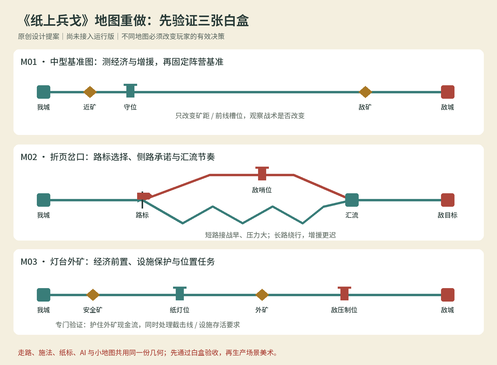

# 地图重设计约束

状态：研究后的实施契约提案，**未接入当前 1.0**。适用于后续 Godot 版本；不修改原作事实和已交付包记录。依据见 [机制研究](02-地图机制与关卡案例.md)，现状见 [审计](03-当前版本差距审计.md)。所有示例位置、时间和收益均为本作试验，不冒称原作数值。

## 1. 不再以换背景定义地图

一张有效地图必须拥有自己的路径、基地/出生点、矿点/归仓点、建造位、任务节点与镜头范围。两张地图即便共用美术，只要改变路线、经济风险或任务窗口，就可以是不同的地图；只有背景不同、决策完全一致，登记为主题变体。

每张地图交付“几何定义 + 决策说明 + 情境配置 + 实测日志 + 画面”。决策说明至少写明：什么投资或选路在这里变得更有价值，为什么，代价是什么，另一种打法何时仍成立。不得用“增加趣味”“地形丰富”代替说明。

## 2. 六项硬约束

| 编号 | 约束 | 验收证据 |
| --- | --- | --- |
| MAP01 | 自动行军沿可编辑路径进行；局部分岔经路标选择 | 切路前后不同批次的 edge/节点日志，旧批次不瞬移 |
| MAP02 | 金币来自地图上工人的真实往返，矿点与服务能力可配置 | 各矿分配、等待、载货、归仓、死亡损失日志 |
| MAP03 | 基地、槽位、矿点和目标逐地图编写 | 切换地图后初始位置及至少一种决策/时序改变 |
| MAP04 | 地表、单位、选取、射程、粒子、纸标与小地图使用同一空间定义 | 上下同 X 单位的选取与伤害对照；脚底无悬浮 |
| MAP05 | 关卡主胜败、加分条件与事件触发分开 | 到达/越线/保护/时间/基地等判定日志，失败原因可见 |
| MAP06 | AI 用公开地图与相同命令处理路线、设施、矿线和任务 | 无瞬移补兵、无免费改图、无隐藏追加金币的对照录像/日志 |

不自动引入战争迷雾、高地伤害、沼泽减速、随机宝箱、自由摆建筑或逐兵移动。后续若增加这些原创规则，必须单独论证并清楚标识，不能用作原作对标证据。

## 3. 地图数据契约

建议新增 `game/data/maps/*.json`，战役配置引用 map ID 和 scenario ID。模拟加载一份地图实例，画面与 UI 只读同一实例。地图字段应至少包含：

| 数据域 | 必需字段 / 责任 |
| --- | --- |
| 基础 | id、schema_version、世界边界、主题引用、初始镜头、导航投影 |
| 路径图 | nodes 的位置/类型；edges 的起止/曲线/可通行方向；明确汇流与终点 |
| 地表 | 每段路径的高度采样、表面类别、装饰禁放区；类别默认只影响表现 |
| 出入口 | 每方基地、招募出生锚点、退回归仓节点；无通路时加载失败 |
| 路标 | 控制方、分岔节点、可选出口、初始选择、可交互状态、选择生效边界 |
| 矿点 | id、位置/路径锚点、可服务方、同时服务数、采集时长、有限/无限资源 |
| 建造位 | id、位置/路径锚点、可服务方、允许类型、施工/占用状态 |
| 任务区域 | 有稳定 ID 的到达节点、截击线、保护对象锚点和触发区域 |
| 表现 | 地表构件、背景层、视差系数、可操作物识别色、地标引用 |

最小分岔拓扑示例（只展示结构，不是完整配置）：

```json
{
  "id": "map.fold-junction",
  "schema_version": 2,
  "nodes": [
    {"id": "west", "position": [0, 0]},
    {"id": "fork", "position": [16, 0]},
    {"id": "merge", "position": [40, 0]},
    {"id": "east", "position": [56, 0]}
  ],
  "edges": [
    {"id": "west-fork", "from": "west", "to": "fork", "controls": [[0,0],[16,0]]},
    {"id": "upper", "from": "fork", "to": "merge", "controls": [[16,0],[24,-3],[34,-3],[40,0]]},
    {"id": "lower", "from": "fork", "to": "merge", "controls": [[16,0],[24,1],[32,4],[40,0]]},
    {"id": "merge-east", "from": "merge", "to": "east", "controls": [[40,0],[56,0]]}
  ],
  "route_signs": [{"id":"sign.west","node":"fork","owner":0,"choices":["upper","lower"],"initial":"lower"}]
}
```

正式数据还须给出双方反向可行路径、矿工往返方案与必需对象。不能因为画了示例便把没有回程或敌方出路的图导入游戏。

## 4. 模拟、攻击与事件

单位用 `edge_id + 沿边距离 s` 表示行军位置，并由曲线采样得到世界足点；路标在进入下一条边时确定选择。这是本作拟定的确定性规则，PC 原作的精确选择时机仍待核对。已经进入边的单位继续前进，后续切换改变后来者；默认不追加逐兵控制。

近战接敌首先检查同一路段/共同节点附近的连通性，不能仅用 X 差。远程采用明文二维世界射程与允许攻击区域；范围法术采用同一世界空间内的圆或明确的路径区域，瞄准预览和命中共用计算。跨路攻击是需要验证的本作规则选择，不冒称已复制原作。路径的绘制间距不能替代命中定义。

出生、击退/突进、转换、复制、召唤、纸标、拾纸、投射物与受击反馈全部保留有效的路径锚点。位移落点必须仍在合法路径，复制/复兵不能跳到相同 X 的另一条路。弹体与击中对象使用世界足点及角色攻击锚点；表现抛物线不改变逻辑命中。

工人分配以可达矿点与服务能力为依据，不能随机塞到无法归仓的上路。安全/外矿及分配逻辑是本作白盒可测试参数，原作容量未证实前不复制讨论帖中的数字。工人死亡丢失货物；矿被压制之后的实际收入下降应能从日志看见。

建筑拥有 `constructing / active / destroyed`，施工期间的生命、攻击能力、费用、完成与槽位释放必须明确。灯台只有 active 时提供法力；护矿塔的作用由位置和射程决定。施工进度与受击同步显示，破坏后的状态只有一个来源。

事件至少覆盖 node_reached、objective_line_crossed、protected_actor_died、building_completed/destroyed、resource_delivered 和 timer_elapsed。主胜利、主失败、额外评价都消费这些事件；胜败优先级、同一步双条件和已结算后停止触发须明确。

## 5. 三张白盒优先验证



| 白盒 | 核心问题 | 对照变量 | 过关标准 |
| --- | --- | --- | --- |
| M01 中型基准 | 同规则经济与增援是否可理解 | 近/远矿距离；后方/前置槽位；再做短/长版本 | 日志能解释第一笔回款、首次接战、增援抵达与设施存活的变化 |
| M02 折页岔口 | 局部选路能否产生真实战术承诺 | 短路较早接战，长路较晚汇流；不同压制位 | 两种路线在不同敌情下各有价值；切路只影响后续过节点单位；无跨路错误近战 |
| M03 灯台外矿 | 地图能否组织经济风险与位置任务 | 安全矿/外矿、灯位/塔位、截击线或保护对象 | 一种打法扩张保外矿，另一种先守设施再反击；任务能以节点或对象状态结算 |

三图是系统验证载体，不是三幅新背景，也不是立即扩写十五关的任务量承诺。先固定 M01 作为平衡参照，再用另外两图检验“某一地图上强”是否被误判成“兵种永远强”。每个阵营组合都记录地图因素，依赖灯台回法的灯符尤其需要设施位置对照。

## 6. 关卡体系重排原则

线性关卡应让“学到的操作”与“地图要求”同时前进。初步教学顺序：近矿与招募 → 对手矿区压制/增援反扑 → 前置塔位与施工保护 → 单处分岔/路标 → 对象存活或矿线截击 → 带多项约束的综合对战。后续章节换阵营时复用已学过的空间语法，再引入回法/复兵/复制与地图的组合。

一关只新增一个主要空间概念，战前说明和地图高亮指向实际节点。不要同一关首次引入分岔、护送、建造限制和多目标倒计时。目标评价与故事话术必须对应同一条逻辑：提示“守灯”，至少要有需要保护的灯及相关目标/评价；提示“绕路”，至少要有可选择路径。

主任务可以是拆城、达到经济目标、拦截指定敌人、对象到达或守住时间；这些是本作内容方案。对应原作案例可提供研究依据，具体本作胜败仍需白盒验证。额外星章另设对象零死亡、设施完整、完成速度等，不能把主失败条件藏在星章里。

## 7. UI、镜头与 AI

路标要有大于装饰的点击区域、箭头方向、可操作归属与立即反馈；点击不打开复杂单位命令菜单。瞄准模式下不能误切路标，拖动画面结束不能误施法。Android 触控区域可比视觉图案大，但目标高亮必须准确。

小地图展示真实分岔、汇流、矿点、设施、对象标记与当前视窗；上下同 X 的路线要能区分。镜头导航增加矿区、保护对象、分路威胁定位，不能用唯一 front 值代表所有战况。垂直空间影响可读性时先调整地图构图和镜头，不缩小所有单位到不可点选。

AI 根据每条路线的敌情、到达时间和需要保护的对象决定出兵/选路/建造/施法。结构化地图公开可知，未知对手钱包仍不窥探。遭遇战 AI 与战役事件脚本分离；固定援军若为剧情公开条件，不伪装成 AI 用金币买来的兵。

## 8. 素材生产约束

继续使用 Godot 2D 分层纸偶与用户指定 `sub2-image-gen` 生成实际位图素材。高度曲线、分岔、点击区域、射程和目标不是生成图片能实现的内容，必须先由模拟和画面系统共同定义。无需外部 3D 建模。

新增素材按用途登记：地表纸边/泥土切面、分岔/汇流接缝、路标状态、近矿/外矿、空槽/施工/完成/破坏、任务地标、分路小地图标。背景远山与可走纸层分开；装饰灯与产法灯分开；地标可在不同主题复用。素材轮廓、色差和遮挡预算围绕实际白盒截图验收。

生产顺序必须是：灰盒几何与命中 → 经济/建筑/任务 → 路标/导航/AI → 对局和触控验证 → 素材生成与分层场景 → 两平台运行验证 → 新版导出。禁止先批量做背景，再靠文案补地图规则。

## 9. 地图验收清单

| 检查 | 必须看见的结果 |
| --- | --- |
| 结构完整 | 双方单位和工人均有可达目标与合法回程；没有死路、重复节点或漏终点 |
| 地图独立性 | 改地图会改变几何/经济/目标日志，而非只改变主题字符串 |
| 路标时序 | 前后两批按规则分路，已进边单位不改路、不瞬移、不重复过节点 |
| 距离一致 | 同 X 异路对照不出现错误近战；区域预览与命中一致；位移不跳错路 |
| 经济风险 | 外矿被压制导致可解释的回款延迟/损失；安全矿仍提供可反击底线 |
| 建筑窗口 | 施工能遭攻击，完成后贡献生效，死亡后停止贡献并正确处理槽位 |
| 任务闭环 | 到达/越线/保护/计时各自可胜可败，原因明确，星章不越权改主判定 |
| 战术选择 | 同一图至少展示两种有代价的有效策略；没有永久最优路线 |
| 信息表达 | 玩家能找到岔路、矿区、设施和保护目标；桌面/触控都无误点遮挡 |
| 回归与范围 | 固定步长可复现；记录地图条件的阵营对照；未测原作与 Android 项目明确标注 |

只有这些证据成立，才能把新版本计为“实现地图对标”。现有 1.0 规则测试、包体检查和概念图片都不能替代这组验收。
