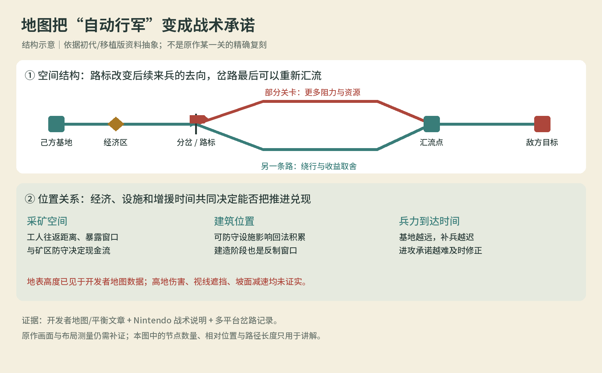

# 《剑与勇士 / HD》地图专项研究

> **当前入口：[2026-10-08 二次研究与 3.0-dev 审计](recheck-20261008/README.md)。** 本目录下原 01–04 保留对 1.0 的历史审计。2.0 实现记录见 [核心博弈](../../paper-warfront/world/01-核心博弈.md) 和 [实施进度](../../paper-warfront/17-规模扩展与实施进度.md)；数量与程序运行检查不能代替地图体验验收。

研究日期：2026-10-08。对标对象：2009 初代及其 HD / 移植版本。本目录历史审查对象：《纸上兵戈》Godot 1.0。以下内容记录研究当时的 1.0 事实重查、运行审计和重设计约束。研究图是当时的提案；2.0 已接入路径等机制，当前设计差距以最新二次研究为准。

## 本次纠正

上一版把“减少 RTS 操作、横向自动行军”错误收缩成“所有关卡共享一条固定平地”。**初代家族存在局部分岔与可切换路标；开发者也把矿点、塔位、地表高度、地面类型作为关卡数据。地图长度和设施防守空间还会改变阵营平衡。** 因此，地图不是兵种对战背后的装饰，而是经济、路线、设施、增援与任务的组合。

审计时的《纸上兵戈》1.0有三个场景主题，但只有一套机械地图：基地、矿点、建筑槽全部固定，单位只用 X 坐标。十五个战役关卡全部以拆基地为胜利条件。切换三种 map ID 后，在相同阵营、种子与 AI 下，120 秒的逐步模拟状态和事件散列完全一致。原有规则测试与可执行包能证明程序可运行，不能证明地图对标达成。

该图是证据支持的机制抽象，不是某个原作关卡的布局复刻。初代/HD 的精确路线长度、PC 路标权限和跨路攻击规则没有被本次实机测量。

## 阅读顺序

| 文档 | 解决的问题 |
| --- | --- |
| [01 来源与事实台账](01-来源与事实台账.md) | 什么已确认，哪个版本，哪些结论仍缺证据 |
| [02 地图机制与关卡案例](02-地图机制与关卡案例.md) | 地图怎样影响经济、战线、法术、路线与关卡节奏 |
| [03 当前版本差距审计](03-当前版本差距审计.md) | 当前代码哪里把地图做成了背景，有何可复现实测 |
| [04 地图重设计约束](04-地图重设计约束.md) | Godot 下一版必须改变什么，白盒如何验收，美术如何接入 |

补充证据：[源码审计 JSON](current-map-audit.json)、[原生 Godot 模拟比对 JSON](current-map-probe.json)、[原作截图标注](figures/hd-reference-annotated.png)、[三张白盒设计图](figures/whitebox-proposals.png)。研究工具位于 [tools/paper-warfront/research](../../../tools/paper-warfront/research/)。

## 研究边界

资料以原开发者文章、Nintendo 官方战术说明、HD Steam 成就和跨平台一手游玩记录相互校验。没有在本机运行原游戏；视频访问发生连接失败，未捏造观看时码或地形测量。岔路资料属于明确的跨平台记录，不能据此填写 PC 每一关的节点坐标。成就条件与主胜利条件分开；二代、DLC 与初代本体分开。详见事实台账。

研究阶段保留1.0 EXE/APK。后续2.0另行交付，已先验证路径图/运输/施工白盒再扩展200图、十院和素材；这不改变原作资料未实测的边界。2.0属于原创落实，精确复刻原作数值或全部地图的结论不在本报告范围。
