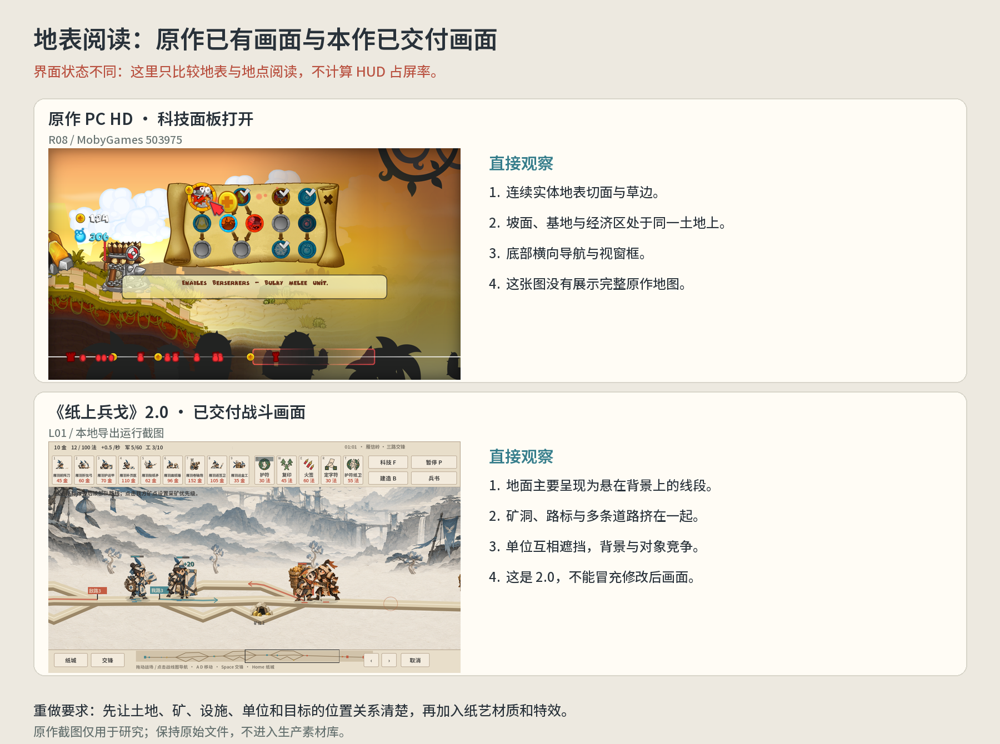

# 原作证据与地图语法

## 1. 原作实际上压缩了哪部分 RTS

Fabian Akker 的开发复盘明确说明：团队试过拖兵后退、点击停兵，最终舍弃，以免微操抢走战术选择的注意力。因此，对标重点是购买时机、经济/科技投资、单位组合与点击施法；地图要让这些操作产生可观察的空间后果。自动行军并没有取消地图设计。[开发复盘，2009](https://www.gamedeveloper.com/audio/postmortem-ronimo-games-i-swords-soldiers-i-)

复盘还记录了原作先做可对战的核心，再扩展战役，并指出后期平衡修改会让已做关卡突然过难或过易。由此推导，本作应先固定基准战场和可玩的少量兵种，再设计地图与任务，避免先批量生成内容后才检验核心。[同一开发复盘](https://www.gamedeveloper.com/audio/postmortem-ronimo-games-i-swords-soldiers-i-)

## 2. 地图结构：横向战场上的地点序列

Joost 的初代引擎文章把矿点、塔位、地表高度和地面类型列为地图核心数据。背景/前景则由另一套分层程序生成。**可走地表和关键地点是人工设计的对象。** 原文没有给出全关卡坐标，也没有证明雪地或坡面带移速惩罚。[原作关卡制作方法，2010](https://joostdevblog.blogspot.com/2010/12/designing-levels-without-tools.html)

据此建立本作分析模型：

`基地与出生 → 经济区 → 可投资的防守位置 → 主要交锋区 → 对方经济区 → 对方基地`

这是用于分析常规对战的模型，不是原作每关的固定顺序。任务关可把其中某个地点变成终点或保护对象，也可限制招募、改变初始部队。局部分岔是有条件的扩展，不能把所有图都画成三条并排道路。

| 设计层 | 要回答的问题 | 具体内容 |
| --- | --- | --- |
| 地表与行军 | 单位脚下是什么，能从哪到哪 | 连续轮廓、出生锚点、主路、必要的分岔和汇流 |
| 经济与设施 | 哪段投资能保住，威胁如何到达 | 矿点、实际运输、固定建造位置、施工暴露 |
| 战斗与时序 | 买下的单位何时起作用 | 阵营速度、接敌距离、增援路径、研究与施法窗口 |
| 任务与事件 | 玩家为何在这里战斗 | 目标对象、到达/越线、设施存活、有限兵力、阶段变化 |
| 镜头与表现 | 玩家能否看到并理解上述关系 | 当前视窗、全局导航、地标、操作标记、地表切面 |

## 3. 矿区同时是收入来源与交战地点

Nintendo 的原作战术说明描述了进攻进入敌方工人区后被拖住，守方趁机生产远程、形成反扑队伍的情形，也明确提醒工人死亡会造成昂贵损失。该段证实了经济对象与战线互相影响；没有提供矿工容量公式。[官方战术说明：General Tips](https://www.nintendo.com/en-gb/Games/WiiWare/Swords-Soldiers-286811.html)

设计推导：推进到矿区必须改变至少一种实际状态，例如运输受扰、工人被杀、攻方时间消耗或守方补兵成团。只把工人图标放在路边、仍由独立计时器持续发钱，无法形成这种体验。

分析时需区分三件事：单个工人的收益；矿点的服务吞吐量；整个经济投入的回本时间。较远的矿即使每趟带回更多，也可能每秒赚得更少。矿工分配与容量未在原作实机确认，本作采用的任何额外规则都要单列为原创配置。

## 4. 路长、设施空间与阵营不对称

Joost 的平衡文章明确举例：中国阵营依赖设施获取法力，大地图提供更多可建造、可防守的空间，会使它更有利。团队以第一张中型地图作为平衡基准，再增加其他地图的变化。[地图与阵营平衡，2011](https://joostdevblog.blogspot.com/2011/01/many-faces-of-balance-in-rts.html)

设计推导：地图长度不是单纯把画布拉长。它改变快兵骚扰、慢兵抵达、科研生效和设施积累之间的时间关系；塔位的位置改变某一笔投资能保护的区域。本作不能让每个阵营都只是在同样的位置选择同样的两种建筑，随后靠背景命名宣称具有地域玩法。

可用分析式：`增援等待 ≈ 剩余生产时间 + 路程 / 移速`。它是本作的测量框架，不是原作公布的数值。实测需补充接敌、控制、绕行和排队的影响。

## 5. 分岔的意义是对未来部队作承诺

本轮重新读取的 iOS 一手游玩记录，明确描述第三关的道路阻力与固定资源差异，以及单位抵达路标后跟随箭头，而非逐兵框选。该关还取消矿工招募，使有限资源与路线选择成为关卡问题。这是移植版文本观察，不能写成 PC HD 的逐帧测量。[iOS 游玩记录，2011，Moving Right Along / Stay In School](https://indiegamereviewer.com/review-swords-and-soldiers-finally-comes-to-ios/)

本作的分岔必须明确：谁能操作；哪些新到达单位受影响；已进入某条路的单位怎样继续；两路在敌情、目标或时间上有什么差异；在何处重新汇流。两条曲线的形状差异只能提供几何变化，不能自动提供选择价值。

## 6. 关卡案例的证据边界

下列 PC HD 成就条件来自上一轮来源台账，本轮 Steam 页面连接失败，尚未再次读取任务屏和完整地图。它们保留为补证案例，**不当作已确认的主胜败条件**。[历史官方成就来源](https://steamcommunity.com/stats/SwordsandSoldiersHD/achievements/)

| 案例 | 已有线索 | 地图设计问题 | 本轮确定度 |
| --- | --- | --- | --- |
| 维京 3 | iOS 第三关分岔、有限资源、路标；HD 有清敌成就 | 怎样在有限预算下选择推进路线 | iOS 文本本轮重读；PC 布局待测 |
| 维京 7 | HD 塔保全挑战 | 支援需多久到达指定设施，哪一塔先受威胁 | 历史成就记录；实际塔位待测 |
| 阿兹特克 2 | 巨人到矿点前击杀的 HD 挑战 | 截击线的位置怎样定义时间预算 | 历史成就记录；主任务待测 |
| 中国 3 | HD 指定忍者不死亡的挑战 | 特定对象的存活怎样改变路线与施法选择 | 历史成就记录；不能直接称原作护送关 |
| 中国 7 | HD 至少 15 名火箭兵存活；PS3 记录为 17 | 行军与前排保护怎样让队伍形成 | 版本数字分开保留 |
| 施工中塔 | HD 有施工阶段被 Rage 破坏的挑战 | 建造时间怎样形成可反制的位置投资 | 历史成就记录；施工细节待测 |

## 7. 地表表现与画面可读性

已有 PC HD 截图可直接观察到实体地表切面、草边、坡面上的基地/矿区，以及底部水平导航与视窗框。截图处于科技面板打开状态，不能据此测量默认战斗 HUD 占屏率。[原始 PC 截图条目](https://www.mobygames.com/game/50971/swords-soldiers/screenshots/windows/503975/)

本作设计推导：画面先让人看懂脚下的土地，再看懂矿、塔、单位和目标。需要连续地表体积、清楚的地面轮廓和放置在足点上的对象；道路图适合白盒或导航，正式战场需要完整地表。坡面高度默认表达位置与舞台层次，新增高地加成必须另行论证。

Joost 在 2014 年回顾初代时，确认其地表与小型地面物件由人工布置，随机背景容易产生重复感；随后介绍了二代更重视手工构图和特定地标的方法。这是二代制作方法对照，不能用二代大景观作为初代几何证据。[初代与二代关卡美术对照](https://joostdevblog.blogspot.com/2014/07/evolving-level-art-from-swords-soldiers.html)

二代的可读性文章还说明了交互物的轮廓/色块与低饱和背景的区别。这可用于本作原创纸艺美术指导，但不说明初代的地图判定规则。[二代画面可读性方法，2015 年 5 月归档正文](https://joostdevblog.blogspot.com/2015/05/)

## 8. 本作应保留的体验关系

一次购买，通过行军等待影响前线；一次扩张，增加收入同时暴露对象；一次设施投资，在具体地点争取施法或防守空间；一次路标切换，改变随后部队的遭遇；一次及时施法，在明确位置挽救队伍或截住威胁。地图把这些动作连接起来，才会形成推进、守住、成团和反击的爽感。
