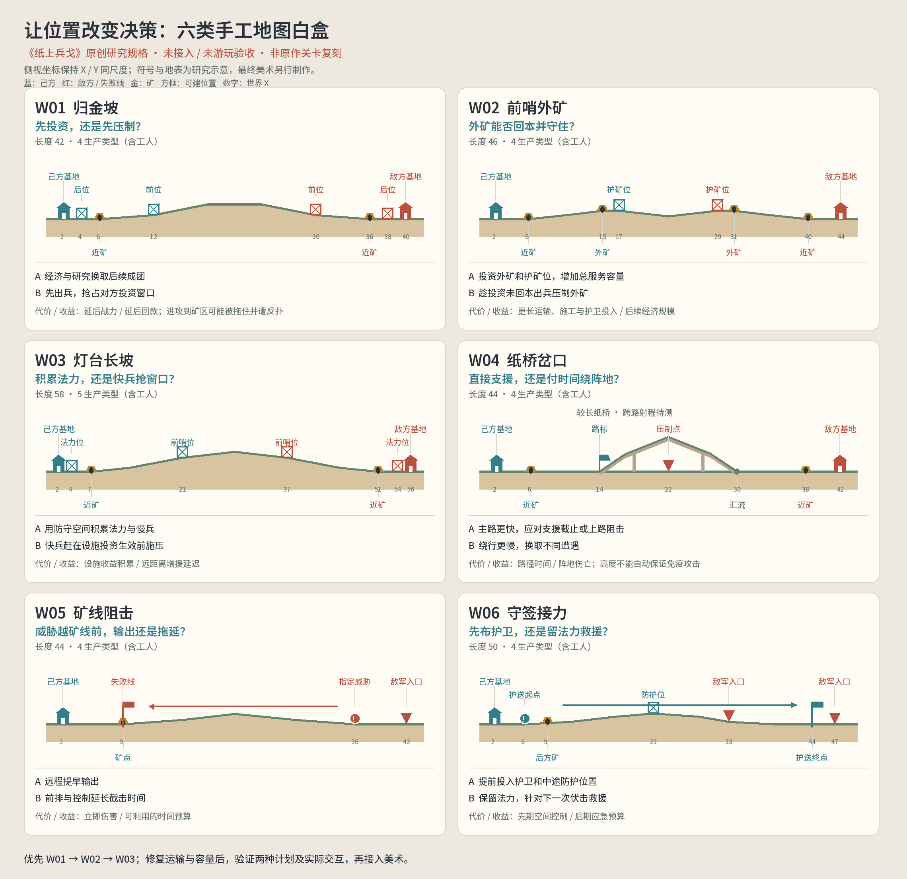

# 地图重做约束与六类白盒

以下是《纸上兵戈》的原创制作规格，依据前两份研究建立。坐标和容量均为待调参的白盒初值，**不是原作坐标，不是已接入游戏的关卡，也不是通过验收的结果**。机器规格见 [whitebox-specs.json](whitebox-specs.json)。

## 1. 每张地图先写设计卡，再做画面

设计卡必须回答下列问题：

1. **本关主要问题。** 例如现在出兵，还是先投资一个会暴露的经济位置；不得仅写地图主题。
2. **布局理由。** 为什么矿在这里、塔在这里、这段路这么长；对称或不对称各有什么依据。
3. **两种可行计划。** 写明适用敌情、付出、收益和对手反制。它们可以是同一路上的不同投资和时机，不必都是选路。
4. **时间预算。** 首次回款、首次接战、增援到达、建造完成、任务截止。采用实际路长和实际单位速度，不只看世界 X。
5. **经济瓶颈。** 单工人、整座矿、整套投资分别多久回本；受到骚扰后哪部分收入实际下降。
6. **操作与反馈。** 玩家点什么、改变谁、改变何时生效，反馈出现在对象、指令栏还是全局导航。
7. **镜头证据。** 全图布局和正常战斗视窗都要检查。一个能缩成漂亮鸟瞰图的布局，不一定在局部镜头里清楚。
8. **任务边界。** 主胜败条件、可选挑战、保护对象和失败优先级分开定义。

两张地图可以采用同一拓扑而提供不同体验；不能把拓扑数量作为唯一评价。反过来，同一锚点模板换二十种山坡，也不能代替逐图设计。

## 2. 固定的空间与表现约束

常规战场采用连续、可辨认的侧视地表；基地、矿、设施和脚部锚点落在真实轮廓上。纸桥要有纸层厚度、入口、支撑和汇流关系。路径线保留在开发调试视图，正式地面不能只靠加粗的折线表现。

先确定路长、经济暴露、设施覆盖和接敌关系，再决定坡形与地标。坡度默认不增加攻击或移速奖励；额外高地效果属于原创机制，必须独立论证。不得把未证实的战争迷雾、雪地减速、自由建塔或拖动单兵当作原作硬规则。

阵营不对称要进入位置设计：需要守住法力设施的阵营，在长图上的积累与远程救援窗口应不同于快速进攻阵营。地图测试应交换阵营与左右方，区分有意非对称和寻路/距离偏差。

全局导航优先显示横向进度、视窗范围、矿点、设施与任务位置；有分岔时再呈现路标状态。不强制把内部节点图完整暴露给玩家。常驻界面保留招募、资源和必要法术；科技与详细说明按需展开。

正常局部镜头也必须经过设计：出生、矿区、交锋、目标不要求始终同屏，但每次切换都要知道正在看什么、哪里需要处理。自动跟随前线不能让经济遭袭和施工状态失去反馈；导航上的事件提示必须能跳到对应地点。

以下是本作 AI 的制作约束，不是尚未复核的原作 AI 参数：按实际路程与到达时间判断增援，按完整运输与投入估计经济，按施工风险选择设施；以相同预算和合法命令作出反应。对手战略与关卡事件分开，按白盒设计卡定义可观察的施压/回防行为，并验证其是否给玩家留有读懂和应对的时间。

## 3. 交互契约

| 操作 | 必须产生的状态变化 | 必须看见的反馈 |
| --- | --- | --- |
| 点击生产单位 | 扣款、排队、出生、沿有效路段行军 | 价格、队列、出生和预计增援方向 |
| 点击研究 | 支付与等待，完成后产生本局相关收益 | 进度、完成、不能购买时的原因 |
| 点击建造位置 | 在该位置施工，允许敌方反制 | 覆盖区域、施工状态、损坏和成品 |
| 点击矿点 | 提交有效分配优先级，运输继续真实往返 | 已分配与正在采集分别显示；受扰状态 |
| 点击路标 | 改变之后抵达的合法单位出口 | 箭头即时更新，已进路单位继续原路 |
| 选择法术并点击目标 | 范围/对象判定、消耗、效果与冷却 | 合法区域、受影响对象、清楚的效果层级 |
| 拖动地面或全局导航 | 改变视窗 | 全图位置和当前视窗同步；触屏不误触施法 |

每局 **3–5 个可生产单位类型，含工人**，通常是一个工人加二至四个作战角色。生产类型上限、战场单位数量、矿点容量是三套不同规则。AI、战前编组、存档迁移、战役和 HUD 都遵守生产类型上限。

## 4. 六类白盒

### W01 归金坡：建立对推基准

全长 42，基地在 2 / 40，近矿在 6 / 36；后方设施位在 4 / 38，前沿位在 12 / 30。中部采用可读的起伏实土地表。四个生产类型：工人、前排、远程、重兵。

玩家在早期经济/研究和立即压制之间分配同一笔预算；推进到敌方矿区会消耗进攻时间，也给守方集中远程反击的机会。后方设施守基地附近，前沿设施争取空间，二者不应只是同一范围的重复按钮。先在这里确定单位、法术和经济基准，不叠加新的地形数值。

验收重点：双向连续运输、投入与回款、矿区遭遇、增援到达、慢兵是否能形成战线。正常镜头必须清楚区分地面、工人、交锋和可点设施。

### W02 前哨外矿：证明经济扩张值得冒险

全长 46，基地 2 / 44，近矿 6 / 40，外矿 15 / 31，前沿建造位 17 / 29。外矿运输线更长，并靠近争夺区，前沿设施可为外矿争取保护时间。四个生产类型。

实验初值让近矿同时采集容量为 1、外矿为 2、每趟载金都为 8；**这只是在白盒里制造可测瓶颈，不声称原作采用此数值**。优先级与同时采集容量分开定义。还要比较相同预算下加工人、加前沿设施、生产进攻兵或研究的回款与战线结果。

两种计划：直接压制，利用对手投资尚未回本的窗口；或者占住外矿，以设施和部队保护额外服务容量。扩张成立的条件是实际总收入能覆盖投入，并给出可利用的后续收益。不能靠随意抬高外矿载金掩盖距离成本。若测不到两种合理窗口，应修改布置/规则或取消此图。

当前外矿运输 P0 修复前，任何扩张优劣结论都不成立。

### W03 灯台长坡：设施积累与增援延迟

全长 58，基地 2 / 56，近矿 7 / 51，后方法力设施位 4 / 54，前沿防守位 21 / 37。中部是一段明确的长坡，以灯台作为地点识别，地标不遮挡前线。五个生产类型，增加一个快速突击角色。

一种计划把时间换成法力与稳固防线；另一种用快兵提前施压，争取让对手不能安心积累。慢兵补到前沿的等待，使控制/救援法术具有明确地点和时机。前沿位置与基地间距不再按 W01 等比例拉伸。

验收重点：交换阵营、交换左右方；记录法力设施被威胁前能积累多少、快兵是否有进攻窗口、远程施法是否只是无限拖延。地图长度改变相对优势后，要有反制路径，不能让长图天然只剩一个胜率最高阵营。

### W04 纸桥岔口：不同遭遇与未来部队的承诺

全长 44，分岔 14、汇流 30；主路较短，上方纸桥绕行更长。主路中部设置可被识别的敌方压制位置；上路提供另一条到达路径。四个生产类型。

第一种敌情让主路阵地造成实际伤亡，上路绕行的时间成本值得承担；第二种敌情让上路出现阻击或主路急需支援，主路更有价值。两种条件均需测试。是否能避开跨路攻击必须按二维射程实测；图中桥高 -4 是待测初值，不构成“免疫塔火”的保证。

路标影响之后抵达分岔的单位，旧部队不能传送或倒退重选。对方、工人和任务单位的权限分别写明；白盒初值仅允许操作己方战斗单位的出口，工人仍按其矿点往返寻路。固定资源变体可另做有限兵力关，不能凭空加随机奖励来解释岔路价值。

### W05 矿线阻击：把任务倒计时放回世界

全长 44，己方基地 2、矿点与失败线 9；有稳定 ID 的威胁从 36 向 9 前进。右端用于敌方进入，主目标是阻止指定威胁越线，不默认要求拆掉另一座基地。四个生产类型。

玩家可先买远程争取输出时间，也可用前排和控制延长截击窗口。剩余时间由目标的实际位置与速度决定，界面同时标出目标与失败线。原作阿兹特克 2 的历史成就是灵感线索；其主任务未补证，不把本作此图称为原作关卡复刻。

验收重点：指定对象死亡/越线优先级、减速与暂停后时间反馈、对象唯一身份。伤亡和经济投入应影响是否来得及，而不是出现一个与位置无关的固定计时器。

### W06 守签接力：保护移动对象的连续空间

全长 50，保护对象从 6 移向 44，防护投资点 23，敌方进入点 33 / 47。非对称是由护送任务产生，必须在开局讲明。四个生产类型。

玩家可以提前投资护卫位置、把队伍送到保护对象前方，也可保留法力应对下一次伏击。对象按稳定 ID 判定，脚部沿有效地表移动，镜头可迅速回到目标或己方经济区。护卫站位、敌人到达和回防时间需要逐段测量。

这属于本作原创护送规格；原作中国 3 的“不损失指定忍者”成就不等于已证实的护送主任务。不得以成就描述替换原作关卡目标。

## 5. 制作顺序与放行条件

先修复运输与容量定义，之后只制作 W01 → W02 → W03。每张通过规则日志、实际交互和正常战斗画面三类检查后，才允许接入最终美术。W04 在双路线价值证据成立后制作，W05 / W06 随任务系统验证。

现有 200 份配置作为候选保留，重新编写设计卡和分批验收，不再把生成完成视为地图完成。已交付的 2.0 EXE/APK 是历史版本；新的研究、白盒或素材文件不能代替重新构建和实机检查。
