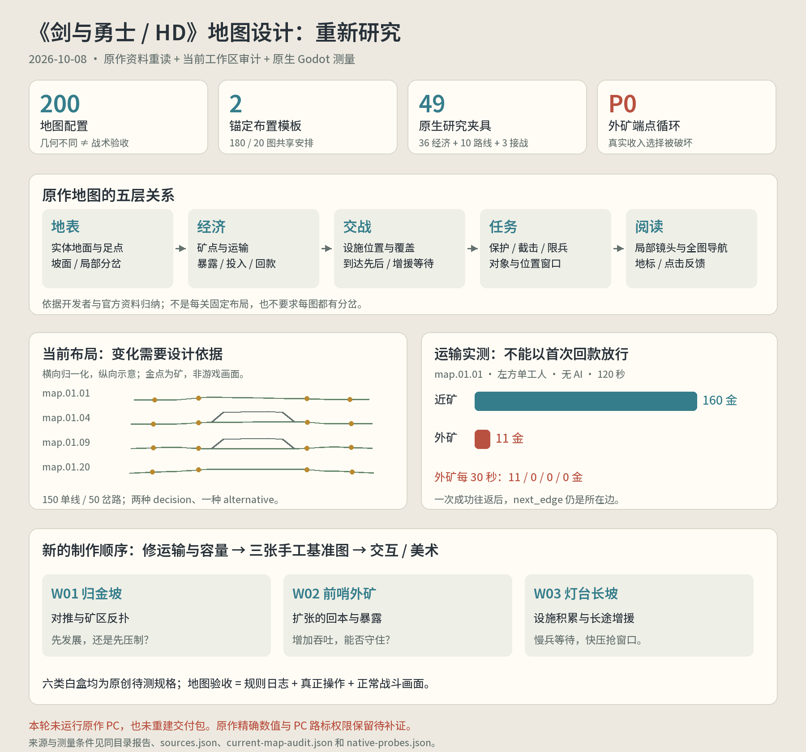

# 《剑与勇士 / HD》地图设计二次研究

研究日期：2026-10-08。对标范围：2009 初代、PC HD；移植版观察单独注明，二代资料只用于美术方法对照。审查对象是当前 **3.0.0-dev 工作区**，并以已交付 2.0 运行画面检查表现问题。

**这次纠正的核心是：地图必须让位置改变决策。路径可运行、几何散列不同和关卡数量，都不能单独证明地图设计成立。** 原作把地表、矿点、设施位置、行军时间和关卡事件组织成横向战场；玩家通过招募、研究、施法和部分关卡的路标，改变这个战场上的压力。

本轮完成开发者资料重读、原作已有截图复核、200 份当前地图配置审计，以及原生 Godot 的 36 组经济、10 组路线、3 组首次接战测量。没有在本机运行原作，也没有取得新的逐关视频测量。原作的精确坡面移速、跨路射程、矿工容量和 PC 路标权限仍列为待实测，不能填入本作配置后声称已复制。

| 阅读入口 | 内容 |
| --- | --- |
| [01 原作证据与地图语法](01-原作证据与地图语法.md) | 原作地图的结构、空间博弈、交互、美术、关卡案例及来源等级 |
| [02 当前版本空间审计](02-当前版本空间审计.md) | 当前地图模板化、运输停运、时序与画面问题的可复核证据 |
| [03 地图重做约束与六类白盒](03-地图重做约束与六类白盒.md) | 将研究转为 Godot 制作约束、六类有明确问题的原创白盒 |
| [04 实机补证与验收方法](04-实机补证与验收方法.md) | 原作缺证据项怎样补测，本作地图怎样验收 |

## 当前审计的关键结果

| 项目 | 结果 | 如何解释 |
| --- | --- | --- |
| 地图配置 / 几何散列 | 200 / 200 | 数据确实不同；仍需验证决策差异 |
| 路径拓扑 | 150 单线、50 单处分岔；两类拓扑 | 单线本身合理，问题是缺少逐图战术设计依据 |
| 矿点 / 塔位锚定布置模板 | 两套，分别覆盖 180 / 20 图 | 大多数地点按同一比例模板放置 |
| 岔路矿点 / 有岔路设施的地图 | 0 / 20 | 另外 30 张岔路图需要靠敌情、任务或时序证明价值 |
| 决策说明 / 另一打法说明 | 两种 / 一种文本 | 尚不能解释每关为何采用这个布局 |
| 基准图单工人 120 秒回款 | 近矿 160 金；外矿 11 金 | 左方外矿仅完成一次往返，之后寻路原地循环 |
| 五张样本图改走纸桥 | 汇流延迟约 1.43–1.60 秒 | 是真实差异；价值仍要结合压制位置与任务窗口验证 |

原生运输停运的具体状态是 `ground.0, s=0, next_edge=ground.0`。这是 P0 实现缺陷，会直接破坏地图的经济选择。理论上的外矿单工人收益仅为近矿约 55%–57%，也说明“每趟多 3 金”不能直接写成“更高收入”。容量扩张是否值得投入，须按整套经济规则实测。

## 对后续实现的决定

先以三张手工白盒验证基准对推、前沿经济投资和长图设施防守。它们成立后，再做有敌情或任务依据的分岔、截击、护送。六类白盒是研究规格，**尚未接入游戏，也没有被标为通过**。

单局维持 3–5 个可生产单位类型，通常含一个工人类型。这个上限不等于战场只能有五个单位，也不等于一座矿只能放五个工人。少量兵种应通过到达先后、阵型、经济投入和施法时机形成组合。

机器证据：[当前地图审计](current-map-audit.json)、[原生模拟测量](native-probes.json)、[来源台账](sources.json)、[六类白盒规格](whitebox-specs.json)、[输入散列与材料核验](evidence-manifest.json)。研究工具见 [执行说明](../../../../tools/paper-warfront/research/README.md)。

本轮交付的是研究、审计与制作约束。现有 2.0 EXE/APK 及 3.0-dev 游戏规则没有因这份报告自动成为新的验收成品。
