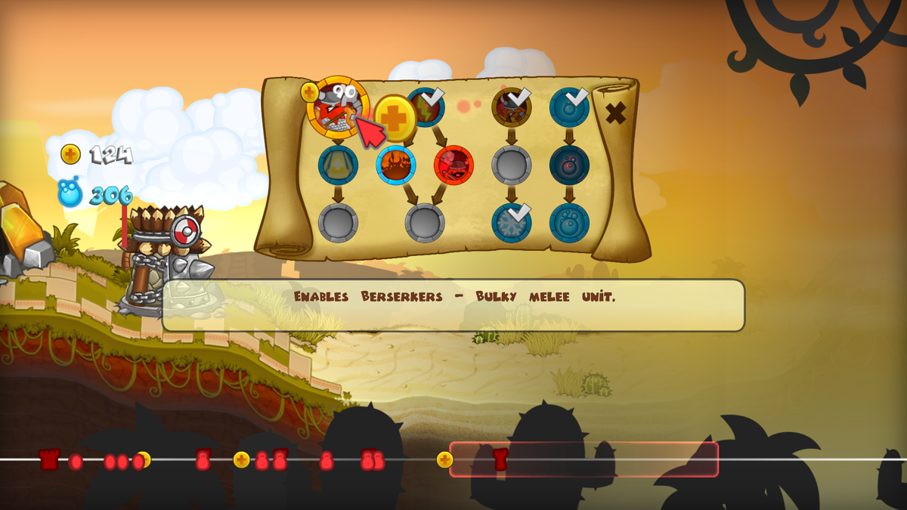
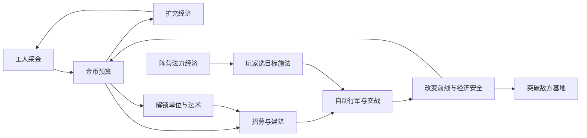

# 《剑与勇士 / HD》核心玩法与交互拆解

研究日期：2026-10-08。用途：为本项目建立可追溯的对标要求，再据此选择题材、美术与实现路线。

地图范围纠正（2026-10-08）：本文早期没有系统处理初代家族的局部分岔/路标、逐地图矿点/塔位/高度和空间任务，不能据此把所有关卡限制成固定平地。地图事实、版本差异与本作修订以 [地图专项研究](research/swords-and-soldiers-map/README.md) 为准。文中 Three.js 及纯 X 范围属于历史方案；当前 Godot 实现及尚未实施的地图重做要分别阅读。

本文使用开发者复盘、开发者采访、参与项目的可用性研究、官方玩法说明和 Windows 版实际界面截图。没有把游戏宣传图或本项目生成的概念图当作玩法证据。本轮未在本机运行原游戏；精确数值、全部关卡规则和逐帧操作仍需后续实机核对。

## 1. 参考资料与证据范围

| 编号 | 资料 | 能支持的结论 | 使用边界 |
| --- | --- | --- | --- |
| S1 | [Ronimo 设计师 Fabian Akker 的开发者采访](https://www.nintendolife.com/news/2008/09/ronimo_games_interview_swords_and_soldiers) | 单位自动向敌方行军；金币购买单位、法力施法；点击指向交互；战术选择与反制 | 2008 年发布前采访；当时的联机计划不能直接代表后续 HD 版本 |
| S2 | [Fabian Akker 的开发复盘](https://www.gamedeveloper.com/audio/postmortem-ronimo-games-i-swords-soldiers-i-) | 开发者主动取消拖回/暂停部队；三阵营法力经济不同；曾取消不同矿工经济；对局与平衡先行 | WiiWare 原作开发过程；不能拿来断言 PC 的快捷键 |
| S3 | [Valsplat 可用性研究负责人记录](https://www.gamedeveloper.com/design/successful-playtesting-in-i-swords-soldiers-i-) | 快速招募、施法、滚动战场和科技菜单是关键任务；提示不能遮挡选项；教学须简短 | 研究对象包括 Wii 与 PSN 移植；PSN 径向菜单不是 PC 的原生布局 |
| S4 | [Nintendo 的官方玩法与战术说明](https://www.nintendo.com/fr-fr/Jeux/WiiWare/Swords-Soldiers-286811.html) | 经济投资与压制；工人安全；单位—法术反制；近远程、巨型单位、复活、反弹、复制、保护等功能 | 官方介绍并未给出全部伤害、价格和冷却数值 |
| S5 | [HD 的 Steam 产品页](https://store.steampowered.com/app/63500/Swords_and_Soldiers_HD/) | HD 的题材、横向策略定位、战役/遭遇战/挑战与多人功能 | 当前商店功能描述不用于推断所有平台或 DLC 内容 |
| S6 | [Windows 版科技树实际截图](https://www.mobygames.com/game/50971/swords-soldiers/screenshots/windows/503975/) | 科技节点的前置连线、状态、费用、说明位置；底部战线导航 | 使用公开预览截图；单张截图不能证明研究时间、暂停规则和全部操作 |
| S7 | [Ronimo 官方 HD PC 预告入口](https://www.youtube.com/watch?v=FlCd1RpZLkk) | 后续实机画面核对入口 | 本轮浏览器连接失败，未将视频内容当作已观看证据 |

实际截图：

图片来自 S6 的公开预览，保留原始画面，仅用于分析。本轮浏览器的 Steam 导航遇到连接错误；截图通过公开图片地址取得并检查。

## 2. 原作首先压缩的是操作负担

**已核实的事实摘要：** 单位从己方基地自动前往敌方，玩家通过招募和施法干预战局。开发者复盘说明，他们试过拖回、点击暂停部队，随后取消这些机制。法力经济采用三种不同方式，矿工经济则保持一致。依据：S1、S2。

**设计分析：** 玩家要同时处理的是四种选择：现在花钱做什么、下一项解锁什么、何时使用法力、把法術交给哪个目标。自动行军把部队操纵的负担压低，使这些决定可以在实时战斗中连续发生。题材与画面应帮助玩家理解这四种选择。

地图专项补充：上述四种选择并不穷尽地图交互。初代家族的部分关卡还有路标选路，改变后续来兵的路径；矿区、设施与任务节点又影响何时在哪里接敌。自主行军不等于一条不可改变的直线。证据与版本范围见 [新台账 F05/F06](research/swords-and-soldiers-map/01-来源与事实台账.md)。

本项目由此形成一组实现要求：

- 作战单位具有完整的自主行军、接敌、攻击、再推进行为。
- 每次招募都意味着一次资源承诺和行军等待，玩家可用后续出兵顺序改变组合。
- 法术成为直接操纵战况的主要入口，目标与生效时间须清楚。
- 玩家视线在资源、战线、招募、科技之间切换时，可以随时回到需要处理的交锋位置。
- 单位/法术的规则能从轮廓、动作、图标与少量说明中学会。

## 3. 核心循环：金币承诺，法力修正，战线检验

这是根据资料建立的设计关系图，不是原作程序结构的复原。

**金币的含义：** 扩经济、研究和即时兵力相互竞争。买下科技后仍需支付单位的招募费用，解锁本身不会自动替玩家形成军队。工人和建筑把经济投资显露在战场上，进攻因此具有实际战略价值。

**法力的含义：** 可保护已经付过金币的关键部队，也能直接消灭或控制敌方高价值目标。每次施法既影响眼前交锋，也决定下一段时间还有多少应急能力。消耗法力的选择与招募的选择互相补足。

**战线的含义：** 前线靠近己方时，己方新兵更容易接上交战；前线深入敌方时，己方补充需要等待，对方则更接近自己的生产和防御设施。这是本项目需要通过行军时间、攻击距离和生产节奏实现的拉扯关系，不额外叠加隐藏的守方攻击加成。

**本项目的示例预算，非原作数值：** 如果一种远程单位解锁需 90 金、招募需 40 金，当前有 120 金，那么解锁后还不能立即获得一个远程单位；同样的金币也可以先买数个低价近战。该例说明科技与眼前兵力的机会成本，最终价格应由对局验证。

## 4. 三阵营的差异必须深入资源与单位行为

**已核实的事实摘要：** 维京人通过购买升级增加回法；阿兹特克人使用献祭把单位生命转换为法力；中国阵营建造可被摧毁的产法力设施。依据：S2。S4 还展示了不同阵营的恢复、复活、控制、反弹投射物、复制和保护等功能。

**设计分析：** 这意味着阵营差异至少有三层：

| 层次 | 玩家实际面对的问题 | 本项目应产生的可观察结果 |
| --- | --- | --- |
| 法力投资 | 花金币稳步回法、牺牲战力换法力、保护产法力建筑 | 同样剩余法力的两军，下一轮施法的准备方式不同 |
| 单位行为 | 硬前排、远程累积、尸体利用、投射物反制、穿越前线、巨型威胁 | 对手组合变化后，玩家会改变出兵和科技选择 |
| 法术组合 | 保住前排、限制巨人、打击密集后排、控制高价值单位、复制局部战力 | 关键施法能改变已有单位的胜负关系 |

三阵营的采金基础保持一致，有利于把复杂度集中在上述三层。角色可以更换为原创种族，回法和战术关系仍要完整。

**本项目采用的三个阵营原型：**

| 原型 | 回法方式 | 核心单位行为 | 玩家练习重点 |
| --- | --- | --- | --- |
| 正面军团 | 金币购买永久回法升级 | 耐久近战、常规投射物、重击控制、攻城火力 | 保护关键前排、稳步积累兵力、安排金币投资 |
| 祭术军团 | 基础回法 + 主动献祭生命换法力 | 突击兵、持续伤害、利用阵亡标记召唤、巨型单位 | 为控制或爆发牺牲战力，判断尸体与施法收益 |
| 机关军团 | 基础回法 + 保护产法力建筑 | 投射物反制、爆发远程、越过局部前线、保护/复制组合 | 建筑安全、目标选择、以法力形成局部优势 |

这是后续五个方向的共同功能骨架。各阵营分别定义科技图、费用、技能与弱点，避免把角色排成完全相同的职业模板。

## 5. 兵种克制发生在具体交战情境中

**已核实的事实摘要：** 官方攻略讨论了近远程组合、控制配合远程输出、巨型单位的低速度和范围威胁、保护前排争取输出时间，以及进攻受矿工和敌方补充影响等情境。依据：S4。

**设计分析：** 本项目要验证以下关系，而不是只给兵种贴一个抽象的克制标签：

| 战况 | 玩家能做的选择 | 系统必须支持的行为 |
| --- | --- | --- |
| 对方远程在前排后逐渐成团 | 范围法术打后排、让突击单位穿过局部交锋、控制前排缩短接敌时间 | 区分前排与后排价值、范围瞄准、投射物路径与合法突击目标 |
| 巨人接近己方远程 | 便宜前排争取时间、控制巨人、保住正在承伤的关键单位 | 清楚的巨人攻击前摇、控制状态、近远程射程差 |
| 对方阵亡单位不断补成召唤兵 | 清掉召唤支援单位、控制尸体利用窗口、范围清兵 | 阵亡标记被消费一次、支援单位射程、召唤兵清晰轮廓 |
| 敌方有投射物反制单位 | 改变兵种或用法术处理、选择其他攻击属性 | 投射物独立于伤害事件，反弹/抵消结果可见，避免无限反弹 |
| 自己冲到了敌方家门口 | 判断是否继续补兵，或将资源转向经济与科技 | 真正的行军时间、基地附近的工人和建筑、双方补充节奏 |

攻击速度、射程、移速、前摇、费用、生命、溅射与技能相互影响。这些参数应围绕实际对局联合调节。

## 6. 核心交互：快速、可取消、少遮挡

**已核实的事实摘要：** 参与移植的可用性研究把快速招募、施法、滚动战场和理解升级菜单列为重点；科技说明遮挡其他节点曾造成问题。PC 实际截图可见科技前置连线和底部战线导航。依据：S3、S6。

本项目的具体交互由这些要求推导如下；新增快捷键属于本项目方案，不声称为 HD 原有键位。

| 动作 | 操作流程 | 操作结束时必须能确认的结果 |
| --- | --- | --- |
| 招募 | 点击已解锁兵种图标 → 系统检查金币与生产可用状态 → 支付并招募 | 金币改变、生产反馈、基地出兵；镜头位置保持 |
| 解锁 | 开科技图 → 看前置与费用 → 点击购买 → 查看研究/完成状态 → 回到战场 | 解锁状态及新的快捷入口；未满足前置的原因清楚 |
| 单体施法 | 点法术 → 指针进入目标模式 → 悬停单位查看合法性与高亮 → 点击确认 | 对应单位被保护、控制或受伤；费用与冷却改变 |
| 区域施法 | 点法术 → 地面范围预览 → 指定交战位置 → 点击确认 | 范围中的合法单位受到效果，效果边界与预览一致 |
| 无需指向的效果 | 点对应图标直接执行 → 显示结果 | 经济升级、全局或指定规则效果成功生效 |
| 建筑 | 选建筑 → 高亮合法固定建造位 → 点击一个位置确认 | 对应位置出现建筑，费用扣除，建筑贡献与生命可查 |
| 战场导航 | 边缘滚动/战线导航点击；可选快捷定位己方基地与当前交锋 | 镜头抵达目标位置，资源和快捷按钮一直可达 |
| 取消 | 右键或 Esc 退出瞄准/菜单 | 未确认的施法不扣费；指针回到正常状态 |

**HUD 结构建议：** 顶部边缘保留资源与已解锁单位/法术的圆形入口，单位与法术清楚分组；底部为战线导航，显示基地、建筑、单位分布和当前视窗。科技图按需展开，提示放在不覆盖其他节点的位置。法术入口由阵营的实际技能数量决定，可以展示该阵营完整的已解锁能力。

图标至少表达六种状态：未解锁、可解锁、研究中、已解锁可用、资源不足、冷却/生产中。状态使用形状、遮罩与符号共同表达。帮助说明包含费用、前置、目标类型和一句用途；背景故事通过战役对话或图鉴呈现。

**施法命中实现（修订）：** 对角色的投影包围框或稳定选取区域进行检测，再返回模拟单位 ID。密集交战下高亮将要命中的单位，优先匹配法术合法目标。分路之后不能只用 X 判断范围：路径、高度、选取、预览与伤害必须共享空间定义。原作跨路攻击规则尚待实机测量；本作方案详见 [新地图命中约束](research/swords-and-soldiers-map/04-地图重设计约束.md)。纯表现错位仍不得改变逻辑射程。

## 7. 爽感来自一次选择兑现成战线变化

下面是本项目需要实现的体验目标，不是对原游戏音画数值的断言。

1. **精准救援。** 在关键单位将被击倒时成功保护它；受击、保护成功和继续输出形成清楚的反馈。
2. **高价值打击。** 玩家选中敌方脆弱后排，用有限法力清掉它们；前排随即失去火力支援。
3. **兵力滚动。** 一个被保住的前排让后续远程接上，投入逐渐成为一支完整军队；范围攻击又能威胁这种积累。
4. **大招改写局部交战。** 巨型单位、广域打击或召唤产生显著战况变化，事前有可识别的准备，事后有对应反制。
5. **家门口反扑。** 守方及时完成补充和关键施法，推回战线；攻方因此需要重做金币与法力决策。
6. **摧毁终点。** 部队真正推进到敌方基地并完成攻破，胜利演出展示整个攻防结果。

重击声音、局部动画停顿、受击姿态和夸张碎块强化这些结果。特效应让玩家看懂发生了什么，施法后仍须能辨认下一项操作目标。

## 8. 美术如何服务这套交互

侧视卡通的优势是：同等距离的单位大小稳定，兵种轮廓易比较，前后排和施法目标容易辨认，长战场可以横向滚动。

本项目的表现要求：

- 大头、粗手臂、大武器和清晰表情；每种特殊能力有明显形状或动作提示。
- 场景允许夸张的山、树林、城堡与神像，主要交锋区域保持轮廓对比。
- 视窗呈现局部交锋，战线长度大于一屏；单位保持容易点选的尺寸。
- 正交或非常弱的透视，固定侧向角度，镜头沿战线平移。
- 人物阵亡可以具有喜剧性，但阵亡标记、召唤来源与技能状态清楚。
- 阵营的故事动机、技能、造型与音色彼此对应，三者放在一起能构成同一个世界。

**Three.js 的作用：** 用程序化几何和可复用的部件节点完成角色与动画；其正交相机有利于维持稳定的单位投影尺寸。[Three.js 正交相机文档](https://threejs.org/docs/pages/OrthographicCamera.html)

**图片生成的作用：** 角色设计参考、肖像、法术图标、徽记、表情贴花和远景。`sub2-image-gen` 输出位图；几何、关节层级、动画和选择区域由代码实现。

## 9. 内容模式与制作顺序

**已核实的事实摘要：** 官方及开发资料将战役、遭遇战、挑战与多人列为游戏内容；开发者复盘把对战与平衡放在早期原型中。依据：S1、S2、S5。各版本模式细节另行核对。

本项目首先验证双边对局和不同阵营之间的攻防，再将它组织成教学与战役。关卡应改变资源、可用科技、敌军组合或胜利条件，引导玩家学会具体反制。完整对标目标包括三个阵营、战役、AI 遭遇战、规则明确的挑战与 1v1 对战；在线同步的工作量单独安排。

## 10. 首个可玩切片的验收

首个切片为两个阵营、一张可滚动地图，带经济单位、基础生产、科技图、不同法力机制、至少一种特殊兵种行为、单体与范围施法、建筑和完整胜负。

| 验收情境 | 合格表现 |
| --- | --- |
| 同一开局，分别选择补经济与先出兵 | 早期压力和后续收入存在可解释的差异 |
| 同一预算，分别选择即时兵力与科技 | 研究机会成本能在交战中体现 |
| 同一交锋，用对与用错关键法术 | 保留单位、后排输出与前线位置的结果不同 |
| 远程成团与范围攻击 | 二者都能发挥作用，操作和目标反馈清楚 |
| 不同回法机制 | 玩家需要做不同投资或生命/建筑安全决策 |
| 攻到敌方家门口 | 补充距离和经济目标改变攻防节奏 |
| 接连招募、施法、导航和购买科技 | 操作可以连续完成，不被提示和装饰遮挡 |
| 阵亡、复活、复制、反弹等特殊行为 | 所有权和状态一致，不出现重复资源、错误目标或无限循环 |

## 11. 仍需实机核对的项目

以下项目未凭文字或单张截图定案，也不作为已经复刻的原作事实：每个单位/法术的精确费用、研究时间、生产间隔、冷却、射程、伤害；同阵营单位如何互相穿过或排队；目标优先级和攻击锁定；每类法术对工人/建筑的合法性；复制单位的寿命与限制；全部科技节点；科技菜单是否影响时间流逝；PC 默认快捷键；地图分支和特定关卡路线规则；不同移植版/DLC 的差异。

设计阶段可先用可配置规则完成原型，再依据实机对照调节。资料推导、项目设计和实测结论分别记录，避免把本项目的实现选择误写成原作规则。
